# elder-terms

A Terminal emulator for local shell, SSH, TELNET, serial connections.
And FTP, FTPS, SFTP, WebDAV, HTTP sites, SMB, and NFS file transfer.
'90s, come back in this time. This is all we need.

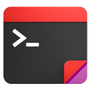

[](https://www.repostatus.org/#active)
[](https://opensource.org/licenses/MIT)

----

[(Japanese language is here/日本語はこちら)](./README_ja.md)

> Please note that this English version of the document was machine-translated and then partially edited, so it may contain inaccuracies.
> We welcome pull requests to correct any errors in the text.

## What Is This?

A terminal application, inspired by personal computing in the 1990s.

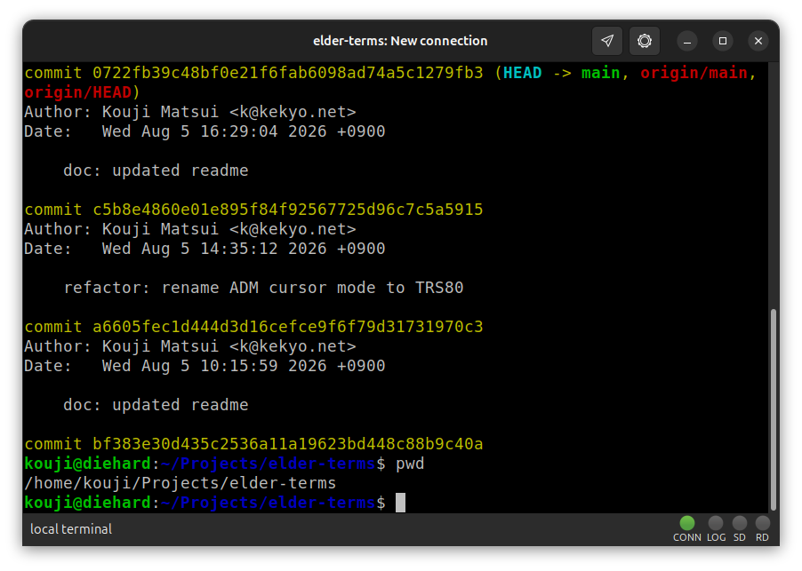

### Features

- Runs on Linux desktops.
- Supports local terminals, SSH, SFTP, FTP, WebDAV, and SMB as well as serial and TELNET
  connections, bringing that familiar terminal experience into the present.
- Lets you manage multiple connections and launch terminals from the launcher.
- Stores all connection settings in INI files, which you can freely edit with
  any text editor.
- Lets you configure BS/DEL, cursor key conversion, Enter/Return codes, and
  character encoding conversion.
- Remembers the terminal's rows and columns for each connection.
- Lets you explicitly specify the terminal type, such as `xterm` or
  `xterm-256color`, for TELNET and SSH.
- Supports X/Y/ZMODEM file transfers for TELNET, serial, and SSH terminal
  connections. Automatic transfers can be enabled for ZMODEM.
- Transfers files to and from the host over SFTP/FTP/FTPS, WebDAV, HTTP sites, SMB, and NFS.
- Transfers files over FTP and FTPS using passive or active data connections.
- Supports pasting text and sending text files. You can specify the send rate
  and newline handling to avoid overflowing the host's buffer or using
  incompatible newline codes.
- Shows indicators below the terminal by default, or beside the title in
  compact mode, so you can reminisce about analog modems.
- Uses either the built-in beep or a custom WAV/Ogg Vorbis sound for BEL.
- Changes the font size with keyboard shortcuts or the mouse wheel.
- Customizes the window exterior colors and terminal background for each
  connection.
- Opens a specified connection with a single hotkey.
- Starts the launcher automatically and can keep it running in the system tray.
- Monitors received text with regular expressions and defines rules that
  automatically send text or run a specified command.
- Opens URLs and file links displayed in the terminal.
- Records logs to files and organizes them into directories by connection and
  date and time.
- Supports multilingual display (English, Arabic, Spanish, French, Hindi,
  Japanese, Korean, Portuguese, Russian, and Simplified Chinese).

### Terminal Launcher

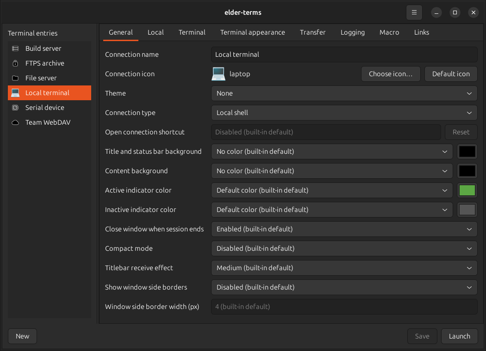

### Complex Display

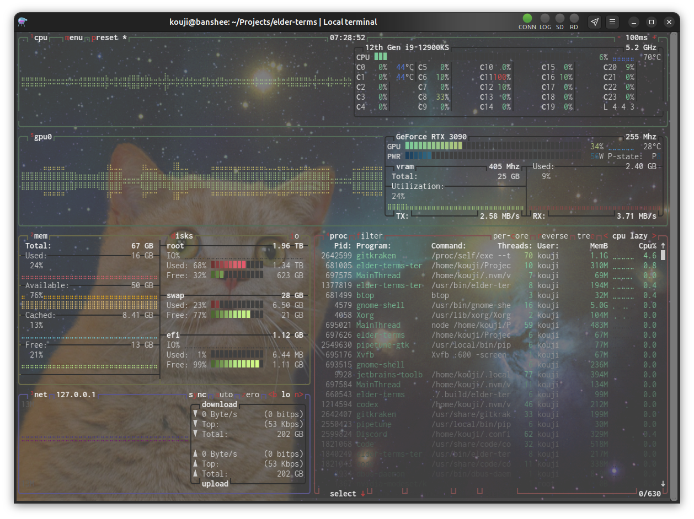

### Serial Device

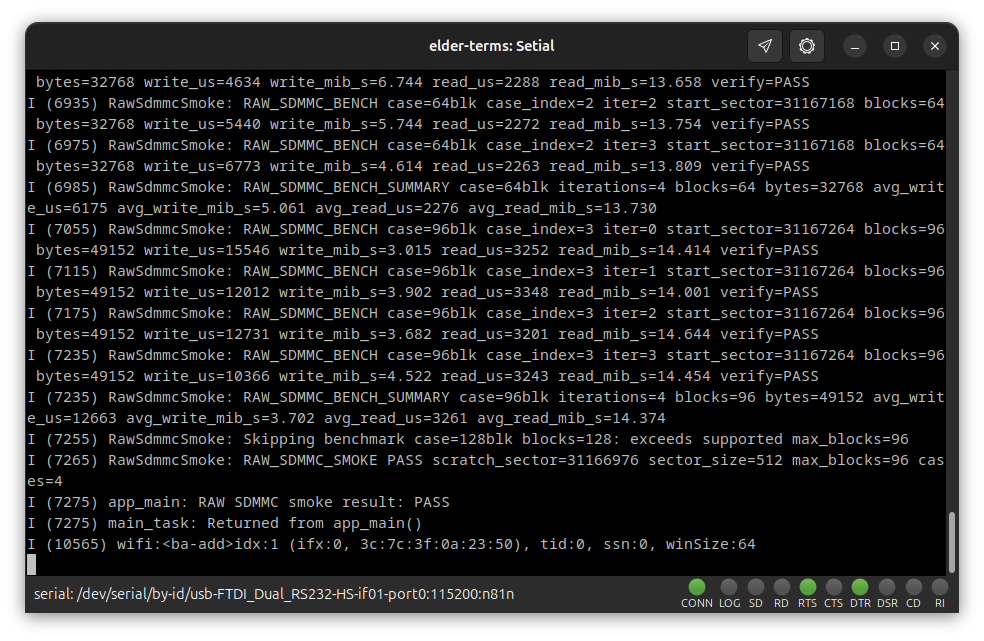

### Custom Exterior Colors

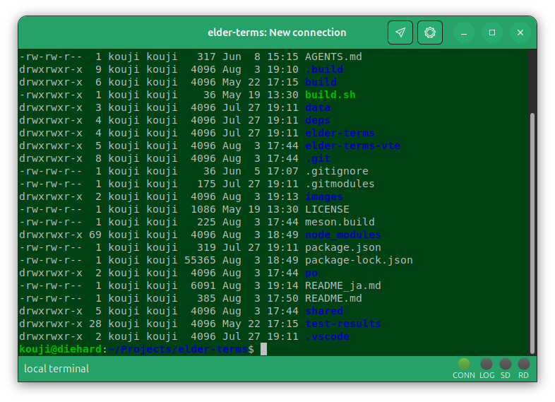

### SFTP/FTP/FTPS/WebDAV/HTTP sites/SMB and NFS file transfer

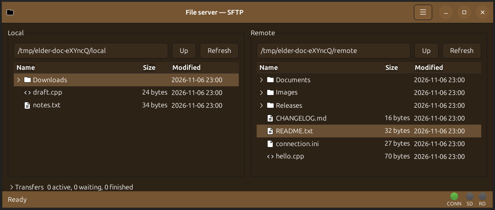

## Environment

- Linux GTK3 (Ubuntu/Debian preferred)

Prebuilt packages support the following environments.

| Distribution | Release | Architecture |
| --- | --- | --- |
| Debian | trixie | amd64, i386, arm64, armhf, riscv64 |
| Ubuntu | 24.04 | amd64, arm64 |
| Ubuntu | 26.04 | amd64, arm64 |

Debian bookworm is not supported. See the [build guide](./docs/en/building.md) for library requirements.

---

## Installation

Download a prebuilt package (deb format) from the
[releases](https://github.com/kekyo/elder-terms/releases/) and install it:

```bash
sudo apt install ./elder-terms-*.deb
```

Then start elder-terms:

```bash
elder-terms
```

Use `elder-terms-terminal` to start a terminal directly, or `elder-terms-terminal -c connection.ini` to select a connection settings file.

---

## Basic Usage

On the first launch, elder-terms automatically creates a connection entry named `Local terminal`.
It starts a shell such as `bash`, much like the terminal you normally use.

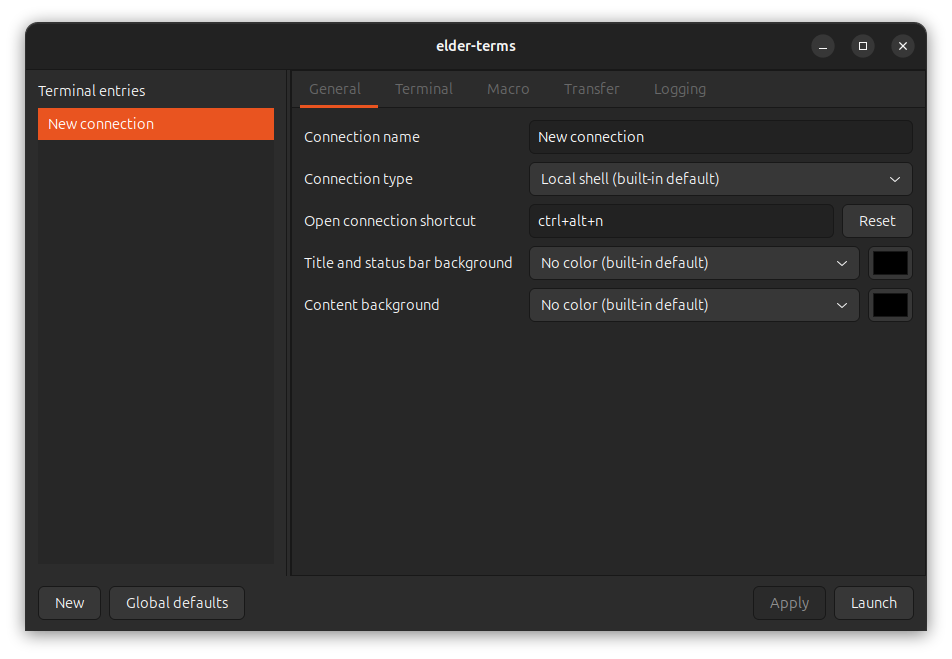

Double-click the entry in the launcher's list to open it. To create another connection,
click "New" at the bottom of the launcher,
change the name from "New connection" to whatever you like, and click "Save". There it is:

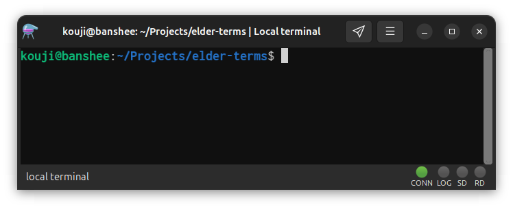

Open the menu at the top-right of the terminal and select "Settings" to change its settings.

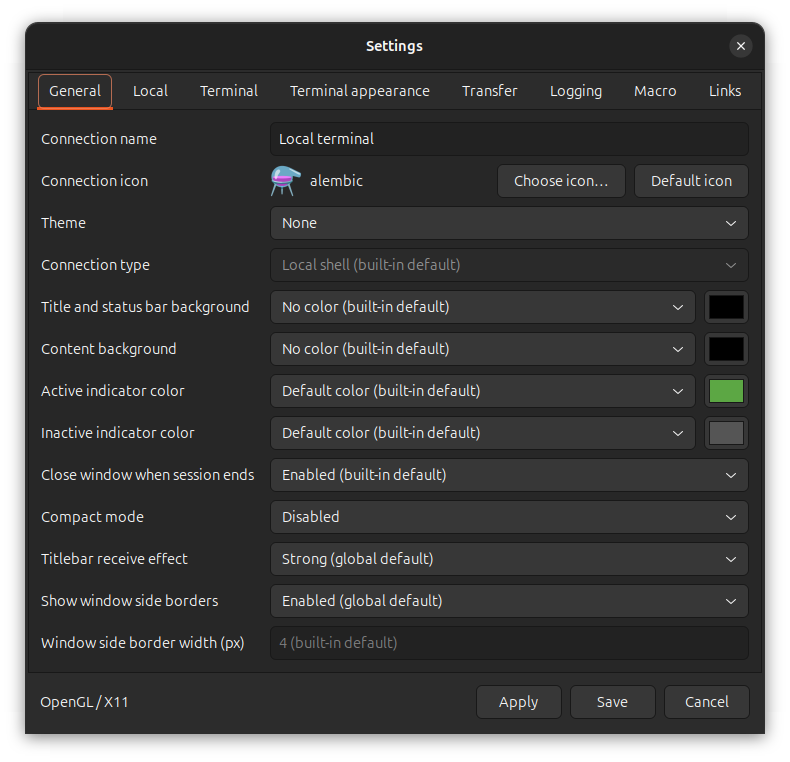

Clicking "Apply" applies the changes only to the currently running terminal.
Clicking "Save" remembers the settings and uses them the next time the terminal starts.
In terminal and file transfer windows, the settings dialog stays open after Apply so you can continue editing.
Save records the changes and closes it.
Cancel discards edits since the last Apply or Save; already applied changes remain active.

Apply and Save are unavailable while required input is missing or settings conflict.
Check the marked fields and tabs. Hover over a field to see what needs correction.

Terminal settings are split into two tabs. "Terminal" contains encoding, character width, special
keys, rows and columns, scrollback, BEL, shortcuts, screen-reader access, and copy settings.
"Terminal appearance" contains fonts, text size, the cursor, background,
and color correction. The same layout is used for individual connections and "Connection defaults".
Border visibility and width are configured on the "General" tab for both terminal and file transfer windows.

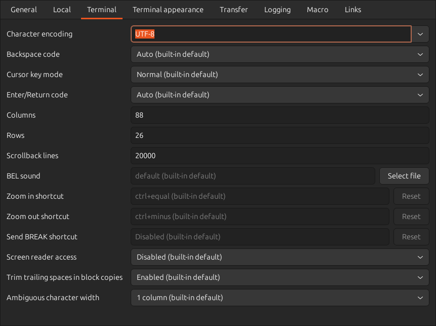

Try changing different settings with the "Apply" button. If something goes wrong,
simply close the terminal window to discard the changes.

Most settings are self-explanatory once you try them, but a few need more detail.
Those settings are described in the following sections.

To read terminal text with a screen reader, enable "Screen reader access" in the "Terminal" settings tab.
It is disabled by default and can be changed while the terminal is running.
Enabling it exposes the currently visible terminal text.
This setting does not affect screen-reader access to menus or settings dialogs.

To edit a saved connection's INI file directly, right-click its entry in the launcher and select "Edit in text editor".
This uses your desktop's default application for plain text files.
Changes saved in an external editor are reloaded automatically.

See the [INI settings reference](./docs/en/configuration.md) for editing configuration files directly.

It is also useful to remember that `Ctrl`+`=` increases the font size and `Ctrl`+`-` decreases it.
You can do the same with the mouse wheel while holding `Ctrl`.

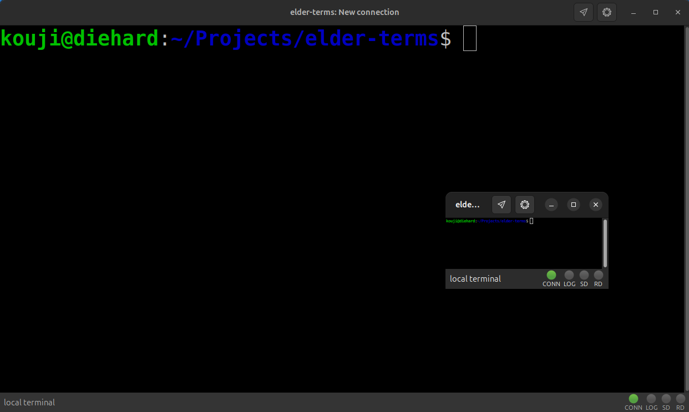

Terminal window placement is left to your window manager or Wayland compositor.
Use bindings such as the `Super` key according to your window system environment.

Today, IoT development often involves debugging and collecting logs from serial devices such as Arduino boards.
elder-terms is exceptionally capable in such environments.

And yes, analog modems have not been forgotten.
The indicators below the terminal by default will satisfy that nostalgia:

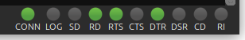

Think the blinking looks suspiciously regular?
Of course it does. It is an homage to the [SONY NEWS workstation](https://en.wikipedia.org/wiki/Sony_NEWS).

Well then, enjoy elder-terms!

---

## INI File Locations

elder-terms configuration files are stored under the XDG user configuration directory.
A theme gives a name to settings shared by several connections.
In a typical environment where `XDG_CONFIG_HOME` is not set, their locations are:

- Global settings (application settings and connection defaults):
  `~/.config/elder-terms/global.ini`
- Named themes: `~/.config/elder-terms/theme.ini`
- Connection settings:
  `~/.config/elder-terms/connections/<connection-name>.ini`

When `XDG_CONFIG_HOME` is set, its value replaces `~/.config` in the paths above.
Settings take precedence in this order: explicit connection values, the selected theme's values, then global connection defaults.

## Configuration Structure

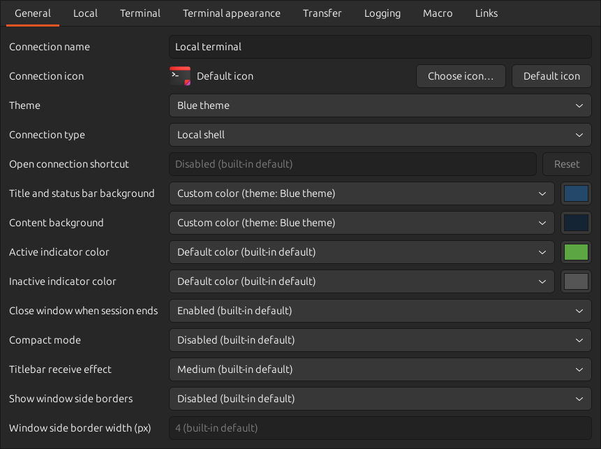

elder-terms has the following three kinds of configuration values. Items later
in the list take precedence.

1. Built-in defaults: Defaults provided by elder-terms itself. They are
   determined by the connection type and other factors.
2. Settings saved in INI files: Connection values in `global.ini`, edited on
   the "Connection defaults" tab of Application settings, override built-in defaults.
   The selected theme's values and then each connection's explicit values take precedence. Application-wide settings are
   edited with "Application settings", including the New Window connection.
   These settings are stored in `global.ini` and preserved for the next launch.
3. Settings for the current connection: Unsaved changes used to launch a
   connection affect only that session. Changes made with "Apply" in the
   settings dialog after launch work the same way. These settings are not
   recorded in an INI file unless you click "Save", and they are lost when the
   session ends.

In the settings dialog, inherited values show their source as
`(built-in default)`, `(global default)`, or `(theme: name)`. Text fields show defaults as faint
placeholder text, while selection fields append the source to the default
option.

Ordinary values without a source in parentheses were explicitly set in the
connection's INI file or in the current launch session. The displayed value
alone does not distinguish between the two. Use "Save" to keep changes for the next launch.

Clearing a text field or selecting the default item in a selection field
removes the explicit value, causing the setting to inherit the first defined value from the selected theme, global defaults, or built-in defaults.

For the settings below, "Apply" changes the current connection, "Save" keeps changes for the next launch, and "Cancel" discards unapplied edits.
See the [INI settings reference](./docs/en/configuration.md) for file syntax and examples.

## Configuring Connection Icons


Open "Choose icon…" on a connection's "General" tab to select a Noto Color Emoji or Material Icons preset.
Material Icons offer black or white glyphs. "Choose image file…" lets you select a PNG or JPEG.
"Default icon" restores the elder-terms image. Presets are bundled and need no download.

The icon appears in the title bar, launcher connection list, and tray connection menu.
It is specific to each connection and does not inherit from "Connection defaults".
Keep custom image files at the same path so they remain available for future launches.

Windows from the same saved connection form one dock group on supporting desktops.
See [connection icon details](./docs/en/connection-icons.md) for image limits, dock behavior, and INI syntax.

## Finding a Host with IP Scan

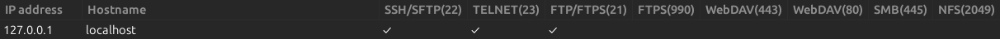

The TELNET, SSH/SFTP, FTP/FTPS, WebDAV, SMB, and NFS settings place an "IP scan" button beside the
address field.
Opening it immediately scans the IPv4 ranges of all configured network interfaces
for the standard FTP/explicit FTPS (21), SSH/SFTP (22), TELNET (23), WebDAV HTTP (80),
WebDAV HTTPS (443), SMB (445), implicit FTPS (990), and NFS (2049) TCP ports.
All connection settings scan the same eight ports.

For example, a `/24` interface scans every address whose final octet is 0 through 255.
A network wider than `/24` is limited to its first 256 addresses.
For example, an address on `172.20.0.0/16` scans `172.20.0.0` through `172.20.0.255`.

You can select discovered hosts while the scan is still running. Resolved host names appear as they become available.
The table has columns for the IP address, host name, and eight ports, with a check mark for each port that accepted a TCP connection.
A check mark identifies a candidate host; it does not verify service support such as WebDAV, successful authentication, or TLS certificate validity.
The FTP/FTPS (21) column covers both plain FTP and explicit FTPS.
The progress bar counts checked addresses in the scan range. Scroll horizontally if the table does not fit.

Double-click a row to stop the scan, close the dialog,
and copy the resolved name into the setting if it is already available.
Otherwise, the numeric IP address is used.
Only the address changes. The connection type, port, entry name, WebDAV HTTPS/HTTP choice,
FTP TLS mode, NFS version, paths, and authentication settings are preserved.
Check the connection settings and save them after selecting a host.

Click "Cancel" to stop and close the scan without changing the address.

Only local interfaces with an IPv4 address are scanned.
Scanning runs from this machine even when SSH proxy is configured.
Loopback interfaces scan only their assigned addresses.

You can still select a host by its numeric IP address when its name cannot be obtained.
mDNS and LLMNR lookup require systemd-resolved with those protocols enabled.
To connect using a discovered name, the operating system's normal name resolution must also resolve it.
See the [systemd resolver API documentation](https://github.com/systemd/systemd/blob/v257/man/org.freedesktop.resolve1.xml) for environment requirements.

## Using SSH and SFTP


SSH, SFTP, TELNET, HTTP/HTTPS, WebDAV, passive FTP/FTPS, SMB2/3 and NFS can use an SSH gateway.
Configure it in the separate "SSH proxy" tab, keeping the final destination in
its protocol tab. See [Using SSH proxy](./docs/en/ssh-proxy.md) for inheritance,
authentication and supported connection modes.

When an SSH terminal or a dedicated SFTP window starts,
a user-name panel is shown before the SSH connection is opened.
The initial value is selected in this order:
the user name in the connection settings, the matching `User` value in `~/.ssh/config`,
and the current operating-system user name.
You can change it for this connection without changing the saved settings.
An empty user name is not accepted.

SSH first tries the configured private key, then credentials available
through SSH Agent or default identity files.
An encrypted configured key opens a passphrase panel.
The password or keyboard-interactive panel is shown only when the server offers
that method and an earlier method has not completed authentication.
All of these methods authenticate the user name selected in the first panel.

An SFTP window opened from an already authenticated SSH terminal reuses that terminal's SSH connection,
including its selected user name and authentication,
and therefore does not ask for them again.

## File Transfers and Jobs

The FTP, FTPS, SFTP, WebDAV, and SMB windows show local files on the left and remote files on the right.
Icons beside names distinguish folders, documents, images, source code, archives, links, and other file types.
SMB shares have a different icon from ordinary folders.

Select one folder or regular file in the opposite pane, then right-click the source items and choose "Send" or "Receive".
Choose the destination in Remote on the right for Send, or Local on the left for Receive. Selecting a folder transfers into that folder; selecting a file transfers into its containing folder.
These actions are unavailable when no destination is selected, a symbolic link is selected, or multiple items are selected.
The path field is not used as the destination. To transfer into the folder currently open, select a file directly inside it, or use "Up" to open its parent and select that folder.
Each selection becomes one transfer job in the "Transfers" list at the bottom of the window.
The destination is fixed when you submit the request. Changing the selection later does not change an existing job's destination. Additional jobs run in order.

Expand "Transfers" to see each job's state, progress, and Cancel button.
Drag the divider above the list to change its height.
Transfers continue while the list is collapsed; the summary still shows active and waiting counts and progress.
Discovery and transfers with unknown total sizes show known item counts or transferred bytes without a percentage.

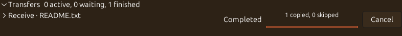

Expand a row to see its destination, start and finish times, and copied, skipped, failed, and unprocessed counts.
The unprocessed count remains "Unknown" if discovery did not finish.
Failure locations and temporary files that could not be removed are also retained here.
Skipped items are excluded from the copied count.

Cancel affects the selected job. Active jobs show "Cancelling…" until cleanup finishes.
"Retry as new job" submits a new request with the same sources and destination after failure or cancellation.
It does not resume from the interrupted byte position.
Jobs waiting at disconnection do not run automatically after reconnection; explicitly retry the ones you still need.

You can browse during transfers. Remote reads wait for the active transfer to finish.
Creation, rename, deletion, and hash calculation become available after active and waiting transfers finish.
Use "Clear finished jobs" to remove history, which otherwise lasts until the window closes.
Closing the window cancels waiting jobs and finishes active-transfer cleanup before closing the connection.

## Reconnecting after Disconnection


If a connection fails or disconnects, review the reason in the notice and select
"Reconnect" there.

In file transfer windows, the notice dims the background and blocks both file lists
and the transfer queue until reconnection succeeds. Select "Close" to exit the window.

To keep a terminal open after a normal session ends, turn off "Close window when
session ends" in General settings (`[general] auto_close=false`). Failed connection
attempts and file transfer disconnections retain their notices regardless of this setting.

Reconnection waits for the previous connection's pending work to stop. It reopens
serial devices or starts a new local shell or command. You can also wait for a
serial connection to recover automatically, or reconnect an SFTP window independently
of the SSH terminal that opened it.

If reconnection fails, review the reason and retry from the same window.
Interrupted transfers are not resumed automatically.

## Using FTP/FTPS


Create a connection in the launcher and select `FTP` as its connection type.
The FTP tab contains the server address, control port, user name, data
connection mode, and initial local and remote directories. The default control
port is 21 and the default data connection mode is `Passive (recommended)`.

Every time the FTP window starts,
it asks for the user name first and then the password in a separate hidden-input panel.
For anonymous login, click `anonymous` in the user name panel to continue to the password panel.
You can also enter `anonymous` as the user name and click Connect.
Enter the password expected by the server; no password is supplied automatically,
and the entered password is not stored in the connection settings.
After login, FTP uses the same two-pane file browser and transfer controls as SFTP.

FTP sends commands, user names, passwords, directory listings, and file data without encryption.
elder-terms uses [FTP (RFC 959)](https://www.rfc-editor.org/rfc/rfc959) or [FTPS](https://everything.curl.dev/ftp/ftps.html).

See the [FTP/FTPS guide](./docs/en/ftp-sftp.md) for further details and INI settings.

## Receiving over HTTP/HTTPS

HTTP/HTTPS connections expand HTML links for file reception. A base URL bounds the permitted scope, and targets are fetched only when needed. Choose between saving original HTML and receiving a selected subtree recursively. The remote side is read-only.

See [Receiving files over HTTP/HTTPS](./docs/en/http.md) for configuration and supported behavior.

## Using WebDAV

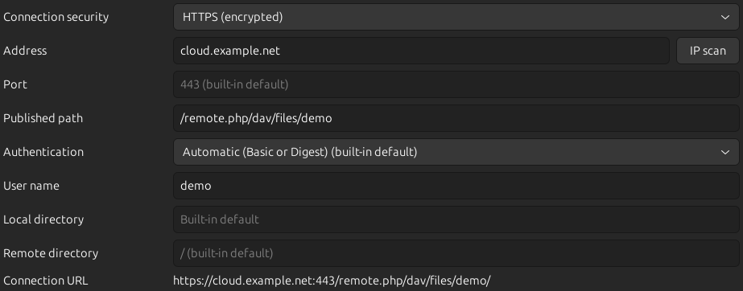

Select `WebDAV` as the connection type, then set the address, published path,
and authentication on the WebDAV tab. For `https://files.example.com/dav/team/`,
use `files.example.com` as the address and `/dav/team/` as the published path.
HTTPS is the default; HTTP is also available.

The read-only URL preview shows the resulting address. Enter the server name separately from its scheme, path and credentials.

The base path becomes `/` in the file browser.
You cannot navigate above it.
An initial remote directory of `/Documents` starts this example at `/dav/team/Documents`.

The shared SFTP/FTP/FTPS browser supports file and folder uploads and downloads,
folder creation, renaming, and deletion.
HTTPS certificate failures are either rejected or shown in the same confirmation overlay as FTPS,
according to the connection settings.

See [Using WebDAV](./docs/en/webdav.md) for settings and supported operations.

## Using SMB

Create a connection in the launcher, choose "SMB", and save the server address
on the SMB tab. The default direct TCP port is 445, with automatic SMB2/3 selection.
You can also select SMB1, SMB2, or SMB3 explicitly. SMB1 supports direct IPv4 connections.
The window asks for a username and password when it opens; passwords are not saved.

After connecting, `/` on the remote side lists shares. Open a share or enter a
path such as `/share-name/folder` to browse it. Within a share, use the same file
browser as other transfer types to send, receive, and manage folders.
See [Using SMB](./docs/en/smb.md) for connection settings,
signing, encryption, and file operation limits.

For Windows XP, select SMB1 and follow the [XP connection requirements and setup](./docs/en/smb.md#restrictions-and-configuration-for-connecting-to-windows-xp-over-smb1).

## Using NFS

Choose "NFS" as the connection type and specify the server address and NFS version. NFS v2, v3, and v4.0 over TCP support listing public directories, transfers, renaming, and deletion.
Filename encoding defaults to UTF-8 and can be set to CP932, EUC-JP, or another supported encoding. See [Using NFS](./docs/en/nfs.md) for public paths and numeric identity settings.

## Managing Items in SFTP/FTP/FTPS, WebDAV, SMB, and NFS

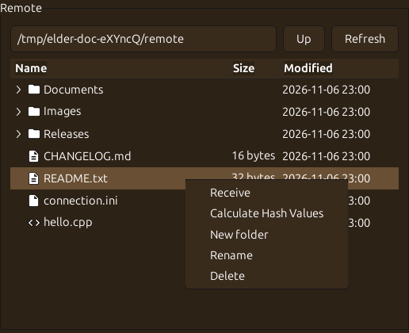

SFTP/FTP/FTPS, WebDAV, SMB, and NFS use the same two-pane file browser.
Select an item in either the local or remote pane and right-click it to open the item menu.
Multiple items can be selected with `Ctrl`+click or a drag rectangle before opening the menu.

- `Rename` is available when exactly one file or directory is selected.
  Enter the new name in the window overlay.
  The item stays in its current directory, and an existing item is never overwritten.
- `Delete` is available for one or more selected files and directories.
  The confirmation overlay lists the effective deletion roots before anything is removed.
  A non-empty directory is deleted recursively.
  If both a directory and one of its descendants are selected,
  the descendant is covered by that directory and is not listed or processed twice.
- `Calculate Hash Values` is available when exactly one regular file is selected.
  For a local file, elder-terms calculates MD5, SHA-1, and SHA-256 internally.
  For a remote file over SFTP, the SSH server must permit command execution and make `md5sum`, `sha1sum`, and `sha256sum` available in the connected account's command search path.
  Calculation fails if these conditions are not met.
  Hash calculation for remote files over FTP or SMB is not supported;
  hash calculation in the local pane remains available.

On a Debian or Ubuntu SFTP server, the required commands are provided by the
[`coreutils` package for Debian](https://packages.debian.org/stable/coreutils)
or the
[`coreutils` package for Ubuntu](https://packages.ubuntu.com/search?keywords=coreutils&searchon=names&suite=all&section=all).
Install it on the server as follows:

```shell
sudo apt update
sudo apt install coreutils
```

Deletion is permanent and does not use the desktop trash.
In the local pane and over SFTP, deleting a symbolic link removes the link itself without
following its target.
The browser is temporarily covered by a progress overlay and is refreshed when the operation finishes.

## Local Startup Process


For a Local connection, "Startup command" on the Local tab selects the process that `elder-terms-terminal` starts in the terminal.
The setting takes effect the next time the connection is opened and is read-only in a running terminal.

When this field is empty, it inherits the global or built-in default.
The built-in default starts the user's shell specified by `SHELL`, with no additional arguments.
If `SHELL` is unset or empty, `/bin/sh` is used.

The value is split into an executable and arguments using shell-style quoting,
but the process is started directly without a shell.
Environment-variable expansion, globbing, redirection, and pipelines are therefore not performed.
Start a shell explicitly when those features are required, for example:

```text
/bin/sh -lc 'exec tmux new-session -A -s elder-terms'
```

See the [settings reference](./docs/en/configuration.md#local-startup-command) for the INI form.

## Selecting a Serial Device


For a serial connection, "Device identification" lets you choose one of three
ways to identify the device:

- Stable device identity: Uses a link created under `/dev/serial/by-id`.
  This tracks the same USB serial device even when it is moved to another USB port,
  so you should normally use this built-in default.
- Physical USB port: Uses a link created under `/dev/serial/by-path`.
  Use this when you always want to connect to the device plugged into the same physical
  port rather than to a particular USB serial device.
- Device path: Uses the current device node,
  such as `/dev/ttyUSB0` or `/dev/ttyACM0`.
  Its node number may change after the device is unplugged and reconnected.

"Device" is not a field for directly entering a path.
It lists the devices currently available under the selected identification method.
The list updates automatically when devices are plugged in or unplugged.
"Stable ID", "USB serial number", and "Current device node" are also shown for the selected device.

If the device is removed while connected, elder-terms retains the selected identity and reconnects when the same target reappears.
"Stable device identity" also stores the USB serial number as supplementary information.
This allows elder-terms to reconnect to the same device when it can uniquely identify one,
even if the `/dev/serial/by-id` link name changes.
If multiple candidates have the same USB serial number,
it waits for a connection instead of selecting the wrong device.

See the [settings reference](./docs/en/configuration.md#serial-connections) for INI syntax and existing configuration behavior.

## Monitoring Serial Connections


"Connection monitoring signal" detects a session disconnection when DCD, CTS, or DSR changes from high to low.
Select "Ignore (do not monitor)" if your USB serial adapter has no usable modem-line signal, 
or if its driver does not support polling modem lines and reports "Invalid argument".

With "Ignore (do not monitor)", elder-terms does not read modem-line state,
and that state cannot trigger "Close window when session ends".
The serial session remains available for sending and receiving.
Removing the device itself, or a read/write error,
is still treated as an actual disconnection as before.

## Character Encoding and Special Key Settings


"Character encoding" converts bytes received from the remote host to UTF-8 for
display, and converts entered text to the remote host's character encoding.
The default for every connection is `UTF-8`.

"Backspace code" selects the control code sent when you press Backspace.
"Auto" uses the terminal's standard behavior, normally sending DEL. "BS" sends ASCII BS (`0x08`), and "DEL" sends ASCII DEL (`0x7f`).
Change this setting if pressing Backspace on the remote host does not delete a character or displays something such as `^H`.
The Delete key is independent of this setting and normally sends `ESC [ 3 ~`.

"Normal" under "Cursor key mode" sends escape sequences according to the terminal mode selected by the remote application.
"TRS80" converts them to the one-byte control codes used by the TRS-80 Model 100/200,
IBM PC GW-BASIC/Quick BASIC, NEC PC-9800 series, and MSX: up is `0x1e`, down is `0x1f`, right is `0x1c`, and left is `0x1d`.
Use this mode when the remote host expects TRS-80-style cursor keys.

"Enter/Return code" selects the code sent when an unmodified Return key or numpad Enter confirms a normal newline.
"CR" sends `0x0d`, "LF" sends `0x0a`, and "CRLF" sends `0x0d 0x0a`.
"Auto" follows the terminal's newline mode and normally sends CR.
It does not replace Return/Enter modified by `Shift`, `Ctrl`, `Alt`, `Super`,
or similar keys, nor dedicated sequences generated in application keypad mode.
Key reports also follow the Kitty keyboard protocol when the remote application enables it.

The built-in defaults for each connection type are as follows:

| Connection type | Character encoding | Backspace code | Cursor key mode | Enter/Return code |
| :--- | :--- | :--- | :--- | :--- |
| Local terminal | UTF-8 | `Auto` | `Normal` | `Auto` |
| SSH | UTF-8 | `Auto` | `Normal` | `Auto` |
| TELNET | UTF-8 | `Auto` | `Normal` | `Auto` |
| Serial | UTF-8 | `BS` | `TRS80` | `CR` |

See the [settings reference](./docs/en/configuration.md#terminal-controls) for INI syntax.

## Selecting and Copying Terminal Text

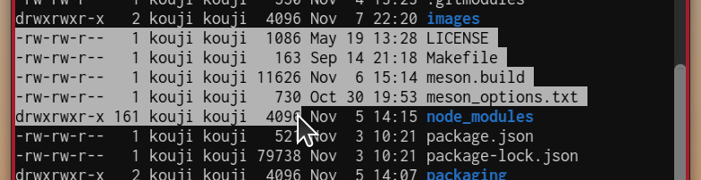

Drag with the left mouse button to select text. The selection uses a gray fill, with your configured color correction applied.
A normal selection follows text order; a block selection is a rectangle aligned to display columns.

| Action | Behavior |
| --- | --- |
| Left click | Clears the selection. A click alone does not copy a character |
| Left drag | Makes a normal selection |
| Double / triple click | Selects a word / line |
| Ctrl + left drag | Makes a block selection |
| Ctrl + click on a link | Opens the link when you release over the same link. Dragging instead makes a block selection |
| Right-click on a link, then “Copy Link” | Copies the link target to the clipboard |
| Escape | Cancels the selection and any active drag |
| Mouse wheel during a drag | Extends the selection through history while retaining its anchor. Ctrl does not zoom during this operation |
| Drag beyond the top or bottom edge | Scrolls through history automatically until you release the button |
| Ctrl + Shift + C, or “Copy” in the context menu | Copies the selected text to the clipboard |

When a terminal application uses mouse input, Shift + drag overrides it for normal selection, and Ctrl + drag for block selection.
Ctrl + Shift + drag also makes a block selection. Ctrl + wheel changes the text size as usual when no selection gesture is active.

Press Ctrl during a drag to switch to block selection on the next mouse movement. Release Ctrl to return to normal selection on the next mouse movement.
Changing Ctrl alone leaves the selection unchanged. Switching preserves the same starting point.

Selected text can also be pasted with the middle mouse button.
Block copies trim trailing spaces by default. To preserve them, disable "Trim trailing spaces in block copies" on the "Terminal" tab.
Normal selection is unaffected.
See [selection and copying details](./docs/en/text-selection.md) for clipboard differences, copy results, and what to do when copying is unavailable.

## Newlines When Sending and Pasting Text


"Follow Enter/Return code for text send" applies to sending text files,
macro output, and all text pasted from the clipboard or primary selection through a keyboard shortcut or the context menu.
The built-in default is enabled.

When enabled, CR, LF, and CRLF newlines are converted to the format selected by "Enter/Return code".
"Auto" sends CR. When disabled, the original newline format is preserved.

Pasting uses the same send-rate, character encoding, and newline settings as text-file sending.
Bracketed Paste, which identifies pasted text to the remote application, is not supported.
See the [settings reference](./docs/en/configuration.md#sending-and-pasting-text) for INI syntax.

## Sending BREAK


When a key combination is assigned to "Send BREAK shortcut", one BREAK is sent for each physical key press.
Automatic repeats caused by holding the key are suppressed.
Leaving the field blank disables the shortcut.
The zoom-in, zoom-out, and BREAK shortcuts cannot use the same key combination.

You can perform the same action by right-clicking the terminal and selecting "Send BREAK".
The menu item is disabled while disconnected, during a transfer, and in a local terminal.
Progress and the result appear in the status bar, and the SD indicator lights while BREAK is sent.

Each connection type sends the following:

| Connection type | BREAK behavior |
| :--- | :--- |
| Local terminal | Not supported |
| TELNET | Sends `IAC BRK` |
| Serial | Asserts the line's BREAK state for 500 milliseconds, then clears it |
| SSH | Sends an SSH BREAK request for 500 milliseconds |

## Notes on Character Encodings

Character encodings accept names defined by iconv, but be aware that several
definitions can have similar yet different names.

For example, in Japanese environments,
Shift JIS is commonly used for BBS serial communication and has the obvious iconv name `SHIFT_JIS`.
In practice, however, the extended `CP932` conventionally used by the NEC PC-9800 series is usually the better choice.

If you use a different encoding, receiving extended or altered characters can produce garbled text.

## Configuring the Terminal Type


The terminal type is a name that tells the remote host which kind of terminal
elder-terms emulates. This value is automatically reported during terminal-type
negotiation for TELNET and when allocating a pseudo-terminal for SSH.

Shells and applications that use `curses` on the remote host consult the
corresponding `terminfo` entry to select control sequences for colors, cursor
movement, function keys, and other features. You can normally leave the
default unchanged. If the remote host does not support that terminal type,
specify a value installed on the host, such as `xterm`.

The default for TELNET and SSH is `xterm-256color`. Use global or connection settings to select a terminal type supported by the remote host.

## Configuring the Scrollback Buffer


"Scrollback lines" on the "Terminal" tab sets the normal-screen history, from 1,000 to 100,000 lines.
The built-in default is 10,000 lines.

## Configuring the BEL Sound


"BEL sound" on the "Terminal" tab selects the sound played when the terminal receives BEL.
The built-in `default` value uses the desktop environment's beep.

For a custom sound, enter the absolute path of an existing file or use the "Select file" button to choose it.
Supported formats are Ogg Vorbis (`.oga`, with the legacy `.ogg` extension also accepted) and WAV (PCM).

## Title-Bar Notifications

Receiving BEL briefly changes the title bar's brightness.
Receiving data moves a subtle band across the title bar. Receive notifications work in both terminals and file-transfer windows.

Use "Visual BEL notification" on the "Terminal appearance" tab and "Titlebar receive effect" on the "General" tab to select Disabled, Weak, Medium, or Strong independently.
Both default to Medium. Disabling visual BEL leaves the BEL sound setting unchanged.
Disabling desktop animations stops both effects.

## Compact Mode


Choosing "Enabled" for "Compact mode" on a connection's General tab hides the
bottom status bar and puts the activity indicators beside the title. The
dropdown can also use the global default or explicitly disable compact mode.
It works for terminal and FTP, FTPS, SFTP, and WebDAV file browser windows. The
built-in default is off.

Enable window side borders on the "General" tab to show borders of the chosen
width on both sides of the window. Compact mode also shows a bottom border
of the same width.

## Configuring Indicator Color


On the "General" tab, set "Active indicator color" and "Inactive indicator color" independently.
Each applies to CONN, LOG, SD, RD, and all serial line indicators.
SFTP, FTP/FTPS, WebDAV, and SMB windows use the same settings for their CONN, SD, and RD indicators.
The lamps retain their shading and highlights; choose different colors if you want to distinguish active from inactive lamps.

"Default color" restores green for active lamps and gray for inactive lamps.
Set shared colors in connection defaults and override them per connection as needed.
See the [settings reference](./docs/en/configuration.md#windows-and-notifications) for INI colors.

## Configuring Text Size


"Text size (DIP)" on the "Terminal appearance" tab sets the text size. A DIP is based on 1/96 inch; the default is 12 DIP.
You can also use `Ctrl`+`=`, `Ctrl`+`-`, or the mouse wheel while holding `Ctrl`. Use "Save" in the settings dialog to save the resulting size in the connection settings.

"Font zoom behavior" offers "Keep rows and columns" (the default) and "Keep window size".
The first resizes the window to fit the text; the second changes the visible row and column counts within the same window and reports them to the connection.
Applying a mode affects subsequent zoom input. See the [settings reference](./docs/en/configuration.md#fonts-and-character-width) for INI syntax.

## Configuring the Cursor and Background

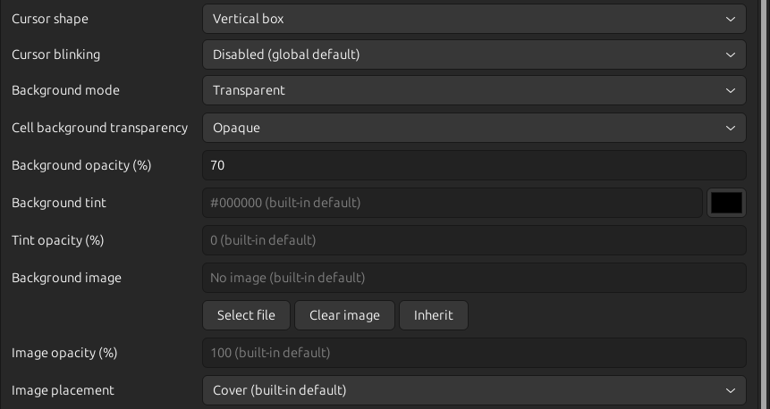

Cursor, background, and color correction options are on the "Terminal appearance" tab.
If image loading fails, the error is shown and the previously applied appearance is retained.

Choose "Full box", "Vertical box", or "Underline box" for the cursor.
The cursor is filled while the terminal has input focus and outlined in the same shape when focus leaves.
Blinking is a separate option. An unfocused outline stays steady.

Background modes are "Opaque", "Transparent", and "Frosted glass".
Lower "Background opacity (%)" to reveal more of the background image or desktop.
"Background tint" and "Tint opacity (%)" add a color over the image and desktop.
Opacity ranges from 0 to 100%; a 0% tint adds no visible color. Text itself stays opaque.

To keep terminal-assigned cell backgrounds from showing through, set "Cell background transparency" to "Opaque".
The default background retains its existing transparency setting, while explicitly assigned cell backgrounds become opaque. The default "Transparent" option applies "Background opacity (%)" to cell backgrounds too.
Changes during a session also apply to existing text and history.

Choose a local PNG or JPEG file, or enter its absolute path.
Image placement can preserve the aspect ratio while covering the viewport, contain the whole image, or stretch both axes.

The image stays fixed within the terminal viewport while text scrolls.
Image opacity and transparent PNG pixels let the image combine with desktop transparency.
Images also work in opaque mode; lower the background opacity if the image is difficult to see.

"Clear image" explicitly selects no image for this connection. "Inherit" follows the selected theme or connection defaults.
The file is neither moved nor embedded, so keep it available at the same path for future starts.
See the [settings reference](./docs/en/configuration.md#background-and-color-correction) for image size limits and INI syntax.

Desktop transparency requires a compositor that combines the windows on your desktop.
Frosted glass requests a compositor effect that blurs the desktop behind the terminal; text and background images remain sharp.
The settings panel reports the actual state. Unavailable blur falls back to transparency, and unavailable transparency falls back to an opaque background.
"Frosted glass requested" means the request was accepted; compositor effect settings still determine whether the blur appears.
See [boxrig's background effects](https://github.com/kekyo/boxrig/blob/0.14.0/docs/en/background.md) for platform requirements.

## Improving Text Color Visibility


Select "Improve visibility (Oklch)" under "Color filter" on the "Terminal appearance" tab to improve contrast for text and markers that are difficult to distinguish from their background. All hues, including red, green, and blue, and neutral gray, black, and white are included.
Oklch represents color using separate lightness, chroma, and hue components. This correction preserves hue and primarily adjusts lightness.
Colors with sufficient contrast are retained; difficult-to-read colors are adjusted. The default is "No correction".
Oklch alone leaves background colors unchanged. Background images, communication, copied text, and logs are also unchanged.
Correction uses the cell's background color as its reference; it does not adapt to individual pixels in a background image or transparent desktop.

## Reversing Background and Text Polarity


Choose one of five modes under "Color filter" on the "Terminal appearance" tab. They turn white text on black into black text on white and continuously transform nearby colors as well. Use "Compare colors" to choose a mode that suits your usual palette.

A palette maps color numbers to RGB values. CAM16, used in D, is a model of color appearance under different viewing conditions.

| Choice | Behavior |
|---|---|
| Reverse lightness (A) | Reflects perceptual lightness while preserving hue. Bright yellow and green become nearly black |
| Reverse contrast (B) | Approximately preserves the original contrast ratios, including poorly readable combinations |
| Reverse text and background (C) | Reverses backgrounds and adjusts chromatic text for readability while retaining hue and tone differences |
| Reverse appearance (D, CAM16) | Compensates for changes in color appearance under assumed dark-to-light viewing conditions |
| Reverse optimized palette (E) | Adjusts color separation across the terminal palette |

E's preview uses the standard palette. The actual display can differ when the connected application changes that palette.

Only one color filter can be selected, so reversal and the existing Oklch filter are mutually exclusive. Color discrimination assistance can be combined with every mode and is applied before reversal. Logical terminal colors, text, communication, copied text, and logs remain unchanged.

Background images, the desktop behind transparent windows, Kitty images, and intrinsic color-emoji pixels are not reversed. Check the actual display when combining reversal with transparency or images. See [boxrig's supported filtering scope](https://github.com/kekyo/boxrig/blob/0.14.0/docs/en/color-filters.md).

See the [settings reference](./docs/en/configuration.md#background-and-color-correction) for INI syntax.

## Helping Distinguish Colors


Select Protan (P), Deutan (D), or Tritan (T) under "Color discrimination" on the "Terminal appearance" tab.
Recoloring represents information from difficult-to-distinguish colors using differences in other colors.
The protan and deutan profiles primarily target red-green distinctions; the tritan profile primarily targets blue-yellow distinctions. The default is "No correction".

Open "Compare colors" and compare the `- removed` and `+ added` diff samples, logs, and text on colored backgrounds.
ANSI 16 colors are the terminal's basic palette, 256 colors are an extended indexed palette, and TrueColor specifies RGB values directly.
The preview includes all three, with dark, light, and connection backgrounds.
Choose the setting that makes your usual content easier to distinguish, using the samples as well as the profile names.

"Correction strength" ranges from 0 to 100; 0 disables recoloring. The default strength when a profile is selected is 100.
This value does not measure the severity of a color-vision difference.
Some other colors can become more similar after correction. Reduce the strength or try another profile if this happens.
Numerical tests and visual checks have been completed; reading evaluations with people who have color-vision differences have not yet been conducted.

Recoloring applies to text, application-specified cell backgrounds, underlines, the cursor, and markers such as search and selection outlines.
It preserves the connection's default background.
Combine it with "Improve visibility (Oklch)" to adjust text and marker contrast against the recolored background.
Oklch remains independent when recoloring strength is zero.

Correction affects display only. Communication, logical terminal colors, copied text, and logs remain unchanged.
Background images, the desktop behind transparent windows, Kitty images, and intrinsic color-emoji pixels are excluded.
See [boxrig's display color filters](https://github.com/kekyo/boxrig/blob/0.14.0/docs/en/color-filters.md) for the supported scope.

## Ambiguous Character Width

Characters such as "①" can occupy one or two terminal columns. These are called ambiguous-width characters.
On the "Terminal" tab, choose "1 column", "2 columns", or "Font dependent" for "Ambiguous character width". The default is "1 column".
This setting controls the number of columns used for text placement, separately from font size.

Font dependent uses the number of columns needed by the actual font.

Changes to this width policy apply to newly opened terminals. Save the setting, then reopen the terminal.
"Apply" and reconnection in the same window retain the existing terminal's width policy.
Changing the font in a font-dependent terminal also changes text placement.

A font's width cannot determine the column count expected by the remote application.
If input positions or borders become misaligned, select one or two columns to match that application.

## Configuring Font Families


Use the "Terminal appearance" tab to edit an ordered list of font families.
Add or remove rows, and use the up/down buttons to change their priority.
Each row accepts a family name or opens a font chooser.

The first family has the highest priority.
Later families supply characters missing from earlier ones, such as Japanese characters missing from a Latin
font.
Uninstalled family names may be saved and are skipped during fallback.

The drop-down applies to the whole list.
"Inherited from: global settings" or "Inherited from: app defaults" follows the inherited settings,
including later global changes.
If the selected theme defines fonts, the inherited option displays its name and follows that list.
"Use app defaults" fixes this connection to `Noto Sans Mono`, then `Monospace`, regardless of global settings.
"Specify for this connection" sets its own list.
The global editor offers "App defaults" and "Specify fonts".
Connection overrides replace the theme or global list rather than extending it.

These settings save only the font families; they do not include font size, weight, or style.
Font size follows "Text size (DIP)", `Ctrl`+`=`, `Ctrl`+`-`, or the mouse wheel while holding `Ctrl`.

See the [settings reference](./docs/en/configuration.md#fonts-and-character-width) for INI list syntax and escaping.

## Support for Text-to-Speech

To have screen reader software read the device text, enable "Read Device Text" on the "Device" tab in Settings.
This setting is disabled by default.
You can toggle it on or off while the app is running; when enabled, the currently displayed text will be made available to the screen reader.

This setting does not affect the reading of menus or settings screens.

## Hotkeys

While elder-terms is running, the hotkey configured for each connection lets you
instantly open its terminal or file transfer window:


Connections with a hotkey also show a combination such as `Ctrl+Alt+X`.
"Open application shortcut" under "Application settings" shows the launcher; its default is `Ctrl+Alt+T`.

Hotkeys work only while the elder-terms launcher is running, so we recommend
keeping it running in the system tray.

> Note: Automatic hotkey registration depends on the desktop environment.
> On Sway and labwc, the launcher saves hotkeys in your compositor configuration files.
> See [desktop-specific hotkey setup](./docs/en/hotkeys.md) for troubleshooting, manual registration, and removal.

## Configuring Logging


Enabling "Enable logging" records content received from the remote host in a
file. "Log directory" is the base destination directory and defaults to
`${documents}/logs/`. "File name format" is a relative path under that
directory and defaults to `${YYYYMMDD}_${hhmmss}_${fff}.txt`.

Both fields support the following placeholders:

- `${documents}`, `${downloads}`, `${home}`: The user's Documents, Downloads,
  and home directories, respectively
- `${name}`: The connection name
- `YYYY`, `MM`, `DD`: The year, month, and day in the local time when logging
  started
- `hh`, `mm`, `ss`, `fff`: The hour, minute, second, and millisecond at the same
  time

Date and time components can be combined in one placeholder, such as
`${YYYYMMDD}` or `${YYYY-MM-DD}`. Write a literal `$` as `$$`. "File name
format" may contain `/`, and the required directories are created
automatically. For example, setting "Log directory" to
`${documents}/elder-terms` and "File name format" to
`${name}/${YYYY}/${MM}/${YYYYMMDD}_${hhmmss}.txt` separates logs by connection,
year, and month.

"Log content" selects the storage format and character encoding. "Raw bytes
(before character conversion)" stores bytes received from the remote host
without conversion, preserving the encoding configured for the connection.
"UTF-8 text (after character conversion)" stores the text as UTF-8 after its
character encoding has been converted for display.

## Configuring Macros


Macros automate sending text or running external commands in response to received text.
For example, they can send Enter when a prompt appears or record an error message in a log.
They work with local terminal, TELNET, serial, and SSH connections.

On the connection's "Macro" tab, specify a regular expression for the received text and the action to perform.
Rules are evaluated from top to bottom, and only the first matching rule runs.
See [macro details](./docs/en/terminal-links.md#configuring-macros) for examples and capture syntax.

## Configuring Terminal Link Actions

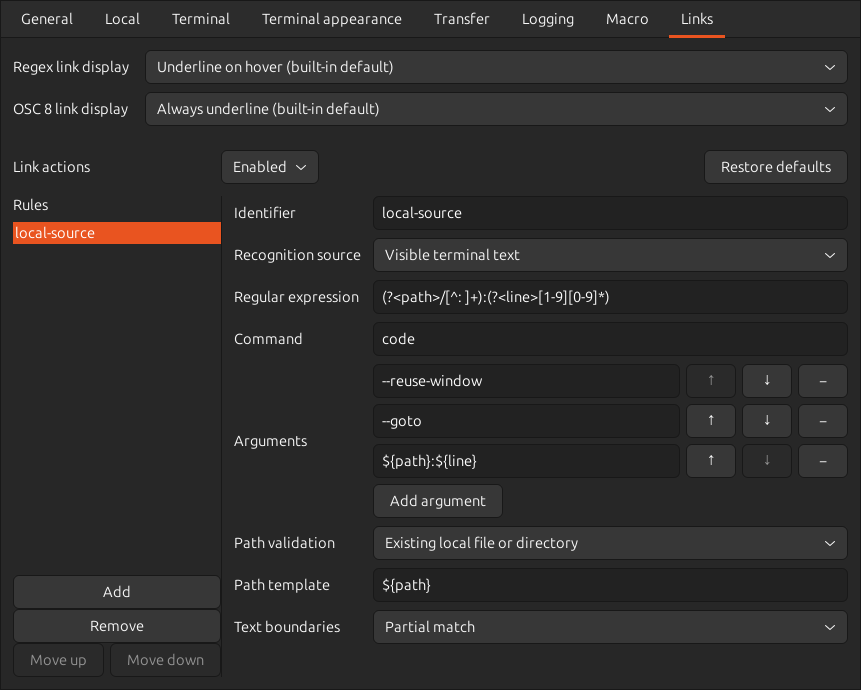

Hold Ctrl and click a link to open it in the configured application.
Right-click and choose "Copy Link" to copy the target.

The defaults recognize HTTP/HTTPS URLs, existing absolute and home-relative local paths, and VS Code links.
Local paths refer to files on the computer running elder-terms.

Use the connection's "Links" tab to enable or disable links, change their display, and define custom rules.
Links recognized in visible text are underlined on hover by default.
OSC 8 links, whose targets and display ranges are explicitly supplied by the connection, are always underlined by default.
With existence-checked display, local paths remain dimmed until they are confirmed valid.

Only the first matching custom rule runs. Since rules launch external commands, restrict the accepted formats to those you need.
See [terminal link details](./docs/en/terminal-links.md) for punctuation boundaries, display choices, regular expressions, and INI syntax.

---

## Configuring the Display Language


"Display language" under the launcher's "Application settings" lets you select
the system default, English, Arabic, Spanish, French, Hindi, Japanese, Korean,
Portuguese, Russian, or Simplified Chinese.

The display language is loaded when elder-terms starts, so you must restart
elder-terms after saving a change. Select "Restart now" in the dialog shown
when you save, or restart it manually later. Terminal and file transfer windows
that are already open do not change language immediately either.

> Note: The elder-terms project owner is a native Japanese speaker who
> understands Japanese and English but cannot read any of the other languages.
> Consequently, the multilingual text included in elder-terms relies entirely
> on machine translation. If you find an undesirable translation, please send
> a pull request.

## Keeping the Launcher in the System Tray

In environments that support a system tray, you can keep elder-terms running in the tray.

Open the launcher's application menu, select "Application settings", and set
"Startup mode" to "System tray only" or "System tray and main window" to keep the launcher in the tray.

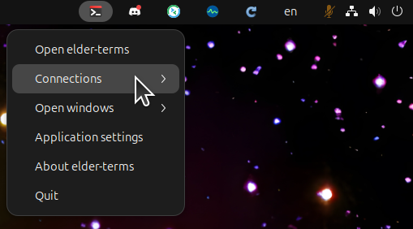

The tray's "Connections" submenu lists every saved connection with its icon and name.
Select a connection here to open it.

The "Open windows" submenu lists terminal and file transfer windows launched by
this launcher that are still running. Selecting one requests that window to be
shown; the desktop environment controls whether it comes to the foreground.

## "New window"

To choose the connection opened by "New Window" on the desktop icon of a terminal started without a connection,
open "Application settings" in the launcher and select its name from "Use for \"New Window\"".

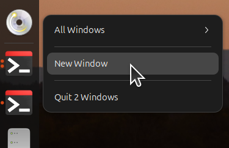

Select "None" to use the default terminal settings.

The list includes saved local shell, TELNET, SSH, and serial connections.
The desktop action is named "New Window" in every system language.

## Defining Themes

elder-terms features a theme system. As the name suggests, it functions as a "theme" that allows you to customize and define the appearance, but it’s actually much more powerful than that.

Themes defined here affect all settings.
The global settings in "Application Settings" allow you to modify nearly all of elder-terms’ settings;
this feature simply lets you assign a theme name to them so you can switch between them.

Themes are applied as follows:

1. It uses the global settings as a baseline.
2. If a theme is specified for a connection, it overrides the settings with those redefined by that theme.
3. Settings for each individual connection override those above.

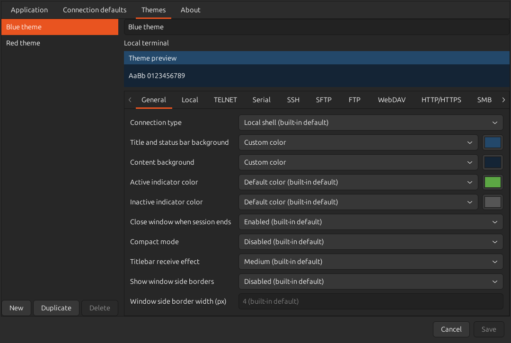

You can create a “Red Theme” that defines only the title bar and body background colors, or you can group settings that apply to all serial connections into a theme such as "Default Baud Rate."

Open "Application settings" from the launcher's menu, choose the "Themes" tab, and click "New". Enter a name and the settings to share, then click "Save". The preview shows the titlebar and content background together. Select the theme on each connection's "General" page to inherit its settings. Choose "None" to return to connection defaults.

Explicit connection settings survive theme changes. Clear an override to inherit the current theme's value. Clearing an item in the theme restores connection defaults for that item. Connection names, icons, launch hotkeys, application-wide settings, macros, and link rules are outside themes.

Renaming a theme keeps existing references. "Duplicate" creates a separate theme. Themes in use list their connections and cannot be deleted until those references are removed. If an external edit removes a referenced theme, select an existing theme or "None" before launching the connection.

Saved themes affect new sessions and the connection being edited in the launcher. For a running terminal or transfer window, reopen settings and click "Apply". Previewing or selecting a theme does not change the running session. Changes such as connection destinations still require reconnection.

Application settings retain edits across tabs, and "Save" covers all editing tabs. If only one of `global.ini` and `theme.ini` saves, the dialog stays open and reports each file's result. Retry writes only unsaved changes; a subsequent "Cancel" discards only those unsaved changes. If an external-edit conflict is reported, review the persisted files and reopen settings.

## Checking the Running Version


Open the application menu in either the launcher or a terminal window and
select "About elder-terms". The "About" page shows the version of elder-terms currently running.

---

## Using the Source

To build and run from source, see the [build guide](./docs/en/building.md).
It covers requirements, building and running, tests, and deb package generation.

## License

Under MIT.

### Included 3rd party libraries

elder-terms bundles the following libraries, each covered by its own license.

| Library | Use | License |
| --- | --- | --- |
| [boxrig](https://github.com/kekyo/boxrig) | Terminal control sequence parsing and rendering | [MIT](https://github.com/kekyo/boxrig/blob/0.14.0/LICENSE) |
| [cardio](https://github.com/kekyo/cardio) | Asynchronous I/O | [MIT](https://github.com/kekyo/cardio/blob/31e8149ce52cdfdaaa48838ca9de39288074885c/LICENSE) |
| [libxyzm](https://github.com/kekyo/libxyzm) | X/Y/ZMODEM file transfers | [MIT](https://github.com/kekyo/libxyzm/blob/b1cd04cfd2769bbd1a5a6bc6990d60338b5a3cf5/LICENSE) |
| [jemalloc](https://github.com/jemalloc/jemalloc) | Memory allocation and management | [BSD-2-Clause](https://github.com/jemalloc/jemalloc/blob/7a34f18502e7b222724097cdcd499b437d189acc/COPYING) |
| [libsmb2](https://github.com/sahlberg/libsmb2) | SMB2/3 file transfers and share listing | [LGPL-2.1-or-later](https://github.com/sahlberg/libsmb2/blob/727feaaa6d0f4fed1bae57745fbc2c5db9a30e64/COPYING) |
| [libdsm](https://github.com/videolabs/libdsm) | SMB1 file transfers and share listing | [LGPL-2.1-or-later](https://github.com/videolabs/libdsm/blob/0f3edc6df6ab5950f2550d453035351440f71e31/COPYING) |

boxrig also includes utf8proc, libpng, zlib, and data or generated code from
Unicode, WHATWG Encoding, and Wayland protocols.
See [boxrig's license list](https://github.com/kekyo/boxrig/blob/0.14.0/packaging/licenses/README.md)
for each component's license.

Distribution packages include the licenses and notices for boxrig, jemalloc,
libsmb2, and libdsm in directories named after each library under
`/usr/share/doc/elder-terms/licenses/`.
The libsmb2 and libdsm directories also contain the corresponding source,
and the libdsm directory includes the applied patch.
See [SMB library source and licenses](./docs/en/smb.md#bundled-library-source-and-licenses)
for details.

### Icons and Emoji images

Bundled connection artwork and emoji names are covered by their respective
licenses. See [artwork sources and licenses](./docs/ja/connection-icon-artwork.md).
Distribution packages include the licenses and notices under
`/usr/share/doc/elder-terms/licenses/connection-icons/`.
