# elder-terms

A Terminal emulator for local shell, serial, TELNET, FTP, FTPS, SSH, and SFTP connections.
'90s, come back in this time. This is all we need.


[](https://www.repostatus.org/#active)
[](https://opensource.org/licenses/MIT)

----

[(Japanese language is here/日本語はこちら)](./README_ja.md)

> Please note that this English version of the document was machine-translated and then partially edited, so it may contain inaccuracies.
> We welcome pull requests to correct any errors in the text.

## What Is This?

A terminal application, inspired by personal computing in the 1990s.

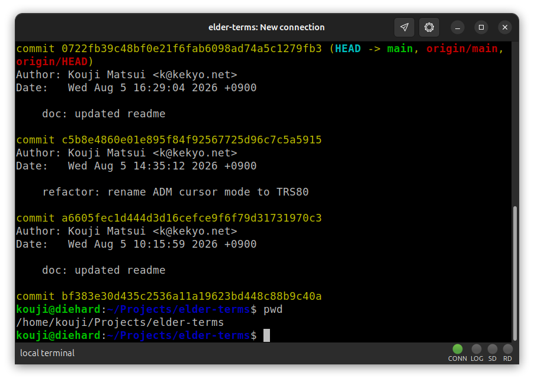

### Features

- Uses Linux GTK3 and [boxrig](https://github.com/kekyo/boxrig), preferring OpenGL rendering and using Cairo when OpenGL is unavailable.
- Supports local terminals, SSH, SFTP, FTP, WebDAV, and SMB as well as serial and TELNET
  connections, bringing that familiar terminal experience into the present.
- Lets you manage multiple connections and launch terminals from the launcher.
- Stores all connection settings in INI files, which you can freely edit with
  any text editor.
- Lets you configure BS/DEL, cursor key conversion, Enter/Return codes, and
  character encoding conversion.
- Remembers the terminal's rows and columns for each connection.
- Lets you explicitly specify the terminal type, such as `xterm` or
  `xterm-256color`, for TELNET and SSH.
- Supports X/Y/ZMODEM file transfers for TELNET, serial, and SSH terminal
  connections. Automatic transfers can be enabled for ZMODEM.
- Transfers files to and from the host over SFTP/FTP/FTPS, WebDAV, and SMB.
- Transfers files over FTP and FTPS using passive or active data connections.
- Supports pasting text and sending text files. You can specify the send rate
  and newline handling to avoid overflowing the host's buffer or using
  incompatible newline codes.
- Shows indicators below the terminal by default, or beside the title in
  compact mode, so you can reminisce about analog modems.
- Uses either the built-in beep or a custom WAV/Ogg Vorbis sound for BEL.
- Changes the font size with keyboard shortcuts or the mouse wheel.
- Customizes the window exterior colors and terminal background for each
  connection.
- Opens a specified connection with a single hotkey.
- Start by opening your local terminal with a hotkey.
- Starts the launcher automatically and can keep it running in the system tray.
- Monitors received text with regular expressions and defines rules that
  automatically send text or run a specified command.
- Recognizes OSC 8 targets or visible terminal text as links.
- Records logs to files and organizes them into directories by connection and
  date and time.
- Supports multilingual display (English, Arabic, Spanish, French, Hindi,
  Japanese, Korean, Portuguese, Russian, and Simplified Chinese).

### Terminal Launcher

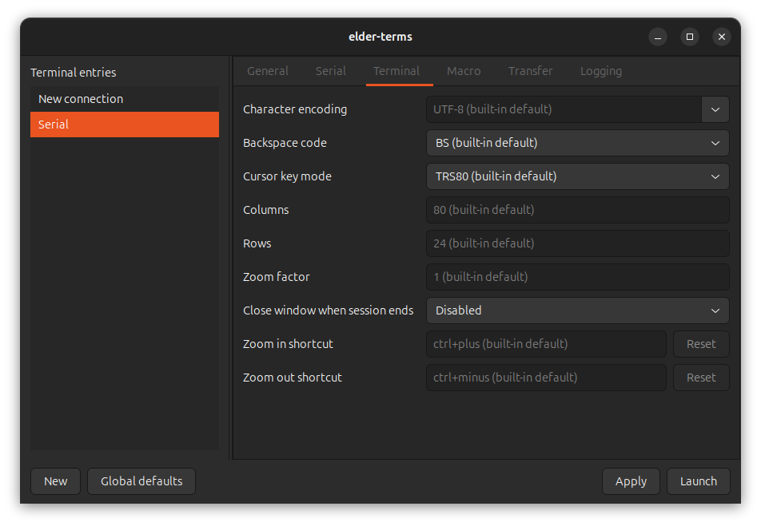

### Complex Display

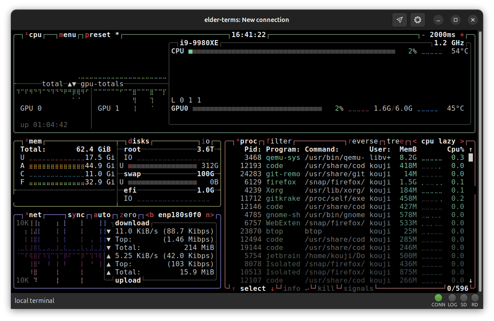

### Serial Device

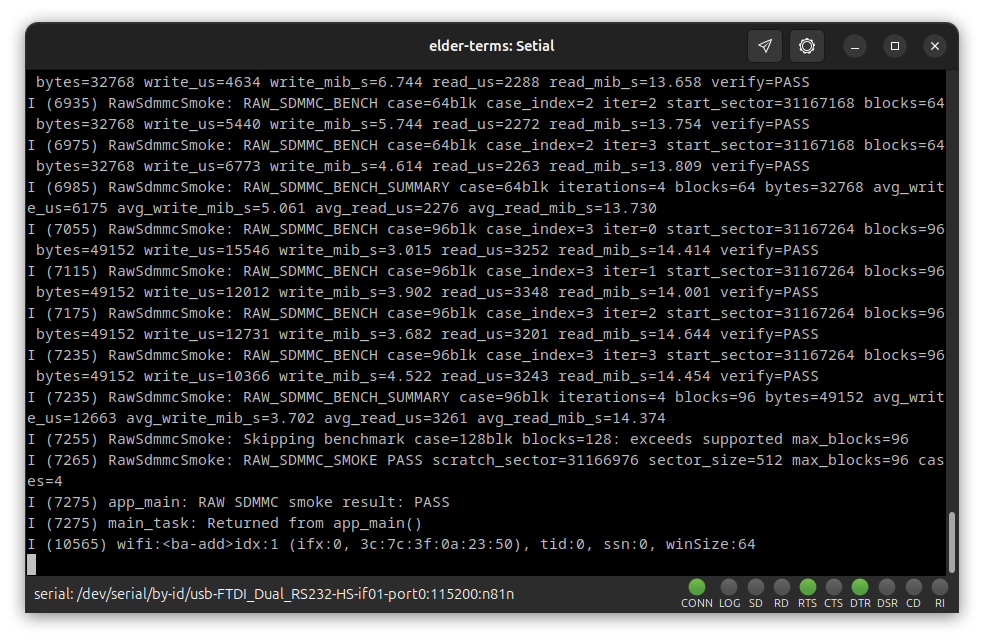

### Custom Exterior Colors

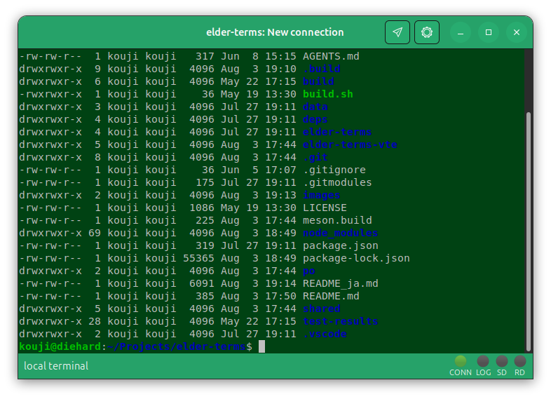

### SFTP/FTP/FTPS/WebDAV/SMB

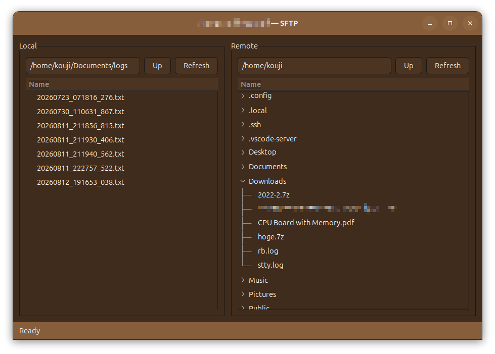

## Environment

- Linux GTK3 (Ubuntu/Debian preferred)

---

## Installation

Download a prebuilt package (deb format) from the
[releases](https://github.com/kekyo/elder-terms/releases/) and install it:

```bash
sudo apt install ./elder-terms-*.deb
```

Then start elder-terms:

```bash
elder-terms
```

Use `elder-terms-terminal` to start a terminal directly, or `elder-terms-terminal -c connection.ini` to select a connection settings file.

---

## Basic Usage

On the first launch, elder-terms automatically creates a connection entry named
`Local terminal`. It starts a shell such as `bash`, much like the terminal you
normally use.

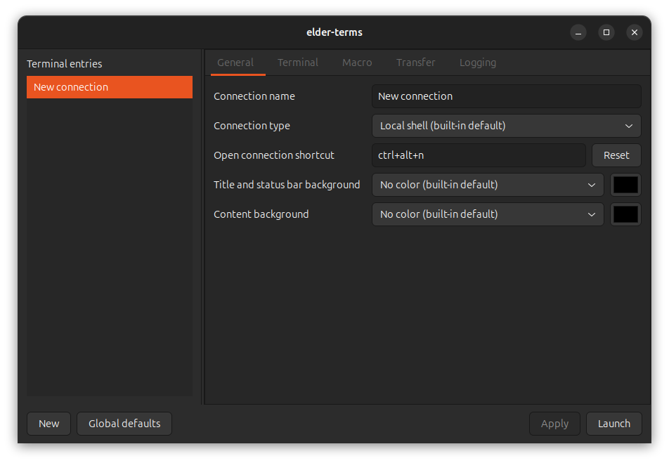

Double-click the entry in the launcher's list to open it. To create another
connection, click "New" at the bottom of the launcher, change the name from
"New connection" to whatever you like, and click "Save". There it is:

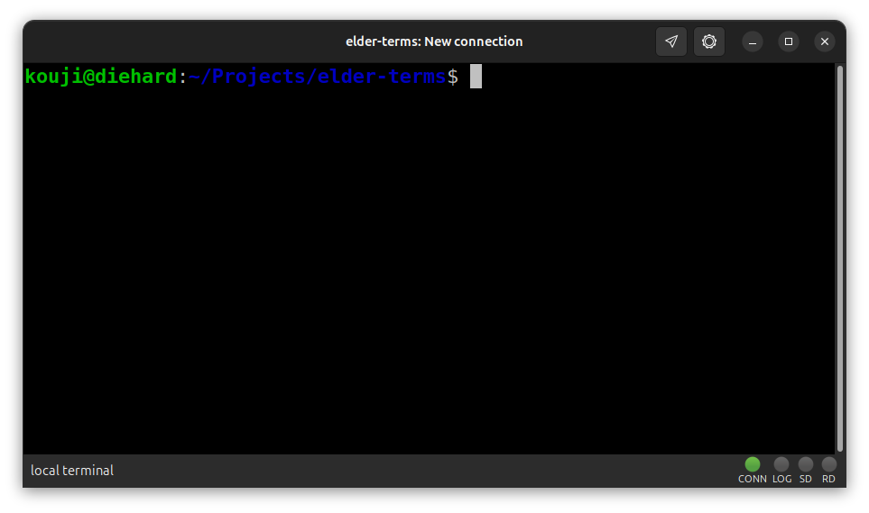

Open the menu at the top-right of the terminal and select "Settings" to change
its settings. Clicking "Apply" applies the changes only to the currently
running terminal. Clicking "Save" remembers the settings and uses them the next
time the terminal starts.
In terminal and file transfer windows, the settings dialog stays open after Apply so you can continue editing. Save
records the changes and closes it. Cancel discards edits since the last Apply
or Save; already applied changes remain active.

Terminal settings are split into two tabs. "Terminal" contains encoding, character width, special
keys, rows and columns, scrollback, BEL, shortcuts, screen-reader access, and copy settings.
"Terminal appearance" contains fonts, text size, the cursor, background,
and color correction. The same layout is used for individual connections and
"Connection defaults". Neither tab is shown for file transfers.
Border visibility and width are configured on the "General" tab for both
terminal and file transfer windows.

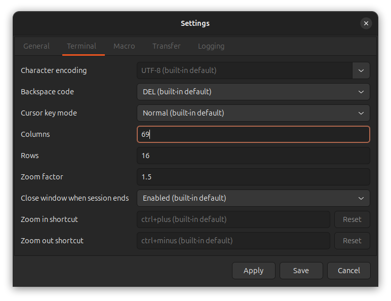

Try changing different settings with the "Apply" button. If something goes
wrong, simply close the terminal window to discard the changes.

Most settings are self-explanatory once you try them, but a few need more
detail. Those settings are described in the following sections.

To read terminal text with a screen reader, enable "Screen reader access" in the
"Terminal" settings tab. It is disabled by default and can be changed while the
terminal is running. Enabling it exposes the currently visible terminal text.
In an INI file, set `accessibility_enabled=true` in `[terminal]`.
This setting does not affect screen-reader access to menus or settings dialogs.

To edit a saved connection's INI file directly, right-click its entry in the
launcher and select "Edit in text editor". This uses your desktop's default
application for plain text files.
Changes saved in an external editor are reloaded automatically, including
editors that replace the file when saving.

To choose the connection opened by "New Window" on the desktop icon of a terminal
started without a connection, open "Application settings" in the launcher and select its name from
"Use for \"New Window\"". Select "None" to use the default terminal settings.
The list includes saved local shell, TELNET, SSH, and serial connections.
The desktop action is named "New Window" in every system language.

The selection is stored as an application setting in `global.ini`. Use the
connection entry's name as the value:

```ini
[general]
new_window=Local terminal
```

Renaming the connection in the launcher updates the selection. Deleting it or
saving it as SFTP, FTP, WebDAV, or SMB clears the selection. When no connection is
selected, the terminal uses built-in settings and global defaults. If the named
connection is missing, unreadable, or not a terminal connection, startup fails.

It is also useful to remember that `Ctrl`+`=` increases the font size and
`Ctrl`+`-` decreases it. You can do the same with the mouse wheel while holding
`Ctrl`.

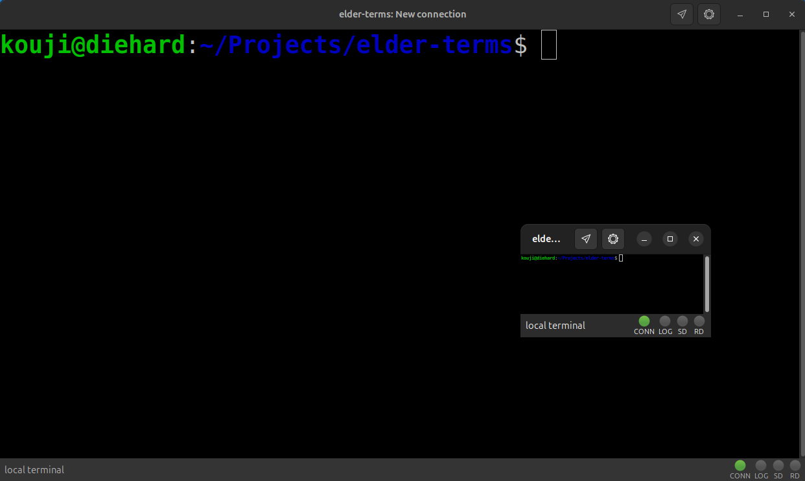

Terminal window placement is left to your window manager or Wayland
compositor.
Use bindings such as the `Super` key according to your window
system environment.

Today, IoT development often involves debugging and collecting logs from
serial devices such as Arduino boards. elder-terms is exceptionally capable in
such environments.

And yes, analog modems have not been forgotten. The indicators below the
terminal by default will satisfy that nostalgia:


Think the blinking looks suspiciously regular? Of course it does. It is an
homage to the [SONY NEWS workstation](https://en.wikipedia.org/wiki/Sony_NEWS).

Well then, enjoy elder-terms!

---

## Configuration Structure


elder-terms has the following three kinds of configuration values. Items later
in the list take precedence.

1. Built-in defaults: Defaults provided by elder-terms itself. They are
   determined by the connection type and other factors.
2. Settings saved in INI files: Connection values in `global.ini`, edited with
   "Connection defaults", override the built-in defaults, and each
   connection's INI file overrides `global.ini`. Application-wide settings are
   edited with "Application settings", including the New Window connection.
   These settings are stored in `global.ini` and preserved for the next launch.
3. Launch-session settings: If you launch a connection with unsaved changes in
   the launcher, those changes are passed to the connection window as a
   temporary launch profile. Changes made with "Apply" in the settings dialog
   after launch also affect only the current session. These settings are not
   recorded in an INI file unless you click "Save", and they are lost when the
   session ends.

In the settings dialog, inherited values show their source as
`(built-in default)` or `(global default)`. Text fields show defaults as faint
placeholder text, while selection fields append the source to the default
option.

Ordinary values without a source in parentheses were explicitly set in the
connection's INI file or in the current launch session. The displayed value
alone does not distinguish between the two. "Save" records explicit values in
the connection's INI file, while "Apply" affects only the current session.

Clearing a text field or selecting the default item in a selection field
removes the explicit value, causing the setting to inherit the global or
built-in default again.

## Configuring Connection Icons


Open "Choose icon…" on a connection's "General" tab to display a popup grid.
Switch between Noto Color Emoji and Material Icons, scroll through the images,
and click one to select it. "Choose image file…" also accepts PNG and JPEG files.
"Default icon" restores the elder-terms image. Presets are bundled and do not
require a download when selected.

For Material Icons, choose Black or White under "Glyph color". The background is
transparent, with an outline in the opposite color. Changing the color updates
the grid previews; clicking an image selects both its glyph and color.

Apply updates the current window; Save records the selection for the next launch.
Cancel discards edits made since the last apply. The image appears at the left
edge of terminal and file-transfer title bars. The launcher's connection list
and tray connection menu show saved icons. Icons are specific to each connection
and do not inherit from "Connection defaults".

Selected files are read from their original paths. Keep the file somewhere it
will remain available on subsequent launches. Both the file and decoded RGBA
image are limited to 64 MiB, with each dimension limited to 16384 pixels.
Images retain their aspect ratio within a square, with transparent padding.
An unspecified or unreadable image uses the default icon. The settings page
shows loading errors without preventing the connection from opening.
Missing files and unknown preset IDs do not automatically clear the saved selection.

Saved connections also use individual dock icons. Windows for the same connection
are grouped together, separately from other connections. Renaming a connection
preserves its identity; duplicating it creates a separate identity. A window
started from unsaved edits forms a separate temporary group. Pinning that group
and relaunching it opens the launcher. The launcher's own window, dock, and tray
icons remain unchanged.

Window icon support is detected from the running display environment and GTK
capabilities. On X11, elder-terms supplies multiple image sizes to GTK. On Wayland,
it sends icons when the public API and `xdg-toplevel-icon-v1` are available.
The title-bar and connection-list icons remain available in unsupported environments.
Dock presentation also depends on the desktop environment; see the
[GTK icon documentation](https://docs.gtk.org/gtk3/method.Window.set_icon_list.html).
Testing on Ubuntu GNOME 46 confirmed that the dock updates on the first launch
after an icon change without reopening the connection. The previous image may
remain for a few seconds while [GNOME refreshes its cache](https://github.com/GNOME/gnome-shell/blob/46.0/src/shell-app-cache.c).
If GNOME still holds an image reference from before this fix, reopen the connection
window once after upgrading. Subsequent icon changes do not require reopening it.

Dock integration generates files in `$XDG_DATA_HOME/applications/` and
`$XDG_DATA_HOME/icons/hicolor/256x256/apps/`, normally under `~/.local/share/`
when `XDG_DATA_HOME` is unset. Generated images and desktop files are retained,
including after deleting a connection, to preserve running windows and pinned entries.
Launching a pinned entry for a deleted connection reports an error; it cannot
open a different connection created with the same name.

In an INI file, `[general] icon` accepts these forms:

| Value | Image |
| --- | --- |
| `default` or omitted | elder-terms default |
| `noto:emoji_u1f44d` | Example Noto Color Emoji preset |
| `material:action/home` | Black Material Icons glyph with a white outline |
| `material:white:action/home` | White Material Icons glyph with a black outline |
| `file:/home/user/Pictures/server.png` | PNG or JPEG at an absolute path |

## Finding a Host with IP Scan

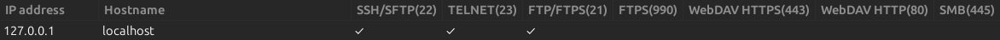

The TELNET, SSH/SFTP, and FTP settings place an "IP scan" button beside the
address field.
Opening it immediately scans the IPv4 ranges of all configured network interfaces
for the standard FTP (21), SSH/SFTP (22), and TELNET (23) TCP ports.

For example, a `/24` interface scans every address whose final octet is 0 through 255.
A range wider than `/24` is limited to its first 256 addresses by treating the additional upper host bits as zero.
For example, an address on `172.20.0.0/16` scans `172.20.0.0` through `172.20.0.255`.

Discovered hosts appear as the scan proceeds, together with their resolved host name when available.
The SSH/SFTP (22), TELNET (23), and FTP (21) columns show a check mark when the corresponding port was found.
The progress bar shows how much of the combined range has been checked.

Double-click a row to stop the scan, close the dialog,
and copy the resolved name into the setting if it is already available.
Otherwise, the numeric IP address is used.
The connection type, port, and entry name are unchanged.

Click "Cancel" to stop and close the scan without changing the address.

Only locally configured IPv4 ranges are scanned.
Interfaces without an IPv4 address are skipped.
Loopback interfaces scan only their assigned addresses, rather than the whole loopback range.

Name lookup uses the system resolver first, then mDNS and LLMNR in parallel,
preferring mDNS if both return names. It keeps `.local` and single-label names unchanged.
Name lookup has a shared three-second deadline per host,
including up to one second for the initial system lookup.

Explicit mDNS/LLMNR lookup requires `systemd-resolved`
with those protocols enabled on the relevant network interface.
Normal hostname resolution must also reach `systemd-resolved` to connect using the discovered names.
The application does not change your system's resolver configuration.

If the service or protocol is unavailable, scanning still works with system-resolved names or numeric addresses.
See the [systemd resolver API documentation](https://github.com/systemd/systemd/blob/v257/man/org.freedesktop.resolve1.xml) for protocol availability and interface selection requirements.

## Using SSH and SFTP


SSH, SFTP, TELNET, WebDAV and passive FTP/FTPS can use an SSH gateway.
Configure it in the separate "SSH proxy" tab, keeping the final destination in
its protocol tab. See [Using SSH proxy](./docs/en/ssh-proxy.md) for inheritance,
authentication and supported connection modes.

When an SSH terminal or a dedicated SFTP window starts,
a user-name panel is shown before the SSH connection is opened.
The initial value is selected in this order:
the user name in the connection settings, the matching `User` value in `~/.ssh/config`,
and the current operating-system user name.
You can change it for this connection without changing the saved settings.
An empty user name is not accepted.

SSH first tries the configured private key, then credentials available
through SSH Agent or default identity files.
An encrypted configured key opens a passphrase panel.
The password or keyboard-interactive panel is shown only when the server offers
that method and an earlier method has not completed authentication.
All of these methods authenticate the user name selected in the first panel.

An SFTP window opened from an already authenticated SSH terminal reuses that terminal's SSH connection,
including its selected user name and authentication,
and therefore does not ask for them again.

## Reconnecting SSH and TELNET


To keep a disconnected terminal open,
turn off "Close window when session ends" in its General settings (`[general] auto_close=false`).
The disconnected overlay then offers a "Reconnect" button for SSH and TELNET.
It becomes clickable after the previous connection's pending work has stopped.

This button is not available with automatic closing enabled or for local and serial terminals.

## Using FTP/FTPS


Create a connection in the launcher and select `FTP` as its connection type.
The FTP tab contains the server address, control port, user name, data
connection mode, and initial local and remote directories. The default control
port is 21 and the default data connection mode is `Passive (recommended)`.

Every time the FTP window starts,
it asks for the user name first and then the password in a separate hidden-input panel.
For anonymous login, click `anonymous` in the user name panel to continue to the password panel.
You can also enter `anonymous` as the user name and click Connect.
Enter the password expected by the server; no password is supplied automatically,
and the entered password is not stored in the connection settings.
After login, FTP uses the same two-pane file browser and transfer controls as SFTP.

FTP sends commands, user names, passwords, directory listings, and file data without encryption.
elder-terms uses [FTP (RFC 959)](https://www.rfc-editor.org/rfc/rfc959) or [FTPS](https://everything.curl.dev/ftp/ftps.html).

The corresponding INI settings have the following form:

```ini
[general]
type=ftp

[ftp]
address=ftp.example.com
port=21
username=
data_connection_mode=passive
local_directory=
remote_directory=.
```

For more information about FTPS and FTP details, see [the document](./docs/ja/ftp-ftps.md).

## Using WebDAV

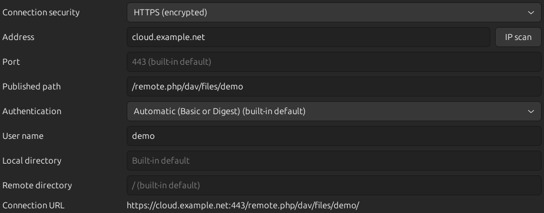

Select `WebDAV` as the connection type, then set the address, published path,
and authentication on the WebDAV tab. For `https://files.example.com/dav/team/`,
use `files.example.com` as the address and `/dav/team/` as the published path.
HTTPS is the default; HTTP is also available.

The read-only URL preview shows the resulting address. Enter the server name separately from its scheme, path and credentials.

The base path becomes `/` in the file browser.
You cannot navigate above it.
An initial remote directory of `/Documents` starts this example at `/dav/team/Documents`.

The shared SFTP/FTP/FTPS browser supports file and folder uploads and downloads,
folder creation, renaming, and deletion.
HTTPS certificate failures are either rejected or shown in the same confirmation overlay as FTPS,
according to the connection settings.

See [Using WebDAV](./docs/en/webdav.md) for settings and supported operations.

## Using SMB

Create a connection in the launcher, choose "SMB", and save the server address
and share name on the SMB tab. Enter only the share name, such as `share`, rather
than the complete `\\server\share` path. The default direct TCP port is 445.
The window asks for a username and password when it opens; passwords are not saved.

After connecting, use the same file transfer window to send and receive files
and manage folders. See [Using SMB](./docs/en/smb.md) for connection settings,
signing, encryption, and file operation limits.

## Managing Items in SFTP/FTP/FTPS, WebDAV, and SMB


SFTP/FTP/FTPS, WebDAV, and SMB use the same two-pane file browser.
Select an item in either the local or remote pane and right-click it to open the item menu.
Multiple items can be selected with `Ctrl`+click or a drag rectangle before opening the menu.

- `Rename` is available when exactly one file or directory is selected.
  Enter the new name in the window overlay.
  The item stays in its current directory, and an existing item is never overwritten.
- `Delete` is available for one or more selected files and directories.
  The confirmation overlay lists the effective deletion roots before anything is removed.
  A non-empty directory is deleted recursively.
  If both a directory and one of its descendants are selected,
  the descendant is covered by that directory and is not listed or processed twice.
- `Calculate Hash Values` is available when exactly one regular file is selected.
  For a local file, elder-terms calculates MD5, SHA-1, and SHA-256 internally.
  For a remote file over SFTP, the SSH server must permit command execution and make `md5sum`, `sha1sum`, and `sha256sum` available in the connected account's command search path.
  Calculation fails if these conditions are not met.
  Hash calculation for remote files over FTP or SMB is not supported;
  hash calculation in the local pane remains available.

On a Debian or Ubuntu SFTP server, the required commands are provided by the
[`coreutils` package for Debian](https://packages.debian.org/stable/coreutils)
or the
[`coreutils` package for Ubuntu](https://packages.ubuntu.com/search?keywords=coreutils&searchon=names&suite=all&section=all).
Install it on the server as follows:

```shell
sudo apt update
sudo apt install coreutils
```

Deletion is permanent and does not use the desktop trash.
In the local pane and over SFTP, deleting a symbolic link removes the link itself without
following its target.
The browser is temporarily covered by a progress overlay and is refreshed when the operation finishes.

## Local Startup Process


For a Local connection, "Startup command" on the Local tab selects the process that `elder-terms-terminal` starts in the terminal.
The setting takes effect the next time the connection is opened and is read-only in a running terminal.

When this field is empty, it inherits the global or built-in default.
The built-in default starts the user's shell specified by `SHELL`, with no additional arguments.
If `SHELL` is unset or empty, `/bin/sh` is used.

The value is split into an executable and arguments using shell-style quoting,
but the process is started directly without a shell.
Environment-variable expansion, globbing, redirection, and pipelines are therefore not performed.
Start a shell explicitly when those features are required, for example:

```ini
[local]
command_line=/bin/sh -lc 'exec tmux new-session -A -s elder-terms'
```

The same `[local]` setting can be saved as a global default or overridden for an individual connection.
Clearing "Startup command" restores inheritance.

## Selecting a Serial Device


For a serial connection, "Device identification" lets you choose one of three
ways to identify the device:

- Stable device identity: Uses a link created under `/dev/serial/by-id`.
  This tracks the same USB serial device even when it is moved to another USB port,
  so you should normally use this built-in default.
- Physical USB port: Uses a link created under `/dev/serial/by-path`.
  Use this when you always want to connect to the device plugged into the same physical
  port rather than to a particular USB serial device.
- Device path: Uses the current device node,
  such as `/dev/ttyUSB0` or `/dev/ttyACM0`.
  Its node number may change after the device is unplugged and reconnected.

"Device" is not a field for directly entering a path.
It lists the devices currently available under the selected identification method.
The list updates automatically when devices are plugged in or unplugged.
"Stable ID", "USB serial number", and "Current device node" are also shown for the selected device.

If the device is removed while connected, elder-terms retains the selected identity and reconnects when the same target reappears.
"Stable device identity" also stores the USB serial number as supplementary information.
This allows elder-terms to reconnect to the same device when it can uniquely identify one,
even if the `/dev/serial/by-id` link name changes.
If multiple candidates have the same USB serial number,
it waits for a connection instead of selecting the wrong device.

The values are stored in the INI file as follows.
`device_match_mode` is one of `path`, `by-id`, or `by-path`, and defaults to `by-id` when omitted.
`device_usb_serial` is supplementary information that is saved when the settings screen can obtain it.

```ini
[serial]
device_match_mode=by-id
device=/dev/serial/by-id/usb-Example_Serial_Device_1234-if00
device_usb_serial=1234
```

If a legacy INI file without `device_match_mode` stores a `device` such as `/dev/ttyUSB0`,
that path continues to be used.
When selecting the device again in the settings screen,
choose the identification method above that suits your use case.

## Monitoring Serial Connections


"Connection monitoring signal" detects a session disconnection when DCD, CTS, or DSR changes from high to low.
Select "Ignore (do not monitor)" if your USB serial adapter has no usable modem-line signal, 
or if its driver does not support polling modem lines and reports "Invalid argument".

With "Ignore (do not monitor)", elder-terms does not read modem-line state,
and that state cannot trigger "Close window when session ends".
The serial session remains available for sending and receiving.
Removing the device itself, or a read/write error,
is still treated as an actual disconnection as before.

The setting is stored in the INI file as follows:

```ini
[serial]
carrier_detect=ignore
```

## Character Encoding and Special Key Settings


"Character encoding" converts bytes received from the remote host to UTF-8 for
display, and converts entered text to the remote host's character encoding.
The default for every connection is `UTF-8`.

"Backspace code" selects the control code sent when you press Backspace.
"Auto" uses the terminal's standard behavior, normally sending DEL. "BS" sends ASCII BS (`0x08`), and "DEL" sends ASCII DEL (`0x7f`).
Change this setting if pressing Backspace on the remote host does not delete a character or displays something such as `^H`.
The Delete key is independent of this setting and normally sends `ESC [ 3 ~`.

"Normal" under "Cursor key mode" sends escape sequences according to the terminal mode selected by the remote application.
"TRS80" converts them to the one-byte control codes used by the TRS-80 Model 100/200,
IBM PC GW-BASIC/Quick BASIC, NEC PC-9800 series, and MSX: up is `0x1e`, down is `0x1f`, right is `0x1c`, and left is `0x1d`.
Use this mode when the remote host expects TRS-80-style cursor keys.

"Enter/Return code" selects the code sent when an unmodified Return key or numpad Enter confirms a normal newline.
"CR" sends `0x0d`, "LF" sends `0x0a`, and "CRLF" sends `0x0d 0x0a`.
"Auto" follows the terminal's newline mode and normally sends CR.
It does not replace Return/Enter modified by `Shift`, `Ctrl`, `Alt`, `Super`,
or similar keys, nor dedicated sequences generated in application keypad mode.
Key reports also follow the Kitty keyboard protocol when the remote application enables it.

The built-in defaults for each connection type are as follows:

| Connection type | Character encoding | Backspace code | Cursor key mode | Enter/Return code |
| :--- | :--- | :--- | :--- | :--- |
| Local terminal | UTF-8 | `Auto` | `Normal` | `Auto` |
| SSH | UTF-8 | `Auto` | `Normal` | `Auto` |
| TELNET | UTF-8 | `Auto` | `Normal` | `Auto` |
| Serial | UTF-8 | `BS` | `TRS80` | `CR` |

When editing the INI file directly, set `return_code` to one of `auto`, `cr`, `lf`, or `crlf`.

```ini
[terminal]
return_code=crlf
```

## Selecting and Copying Terminal Text


Drag with the left mouse button to select text. The selection uses a gray fill, with your configured color correction applied.
A normal selection follows text order; a block selection is a rectangle aligned to display columns.

| Action | Behavior |
| --- | --- |
| Left click | Clears the selection. A click alone does not copy a character |
| Left drag | Makes a normal selection |
| Double / triple click | Selects a word / line |
| Ctrl + left drag | Makes a block selection. Releasing Ctrl during the drag keeps its rectangular shape |
| Ctrl + click on a link | Opens the link when you release over the same link. Dragging instead makes a block selection |
| Right-click on a link, then “Copy Link” | Copies the link target to the clipboard |
| Escape | Cancels the selection and any active drag |
| Mouse wheel during a drag | Extends the selection through history while retaining its anchor. Ctrl does not zoom during this operation |
| Drag beyond the top or bottom edge | Scrolls through history automatically until you release the button |
| Ctrl + Shift + C, or “Copy” in the context menu | Copies the selected text to the clipboard |

When a terminal application uses mouse input, Shift + drag overrides it for normal selection, and Ctrl + drag for block selection.
Ctrl + Shift + drag also makes a block selection. Ctrl + wheel changes the text size as usual when no selection gesture is active.

Completing a selection also stores its text in the primary selection (PRIMARY), which you can paste with the middle mouse button.
This is separate from the regular clipboard (CLIPBOARD). Escape and left click clear the selection without erasing previously copied text.
During IME composition, Escape cancels composition first; the next Escape clears the selection.
If an IME consumes Escape before the widget receives it, the IME takes priority. [IBus key snooping](https://github.com/ibus/ibus/blob/1.5.29/client/gtk2/ibusimcontext.c#L643-L752)

Block selections can span more history than fits on screen. Copying preserves whole wide characters, combining sequences, and emoji.
By default, whitespace continuing to the right edge of each display row is removed within the selection. If text remains to the right of the selection, spaces before it are preserved.
Only empty cells and standalone ASCII spaces are removed. Full-width spaces, nonbreaking spaces (NBSP), and spaces with combining characters are preserved.
Each display row, including a soft-wrapped row, is separated by a newline. Rows emptied by trimming are retained, without an extra final newline. Bidirectional text is copied in logical order within each row.
Reducing the width to zero retains the anchor, so you can expand the rectangle again while holding the button.

To preserve spaces, disable "Trim trailing spaces in block copies" on the "Terminal" tab. In an INI file, use:

```ini
[terminal]
block_copy_trim_trailing_spaces=false
```

An inherited setting uses its parent's value. When no value is specified, the built-in default is `true`.
Changes also apply while the terminal is running, so you can copy the same selection again with the new policy. Normal selection text and the displayed block selection are unchanged.
The setting applies to both PRIMARY and CLIPBOARD. A valid selection with positive width that becomes empty after trimming replaces the clipboard contents with an empty string.

“Copy” is disabled for a zero-width rectangle or a selection invalidated by text changes, and existing clipboard contents are preserved.
Exceeding a selection or copy limit also preserves the previous result instead of publishing partial text; select a smaller range and try again.
Focus changes, menus, and disconnection end an active drag. Changing focus alone does not clear a completed selection.

## Newlines When Sending and Pasting Text


"Follow Enter/Return code for text send" applies to sending text files,
macro output, and all text pasted from the clipboard or primary selection through a keyboard shortcut or the context menu.
The built-in default is enabled.

When enabled, CRLF, a lone CR, and a lone LF in the input are first read as a single logical newline,
and each newline is then sent according to the "Enter/Return code" setting.
With "Auto", text sending uses CR. When a file is read in multiple chunks,
this processing also treats a CRLF split across a chunk boundary as one newline.

When disabled, the original sequence of CR, LF, and CRLF in the input is not changed.
For a TELNET connection, the CR framing and IAC escaping required by TELNET NVT are still applied afterward.

Pasting does not add Bracketed Paste control sequences.
It uses the same send-rate control, character encoding conversion, and newline processing as sending a text file.
Specify this setting in the INI file as follows:

```ini
[transfer]
text_send_follow_return_code=true
```

## Sending BREAK


When a key combination is assigned to "Send BREAK shortcut", one BREAK is sent for each physical key press.
Automatic repeats caused by holding the key are suppressed.
Leaving the field blank disables the shortcut.
The zoom-in, zoom-out, and BREAK shortcuts cannot use the same key combination.

You can perform the same action by right-clicking the terminal and selecting "Send BREAK".
The menu item is disabled while disconnected, during a transfer, and in a local terminal.
Progress and the result appear in the status bar, and the SD indicator lights while BREAK is sent.

Each connection type sends the following:

| Connection type | BREAK behavior |
| :--- | :--- |
| Local terminal | Not supported |
| TELNET | Sends `IAC BRK` |
| Serial | Asserts the line's BREAK state for 500 milliseconds, then clears it |
| SSH | Sends an SSH BREAK request for 500 milliseconds |

When editing the INI file directly, specify the shortcut as follows:

```ini
[terminal]
send_break_key=F12
```

## Notes on Character Encodings

Character encodings accept names defined by iconv, but be aware that several
definitions can have similar yet different names.

For example, in Japanese environments,
Shift JIS is commonly used for BBS serial communication and has the obvious iconv name `SHIFT_JIS`.
In practice, however, the extended `CP932` conventionally used by the NEC PC-9800 series is usually the better choice.

If you use a different encoding, receiving extended or altered characters can produce garbled text.

## Configuring the Scrollback Buffer


"Scrollback lines" on the "Terminal" tab sets the normal-screen history, from 1,000 to 100,000 lines.
The built-in default is 10,000 lines.

When editing the INI file directly, specify the value as follows:

```ini
[terminal]
scrollback_lines=20000
```

## Configuring the BEL Sound


"BEL sound" on the "Terminal" tab selects the sound played when the terminal receives BEL.
The built-in `default` value uses the desktop environment's beep.

For a custom sound, enter the absolute path of an existing file or use the "Select file" button to choose it.
Supported formats are Ogg Vorbis (`.oga`, with the legacy `.ogg` extension also accepted) and WAV (PCM).

```ini
[terminal]
bell_sound=/home/user/.local/share/sounds/terminal-bell.oga
```

## Compact Mode


Choosing "Enabled" for "Compact mode" on a connection's General tab hides the
bottom status bar and puts the activity indicators beside the title. The
dropdown can also use the global default or explicitly disable compact mode.
It works for terminal and FTP, FTPS, SFTP, and WebDAV file browser windows. The
built-in default is off.
Enable window side borders on the "General" tab to show borders of the chosen
width on both sides of the window. Compact mode also shows a bottom border
of the same width. In INI files, use `show_border` and `border_width` in
`[general]` to set visibility and width in pixels. Widths from 1 to 1000px are
accepted, with a default of 4px. Borders are disabled by default.

```ini
[general]
compact_mode=true
```

## Configuring Indicator Color


On the "General" tab, set "Active indicator color" and "Inactive indicator color" independently.
Each applies to CONN, LOG, SD, RD, and all serial line indicators.
SFTP, FTP/FTPS, WebDAV, and SMB windows use the same settings for their CONN, SD, and RD indicators.
Applying colors preserves their current states, blinking, and latched activity.
The lamps retain their shading and highlights; choose different colors if you want to distinguish active from inactive lamps.

Connection defaults can provide a shared color, and each connection can override it.
"Default color" restores green for active lamps and gray for inactive lamps, independently of the other color.
Configuring only the active color leaves the inactive color gray unless a global inactive color is inherited.
Choose the inherited option to follow connection defaults. Save to keep both colors after restarting.

```ini
[general]
indicator_color=#3584E4
indicator_off_color=#808080
```

The value must be `default` or an RGB color in `#RRGGBB` form.
Invalid values produce a warning and use the next valid inherited or built-in value.

## Configuring Text Size


"Text size (DIP)" on the "Terminal appearance" tab sets the text size. A DIP is based on 1/96 inch; the default is 12 DIP.
You can also use `Ctrl`+`=`, `Ctrl`+`-`, or the mouse wheel while holding `Ctrl`. The committed size is saved in the connection settings.
Zooming preserves the row and column counts reported to the connection. Resizing the window manually reports the new counts.

```ini
[terminal]
font_size_dip=14.5
```

## Configuring the Cursor and Background


Cursor, background, and color correction options are on the "Terminal appearance" tab.
They can inherit connection defaults or be overridden for each connection.
"Apply" changes the current terminal; "Save" also keeps the settings for its next start.
"Cancel" discards edits made since the last Apply. Previously applied changes remain active.
If image loading or saving fails, the error is shown and the previously applied appearance is retained.

The left side of the settings footer shows the active renderer and display connection, such as
`OpenGL / X11` or `Cairo / Wayland`. It also reflects a fallback from OpenGL to Cairo.
Action buttons remain on the right.
Scrollbars use colors that remain distinguishable from their background.

Choose "Full box", "Vertical box", or "Underline box" for the cursor.
The cursor is filled while the terminal has input focus and outlined in the same shape when focus leaves.
The vertical width and underline height are based on 4 DIP, with a 1 DIP outline, scaled with the display.
Blinking is a separate option. An unfocused outline stays steady.
Remote cursor hiding and composition handling remain effective.

Background modes are "Opaque", "Transparent", and "Frosted glass".
Lower "Background opacity (%)" to reveal more of the background image or desktop.
"Background tint" and "Tint opacity (%)" add a color over the image and desktop.
Opacity ranges from 0 to 100%; a 0% tint adds no visible color. Text itself stays opaque.

Choose a local PNG or JPEG file, or enter its absolute path.
Image placement can preserve the aspect ratio while covering the viewport, contain the whole image, or stretch both axes.
The image stays fixed within the terminal viewport while text scrolls.
Image opacity and transparent PNG pixels let the image combine with desktop transparency.
Images also work in opaque mode; lower the background opacity if the image is difficult to see.
"Clear image" explicitly selects no image for this connection. "Inherit" follows connection defaults.
The file is neither moved nor embedded, so keep it available at the same path for future starts.
Both the file and decoded RGBA pixels are limited to 64 MiB, with a maximum of 16384 pixels per edge.

Desktop transparency requires a compositor that combines the windows on your desktop.
Frosted glass requests a compositor effect that blurs the desktop behind the terminal; text and background images remain sharp.
The settings panel reports the actual state. Unavailable blur falls back to transparency, and unavailable transparency falls back to an opaque background.
"Frosted glass requested" means the request was accepted; compositor effect settings still determine whether the blur appears.
See [boxrig's background effects](https://github.com/kekyo/boxrig/blob/0.10.0/docs/en/background.md) for platform requirements.

## Improving Text Color Visibility


Select "Improve visibility (Oklch)" under "Color filter" on the "Terminal appearance" tab to improve contrast for text and markers that are difficult to distinguish from their background. All hues, including red, green, and blue, and neutral gray, black, and white are included.
Oklch represents color using separate lightness, chroma, and hue components. This correction preserves hue and primarily adjusts lightness.
Colors with a contrast ratio of at least 4.5:1 against the background are retained; only colors below that threshold are adjusted. Chroma is reduced when necessary to fit the displayable color range, and neutral colors remain neutral. The default is "No correction".
Oklch alone leaves background colors unchanged. Background images, communication, copied text, and logs are also unchanged.
Correction uses the cell's background color as its reference; it does not adapt to individual pixels in a background image or transparent desktop.

```ini
[terminal]
cursor_shape=bar
cursor_blink=false
background_mode=blur
background_opacity=40
background_tint_color=#203040
background_tint_opacity=20
background_image=/home/user/Pictures/terminal.png
background_image_opacity=70
background_image_fit=cover
color_filter=oklch
```

## Reversing Background and Text Polarity


Choose one of five modes under "Color filter" on the "Terminal appearance" tab. They turn white text on black into black text on white and continuously transform nearby colors as well. Use "Compare colors" to choose a mode that suits your usual palette.

A palette maps color numbers to RGB values. CAM16, used in D, is a model of color appearance under different viewing conditions.

| Choice | Configuration value | Behavior |
|---|---|---|
| Reverse lightness (A) | `reverse-lightness` | Reflects perceptual lightness while preserving hue. Bright yellow and green become nearly black |
| Reverse contrast (B) | `reverse-contrast` | Approximately preserves the original contrast ratios, including poorly readable combinations |
| Reverse text and background (C) | `reverse-roles` | Reverses backgrounds and adjusts chromatic text for readability while retaining hue and tone differences |
| Reverse appearance (D, CAM16) | `reverse-cam16` | Compensates for changes in color appearance under assumed dark-to-light viewing conditions |
| Reverse optimized palette (E) | `reverse-palette` | Adjusts color separation across the terminal palette and smoothly extends the result to directly specified RGB colors |

C, D, and E adjust text, underlines, and markers to at least 4.5:1 contrast against the transformed solid background. D uses fixed viewing assumptions; it does not measure room lighting. E follows terminal palette changes and does not change colors merely because you scroll. Unused palette entries can also influence E's adjustments.

E's preview uses the standard palette. The actual display can differ when the connected application changes that palette.

Only one color filter can be selected, so reversal and the existing Oklch filter are mutually exclusive. Color discrimination assistance can be combined with every mode and is applied before reversal. Logical terminal colors, text, communication, copied text, and logs remain unchanged.

Background images, the desktop behind transparent windows, Kitty images, and intrinsic color-emoji pixels are not reversed. Check the actual display when combining reversal with transparency or images. See [boxrig's supported filtering scope](https://github.com/kekyo/boxrig/blob/0.10.0/docs/en/color-filters.md).

```ini
[terminal]
color_filter=reverse-roles
```

Use `none` to disable the filter or `oklch` for the existing visibility correction. Global and per-connection settings, inheritance, Apply, Save, and Cancel work as with other display preferences.

## Helping Distinguish Colors


Select Protan (P), Deutan (D), or Tritan (T) under "Color discrimination" on the "Terminal appearance" tab.
Recoloring represents information from difficult-to-distinguish colors using differences in other colors.
The protan and deutan profiles primarily target red-green distinctions; the tritan profile primarily targets blue-yellow distinctions. The default is "No correction".

Open "Compare colors" and compare the `- removed` and `+ added` diff samples, logs, and text on colored backgrounds.
ANSI 16 colors are the terminal's basic palette, 256 colors are an extended indexed palette, and TrueColor specifies RGB values directly.
The preview includes all three, with dark, light, and connection backgrounds.
Choose the setting that makes your usual content easier to distinguish, using the samples as well as the profile names.

"Correction strength" ranges from 0 to 100; 0 disables recoloring. The default strength when a profile is selected is 100.
This value does not measure the severity of a color-vision difference.
Some other colors can become more similar after correction. Reduce the strength or try another profile if this happens.
Numerical tests and visual checks have been completed; reading evaluations with people who have color-vision differences have not yet been conducted.

Recoloring applies to text, application-specified cell backgrounds, underlines, the cursor, and markers such as search and selection outlines.
It preserves the connection's default background.
Combine it with "Improve visibility (Oklch)" to adjust text and marker contrast against the recolored background.
Oklch remains independent when recoloring strength is zero.
Save preferences globally or per connection; clear an entry or select inheritance to restore the parent setting.
Use Apply or Save to apply previewed changes to the terminal. Cancel discards the current edits.

Correction affects display only. Communication, logical terminal colors, copied text, and logs remain unchanged.
Background images, the desktop behind transparent windows, Kitty images, and intrinsic color-emoji pixels are excluded.
See [boxrig's display color filters](https://github.com/kekyo/boxrig/blob/0.10.0/docs/en/color-filters.md) for the supported scope.

```ini
[terminal]
color_vision=deutan
color_vision_strength=60
color_filter=oklch
```

Accepted `color_vision` values are `none`, `protan`, `deutan`, and `tritan`.

## Ambiguous Character Width

Characters such as "①" can occupy one or two terminal columns. These are called ambiguous-width characters.
On the "Terminal" tab, choose "1 column", "2 columns", or "Font dependent" for "Ambiguous character width". The default is "1 column".
This setting controls the number of columns used for text placement, separately from font size.

To use two columns, select that option and click "Save", or add the following to the INI file:

```ini
[terminal]
ambiguous_width=wide
```

`narrow` means one column, `wide` means two, and `font` means font dependent. Omitting the key inherits the parent's value, falling back to one column if no parent specifies it. Explicit two-column or font-dependent settings are preserved.
Invalid values produce a warning and use a valid inherited value or the built-in default.

Font dependent divides the actual font advance by the cell width and rounds up to a whole number of columns.
The advance is the distance to the next character, including spacing within the font; fallback fonts are measured too.
A character with a 2.1-cell advance occupies three columns and keeps its natural width, centered with a 0.45-cell margin on each side.
The next character starts three columns later, and centering adds no spaces to copied text.
The block cursor covers all columns occupied by the character.

Changes to this width policy apply to newly opened terminals. Save the setting, then reopen the terminal.
"Apply" and reconnection in the same window retain the existing terminal's width policy.
Changing the font itself in a font-dependent terminal remeasures and reflows its text and history while keeping the connection.

A font's width cannot determine the column count expected by the remote application.
If input positions or borders become misaligned, select one or two columns to match that application.

## Configuring Font Families


Use the "Terminal appearance" tab to edit an ordered list of font families.
Add or remove rows, and use the up/down buttons to change their priority.
Each row accepts a family name or opens a font chooser.

The first family has the highest priority.
Later families supply characters missing from earlier ones, such as Japanese characters missing from a Latin
font.
Uninstalled family names may be saved and are skipped during fallback.

The drop-down applies to the whole list.
"Inherited from: global settings" or "Inherited from: app defaults" follows the inherited settings,
including later global changes.
"Use app defaults" fixes this connection to `Noto Sans Mono`, then `Monospace`, regardless of global settings.
"Specify for this connection" sets its own list.
The global editor offers "App defaults" and "Specify fonts".
Connection overrides replace the global list rather than extending it.
Apply changes the current settings, Save persists them, and Cancel discards changes made since the last apply.

These settings save only the font families; they do not include font size, weight, or style.
Font size follows "Text size (DIP)", `Ctrl`+`=`, `Ctrl`+`-`, or the mouse wheel while holding `Ctrl`.

When editing the INI file directly, specify the values as follows:

```ini
[terminal]
font_families=DejaVu Sans Mono;Noto Sans Mono CJK JP;Monospace;
```

Omit the key to inherit, or use `font_families=` to explicitly restore the built-in list.
Names are trimmed and must be non-empty and unique, with no commas or control characters.
Semicolons and backslashes inside a name use the [GLib KeyFile escaping rules](https://docs.gtk.org/glib/struct.KeyFile.html)
(`\;` and `\\`). Invalid lists produce a warning and use the next valid inherited or built-in value.

## Configuring Hotkeys


Hotkeys work only while the elder-terms launcher is running.
In environments with a system tray, you can keep the launcher in the tray by opening the launcher's application menu,
selecting "Application settings", and setting "Startup mode" to "System tray only" or "System tray and main window".

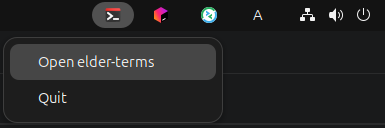

The tray's "Connections" submenu lists every saved connection with its icon and
name. Connections with a hotkey also show a combination such as `Ctrl+Alt+X`.
Select an entry to open it, regardless of whether it has a hotkey or registration
succeeded. This also works while the launcher is hidden. Menu actions use saved
settings; unsaved edits in the launcher are not passed to the new connection.
Adding or deleting connections and saving changes to names, icons, or hotkeys
updates the menu.
The "Open windows" submenu lists terminal and file transfer windows launched by
this launcher that are still running. Selecting one requests that window to be
shown; the desktop environment controls whether it comes to the foreground.
Windows started directly from a command, SFTP windows opened from an SSH terminal,
and windows from before a launcher restart are not listed. Without a session bus, the
list remains visible but its window actions are unavailable.

The deb package and Meson installation install an XDG autostart entry that starts elder-terms when you log in to the desktop.
Whether autostart shows the launcher and keeps it in the system tray follows "Startup mode" under "Application settings",
so hotkeys are available immediately after login.

To disable autostart, use your desktop environment's startup-application settings.

> You can also override the system-wide autostart entry by placing a file with the same name,
> `net.kekyo.elder-terms.desktop`, in your `~/.config/autostart` directory and setting `Hidden=true`.

Assigning a key combination to "Open connection shortcut" for a connection
lets you open it directly with that hotkey even while the launcher is hidden.
"Open application shortcut" under "Application settings" shows the launcher; its default is `Ctrl+Alt+T`.

### Hotkeys on Wayland

On Wayland, the launcher first tries the XDG Global Shortcuts portal. If it cannot register the configured hotkeys,
it detects a Sway or labwc session, saves the hotkeys to the user's compositor configuration, and requests a reload.

Because [Global Shortcuts has been officially supported since GNOME 48](https://release.gnome.org/48/developers/#global-shortcuts),
portal registration is unavailable in Wayland sessions on GNOME 47 or earlier.
Distributions using the standard GNOME desktop are supported starting with [Ubuntu 25.04](https://discourse.ubuntu.com/t/ubuntu-25-04-plucky-puffin-released/59303) and [Debian 13](https://www.debian.org/News/2025/20250809),
which adopted GNOME 48 or later.

The default GNOME Wayland sessions on Ubuntu 24.10 or earlier and Debian 12 or earlier have no automatic registration route through this portal or the Sway/labwc fallback.
Automatic configuration in other Wayland environments also requires the Global Shortcuts portal or the corresponding compositor settings.
In these environments, you may need to enable custom hotkeys (below).

### Manually Enabling Hotkeys

Saving application or connection hotkeys immediately updates the running launcher's registration when the desktop accepts the new bindings.
The Global Shortcuts portal may ask you to approve the changed bindings.
On Sway and labwc, the launcher also synchronizes its compositor bindings and requests a reload when direct registration is unavailable.
Use `etctl setup` to check registration or retry compositor synchronization after a failure.

> Normally, when you launch the elder-terms launcher, it automatically performs a process internally that is equivalent to `etctl setup`.
> Therefore, you do not need to run this command manually,
> but if you encounter issues with hotkeys, running this command may provide more detailed results.

The command checks the running launcher's X11 or Global Shortcuts portal registration result. If it starts the launcher,
the portal may display an approval screen. When registration fails in a Sway or labwc Wayland session,
it saves the current hotkeys to the user's configuration file and requests the compositor to reload them.

Since hotkey hooking is performed within the user session, do not run this command with `sudo`:

```sh
etctl setup
```

The command starts the launcher if needed.
Manually configured desktop shortcuts are managed in your desktop settings and are not changed by saving elder-terms settings.

Automatic setup and repeated command runs replace only the bindings managed by elder-terms. When there is no user compositor configuration,
they preserve the system configuration they find.

- For labwc, this copies the current system configuration into the user file, so later system configuration updates are not inherited automatically.
  See [labwc configuration search and reload rules](https://labwc.github.io/labwc-config.5.html).
- Sway sessions launched with a custom config path may require adding the generated bindings to that config for persistence.
  See the [Sway configuration reference](https://github.com/swaywm/sway/blob/master/sway/sway.5.scd).

Run `etctl unsetup` to remove hotkeys saved by the launcher or `etctl setup` in user Sway or labwc configuration.

It leaves other shortcuts and the configuration files in place.
The command works without a running launcher or graphical session.
In an active Sway or labwc session, it also reloads the compositor; otherwise, reload the compositor or log in again to apply the change.
X11 and Global Shortcuts portal registrations belong to the running launcher and are unaffected by this command.
If configured hotkeys remain enabled, the launcher may recreate Sway or labwc bindings the next time it starts.

```sh
etctl unsetup
```

### Custom Enabling Hotkeys

Below the version in the About panel, you can check the detected hotkey transport and whether `etctl` requests are available.
The transport label describes X11 or portal detection, so it may show "Unavailable" even when Sway or labwc bindings are active.

X11 sessions register hotkeys directly with X11 and do not require D-Bus.
On Wayland, the launcher uses the Global Shortcuts portal first, then supported Sway or labwc configuration when necessary.
If `etctl setup` does not support your desktop, assign a desktop shortcut to one of these commands:

```sh
# Open elder-terms launcher window
etctl open-application

# open 'Local Terminal' connection window
etctl open-connection 'Local Terminal'
```

Replace `Local Terminal` with the exact saved connection name displayed in the launcher, without the `.ini` extension.
Quote names containing spaces or shell characters.

The launcher must already be running. Use its existing login autostart entry;
"Background only" is useful without a system tray.

Both processes must run as the same user with the same `XDG_RUNTIME_DIR`,
pointing to an existing private runtime directory.
`etctl` requires neither a display connection nor D-Bus.

It returns 0 when the launcher accepts a request, 1 for a communication or request error,
and 2 for invalid arguments.
Acceptance does not mean the terminal's connection to a remote host has succeeded.

For [labwc](https://labwc.github.io/labwc-actions.5.html), add this binding inside the existing `<keyboard>` section of `~/.config/labwc/rc.xml`,
then reload your configuration with `labwc --reconfigure`:

```xml
<keybind key="C-A-T">
  <action name="Execute" command="etctl open-application" />
</keybind>
```

For [Sway](https://github.com/swaywm/sway/blob/master/sway/sway.5.scd),
add this to your existing configuration and reload it:

```text
bindsym Ctrl+Mod1+t exec etctl open-application
```

For [Hyprland's Lua configuration](https://wiki.hypr.land/Configuring/Basics/Binds/):

```lua
hl.bind("CTRL + ALT + T", hl.dsp.exec_cmd("etctl open-application"))
```

For [Hyprland 0.54 and earlier using hyprlang](https://wiki.hypr.land/0.54.0/Configuring/Binds/):

```text
bind = CTRL ALT, T, exec, etctl open-application
```

Replace an existing binding for the same key combination if necessary.
The launcher and `etctl setup` modify the user's Sway or labwc configuration. Avoid adding the same binding again when configuring shortcuts manually.

Other desktops can use the same commands through their shortcut settings.
If your compositor provides an [`XDG_ACTIVATION_TOKEN`](https://gitlab.freedesktop.org/wayland/wayland-protocols/-/blob/main/staging/xdg-activation/xdg-activation-v1.xml),
the command forwards it for window activation; focus remains subject to your compositor's policy.

## Configuring the Terminal Type


The terminal type is a name that tells the remote host which kind of terminal
elder-terms emulates. This value is automatically reported during terminal-type
negotiation for TELNET and when allocating a pseudo-terminal for SSH.

Shells and applications that use `curses` on the remote host consult the
corresponding `terminfo` entry to select control sequences for colors, cursor
movement, function keys, and other features. You can normally leave the
default unchanged. If the remote host does not support that terminal type,
specify a value installed on the host, such as `xterm`.

The default for TELNET and SSH is `xterm-256color`. Use global or connection settings to select a terminal type supported by the remote host.

## Configuring the Display Language


"Display language" under the launcher's "Application settings" lets you select
the system default, English, Arabic, Spanish, French, Hindi, Japanese, Korean,
Portuguese, Russian, or Simplified Chinese.

The display language is loaded when elder-terms starts, so you must restart
elder-terms after saving a change. Select "Restart now" in the dialog shown
when you save, or restart it manually later. Terminal and file transfer windows
that are already open do not change language immediately either.

## Checking the Running Version


Open the application menu in either the launcher or a terminal window and
select "About elder-terms". Both entries open the same launcher-owned dialog,
whose "About" page shows the version embedded in the running build or deb
package.

> Note: The elder-terms project owner is a native Japanese speaker who
> understands Japanese and English but cannot read any of the other languages.
> Consequently, the multilingual text included in elder-terms relies entirely
> on machine translation. If you find an undesirable translation, please send
> a pull request.

## Configuring Logging


Enabling "Enable logging" records content received from the remote host in a
file. "Log directory" is the base destination directory and defaults to
`${documents}/logs/`. "File name format" is a relative path under that
directory and defaults to `${YYYYMMDD}_${hhmmss}_${fff}.txt`.

Both fields support the following placeholders:

- `${documents}`, `${downloads}`, `${home}`: The user's Documents, Downloads,
  and home directories, respectively
- `${name}`: The connection name
- `YYYY`, `MM`, `DD`: The year, month, and day in the local time when logging
  started
- `hh`, `mm`, `ss`, `fff`: The hour, minute, second, and millisecond at the same
  time

Date and time components can be combined in one placeholder, such as
`${YYYYMMDD}` or `${YYYY-MM-DD}`. Write a literal `$` as `$$`. "File name
format" may contain `/`, and the required directories are created
automatically. For example, setting "Log directory" to
`${documents}/elder-terms` and "File name format" to
`${name}/${YYYY}/${MM}/${YYYYMMDD}_${hhmmss}.txt` separates logs by connection,
year, and month.

"Log content" selects the storage format and character encoding. "Raw bytes
(before character conversion)" stores bytes received from the remote host
without conversion, preserving the encoding configured for the connection.
"UTF-8 text (after character conversion)" stores the text as UTF-8 after its
character encoding has been converted for display.

## Configuring Macros


Macros (automatic macros) monitor text received from the remote host with
regular expressions. When a match is found, they either send text to the host
or run a specified command. They are available for local terminal, TELNET,
serial, and SSH connections, but cannot be defined for file transfer connections
or Connection defaults.

In text to send, commands, and command arguments, `${0}` refers to the entire
regular-expression match, `${1}` and `${2}` refer to numbered captures, and
`${name}` refers to a named capture. Write a literal `$` as `$$`.

Macro rules are evaluated from top to bottom. Even if multiple regular
expressions match the same received line, only the first matching rule runs.
Use "Move up" and "Move down" to place higher-priority rules nearer the top.
When editing the INI file directly, the order in which `[macro.<rule-id>]`
sections appear determines their priority.

The following examples show the format used when editing a connection's INI
file directly. You can configure the same values on the "Macro" tab in the
settings dialog.

This rule automatically sends Enter when the remote host displays
`Press ENTER to continue`:

```ini
[macro.continue]
regex=^Press ENTER to continue$
send=\r\n
```

This rule extracts a token from text such as `CHALLENGE TOKEN` and responds
with `RESPONSE TOKEN` followed by a newline:

```ini
[macro.challenge]
regex=^CHALLENGE (?<token>[A-Z]+)$
send=RESPONSE ${token}\r\n
```

When a line such as `ERROR: Connection failed` is received, this rule passes
the message portion to the `logger` command and records it in the system log.
`arguments` is semicolon-delimited, and each item becomes a separate command
argument.

```ini
[macro.log-error]
regex=^ERROR: (.+)$
command=/usr/bin/logger
arguments=-t;elder-terms;${1};
```

Commands are launched directly without a shell, so shell syntax such as pipes
and redirections is not interpreted. Specify each required value as a separate
item in `arguments`.

## Configuring Terminal Link Actions


Hold `Ctrl` and left-click a recognized link to run its configured external
command. A rule can inspect either the target of an OSC 8 escape sequence or a
matching substring in visible terminal text. Rules are evaluated in their
displayed order, and only the first matching rule is run.

Right-click a recognized link and choose "Copy Link" to copy its target to the
clipboard. For visible-text links, this copies the entire matched text. For
OSC 8 links, it copies the original target URI. If terminal output changes while
the menu is open, the target from when you opened the menu is still copied.

Select a connection in the launcher and open its "Links" tab to enable or
disable link actions, add and remove rules, change their order, edit command
arguments, and restore the built-in defaults. The same tab is available from
the settings dialog in a running terminal. Link settings are saved separately
for each connection.

When a connection defines no link rules, the built-in rules recognize:

- HTTP and HTTPS URLs in OSC 8 targets and visible terminal text, opened with
  `xdg-open` in the desktop's default application.
- OSC 8 targets in `vscode://file/absolute/path:line` and
  `vscode://file/absolute/path:line:column` form, opened with `code
  --reuse-window --goto`.

URI escapes in captures, such as `%20`, can be decoded before a value is
passed to the command. "Restore defaults" removes the connection's explicit
link settings, so later built-in default changes also take effect.

Each rule selects one recognition source:

- "OSC 8 target" applies the regular expression to the complete raw target.
- "Visible terminal text" finds a matching substring under the pointer. The
  expression must not match an empty string.

Link rules and received-text macros use [boxrig pattern syntax](https://github.com/kekyo/boxrig/blob/0.10.0/docs/en/regex.md).
Character classes, groups, alternatives, repetition, and numbered or named captures are supported. Backreferences, lookahead, lookbehind, and expressions matching an empty string are not supported.
`\d`, `\s`, and `\w` cover ASCII. Use Unicode general categories such as `\p{L}` for letters and `\p{Nd}` for decimal digits.
`.` also matches newlines, and `^` and `$` anchor the complete input. Matching is case-sensitive and chooses the longest match at the same starting position.
A complete match cannot split a visible character composed of multiple Unicode characters. Use an expression such as `[\p{L}\p{M}]+` to include combining marks.

The command is a fixed executable name or path. It is launched directly without a shell,
so pipes, redirections, and other shell syntax are not interpreted. Capture
templates are expanded only in arguments and in the optional validation path.

Path validation can be set to "Existing local file or directory". In that
mode, the expanded path must be absolute and must name an existing regular
file or directory on the computer running elder-terms; otherwise the command
is not run. Relative paths are rejected because terminal display text does not
provide a reliable local working directory, particularly for remote sessions.

The same settings can be edited directly in a connection's INI file. This
example recognizes an absolute local source path followed by a line number:

```ini
[hyperlink]
enabled=true

[hyperlink.local-source]
source=terminal-text
regex=(?<path>/[^\s:]+):(?<line>[1-9][0-9]*)
command=code
arguments=--reuse-window;--goto;${path}:${line};
path_validation=existing-local-path
path=${path}
```

`source` is `osc8` or `terminal-text` and defaults to `osc8` when omitted.
`path_validation` is `none` or `existing-local-path`; `path` is required for
the latter. `[hyperlink.<rule-id>]` sections are evaluated in file order. Rule
IDs may contain letters, digits, `-`, and `_`.

`arguments` is semicolon-delimited, and each item becomes a separate command
argument. `${0}` refers to the entire match, `${1}` and `${2}` to numbered
captures, and `${name}` to a named capture. `${path|uri-decode}` decodes URI
escapes in that capture. Write a literal `$` as `$$`.

Defining at least one `[hyperlink.<rule-id>]` section replaces all built-in
rules for that connection. When no rule section is defined, the built-in rules
apply. To disable all link actions, set `[hyperlink]` `enabled=false` in the
connection file. Link sections in `global.ini` are ignored. A temporary launch
profile similarly uses its own rules, or the built-in rules when it defines
none.

OSC 8 targets and visible text may be supplied by a remote host. Restrict each
regular expression to the formats you intend to accept. Invalid rules,
undefined captures, invalid URI escapes, and failed path validation do not run
the command.

## INI File Locations

Configuration files are stored under the XDG user configuration directory. In
a typical environment where `XDG_CONFIG_HOME` is not set, their locations are:

- Global settings (application settings and connection defaults):
  `~/.config/elder-terms/global.ini`
- Connection settings:
  `~/.config/elder-terms/connections/<connection-name>.ini`

When `XDG_CONFIG_HOME` is set, its value replaces `~/.config` in the paths
above. Connection settings inherit the connection defaults in the global file,
and values changed for an individual connection take precedence over them.

---

## Building from Source

WebDAV requires libcurl 7.88.1 or newer with HTTP/HTTPS and asynchronous DNS, plus [libxml2](https://gnome.pages.gitlab.gnome.org/libxml2/) 2.9.14 or newer.

The FTP client requires [libcurl](https://curl.se/libcurl/) 7.88.1 or newer
with FTP and asynchronous DNS support. FTPS additionally requires a
[TLS-enabled libcurl build](https://curl.se/libcurl/c/libcurl-tutorial.html).
The Debian/Ubuntu packages use OpenSSL-backed libcurl and depend on
`ca-certificates` for the default trust store. Source builds also need OpenSSL
headers and libraries. Certificate confirmation must use the same OpenSSL
version as libcurl; the application checks this before connecting.

To build on Ubuntu or Debian, install a C++20-capable compiler, Meson, Ninja,
gettext, and the development packages for the libraries used by elder-terms:

Rendering requires GTK3 3.24 or later, Pango 1.50 or later, Cairo 1.18 or later, IBus 1.5.29 or later, and Wayland client 1.22 or later. See the [boxrig build requirements](https://github.com/kekyo/boxrig/blob/0.10.0/docs/en/building.md).

```bash
sudo apt update
sudo apt install build-essential git meson ninja-build pkg-config gettext imagemagick libgdk-pixbuf2.0-bin librsvg2-common \
  libglib2.0-dev libgtk-3-dev libgdk-pixbuf-2.0-dev libcanberra-dev libx11-dev libxfixes-dev \
  libxkbcommon-dev liburing-dev libudev-dev libsystemd-dev libssh-dev libcurl4-openssl-dev \
  libcairo2-dev libpango1.0-dev libfontconfig1-dev libepoxy-dev libibus-1.0-dev \
  libwayland-dev libgl-dev libegl-dev libssl-dev libxml2-dev ca-certificates xdg-utils
```

Node.js 22.18 or later is also required for
[direct TypeScript execution](https://nodejs.org/docs/latest-v22.x/api/typescript.html).

Material Icons are rendered to PNG using `gdk-pixbuf-thumbnailer` with SVG support
and ImageMagick's `convert` during the build.
The generated images are included in the distribution; these generation tools
are not needed at runtime.

Check the installed Node.js version when using your distribution's package:

```bash
sudo apt install nodejs
node --version
```

If the distribution's Node.js is too old, use an
[official Node.js distribution](https://nodejs.org/en/download) or a version
manager of your choice, such as [nvm](https://github.com/nvm-sh/nvm).

> You may find it unusual to use Node.js in a GTK project. It is required
> because the GTK UI tests use
> [gestament](https://github.com/kekyo/gestament/).

When cloning the source for the first time, include the submodules to obtain
the [cardio](https://github.com/kekyo/cardio/),
[libxyzm](https://github.com/kekyo/libxyzm/), and [boxrig](https://github.com/kekyo/boxrig/) dependencies:

```bash
git clone --recurse-submodules https://github.com/kekyo/elder-terms.git
```

If you have already cloned the repository, initialize and update its
submodules with:

```bash
git submodule update --init --recursive
```

Install the npm dependencies and build all workspaces:

```bash
npm ci
npm run build
```

Run the built launcher from the repository root with the following command.
The launcher automatically detects the terminal and shared SFTP/FTP file
transfer executables in the same build directory.

```bash
./.build/elder-terms/elder-terms
```

Alternatively:

```bash
npm run dev
```

To run the tests (which take a very long time because they include UI tests):

```bash
npm run test
```

## Building deb Packages

The package-building scripts combine the launcher, terminal, and shared
SFTP/FTP file transfer executables; dedicated shared library and UI data;
translation catalogs; desktop and XDG autostart entries; icons;
documentation; and license notices into a single `elder-terms` deb package.

The following package combinations are supported:

| Distribution | Release | Architectures |
| :--- | :--- | :--- |
| Debian | trixie | amd64, i386, arm64, armhf, riscv64 |
| Ubuntu | 24.04 | amd64, arm64 |
| Ubuntu | 26.04 | amd64, arm64 |

Debian bookworm is excluded because its standard [Cairo 1.16](https://packages.debian.org/bookworm/libcairo2-dev) and [IBus 1.5.27](https://packages.debian.org/bookworm/libibus-1.0-dev) are below the rendering library's required versions.

The host requires Podman, binfmt/QEMU for non-native targets, `dpkg-deb`,
`readelf`, GNU Make, Node.js 22.18 or later, npm, and `npx`.
Preparing preset images also requires `gdk-pixbuf-thumbnailer` with SVG support,
ImageMagick's `convert`, and GLib's `glib-compile-resources`. Run `npm ci` first.
From the repository root, generate the
reusable prerequisite images once, then build packages for every combination:

```sh
./prereq.sh
./build_package_all.sh
```

Regenerate the images after changing the prerequisite package configuration:

```sh
./prereq.sh --force
```

Both commands support filtering with `--distro`, `--release`, `--arch`, and
`--jobs`. For example, to build only for Ubuntu 24.04 amd64, matching the host:

```sh
./prereq.sh \
  --distro ubuntu --release 24.04 --arch amd64
./build_package.sh \
  --target deb --distro ubuntu --release 24.04 --arch amd64
```

Architecture aliases such as `amd64`, `i386`, `armhf`, and `aarch64` are also
accepted. `noble` and `resolute` are treated as Ubuntu 24.04 and 26.04,
respectively. Pass `--debug` to preserve debugging information. If `--version`
is omitted, the version is determined by
`npx screw-up format -e '{version}' -f`.

Artifacts are stored in `artifacts/deb/`, with names such as
`elder-terms-VERSION-ubuntu-24.04-amd64.deb`. Each package is inspected for its
control metadata, runtime dependencies, installed layout, symbolic-link
targets, and ELF architecture. It is then installed in a fresh container for
the same distribution and architecture to verify the required files and
dynamic-library resolution.

## License

Under MIT.

Bundled connection artwork and emoji names are covered by their respective
licenses. See [artwork sources and licenses](./data/connection-icons/SOURCES.md).
Distribution packages include the licenses and notices under
`/usr/share/doc/elder-terms/licenses/connection-icons/`.
