# elder-terms

ローカルシェル・SSH・TELNET・シリアル・FTP・FTPS・SFTP・HTTP/HTTPS・WebDAV・SMB・NFSで接続できるターミナルエミュレータ。
'90s、あの頃のパラダイス。こういうのでいいんだよ。

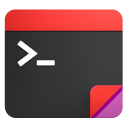

[](https://www.repostatus.org/#active)
[](https://opensource.org/licenses/MIT)

---

[(English language is here)](./README.md)

## これは何?

シリアル接続やTELNET、そしてパソコン通信。すべてが懐かしく、すべてが満たされ、そして全てがコントローラブルだったあの頃。
現代的な機能も追加して、蘇るターミナル生活。

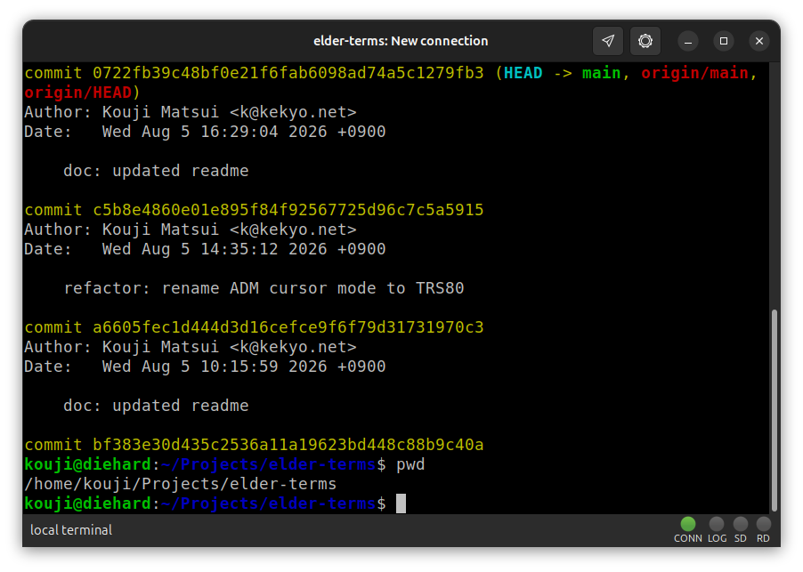

### 機能

- Linuxデスクトップで使えるターミナルです。
- シリアルやTELNET接続だけではなく、ローカルターミナル、SSH、SFTP、FTP、WebDAV、SMBもサポートし、現代で同じ生活を取り戻せます。
- ランチャーから複数の接続先を管理したり、そこからターミナルの起動を行えます。
- 接続先の設定は、全てINI形式のファイルに保存されます。
  INI形式なので、自由にエディタで再編集出来ます。
- BS/DEL、カーソルキー変換、Enter/Returnコード、文字コード変換を指定できます。
- ターミナルの行数と桁数を、接続毎の設定として記憶出来ます。
- TELNET/SSHで、ターミナル種別 (`xterm`や`xterm-256color`など) を明示的に指定できます。
- TELNET、シリアル、SSHの各ターミナル接続で、X/Y/ZMODEMファイル送受信をサポートしています。
  ZMODEMなら、自動送受信を有効化出来ます。
- SFTP/FTP/FTPS/WebDAV/SMB/NFSで、ホストとファイルの送受信を実行出来ます。
- PassiveまたはActiveのデータ接続を使用して、FTP/FTPSでファイルを送受信出来ます。
- テキストのペーストやテキストファイルの送信を実行出来ます。
  その際に、送信速度と改行コードの扱いを指定して、ホスト側のバッファオーバーフローや改行コードの不一致を回避出来ます。
- インジケータがターミナルの下部に表示されます。アナログモデムを思い出して、余韻に浸れます。
- BELに、組み込みbeepまたは任意のWAV/Ogg Vorbisサウンドを指定出来ます。
- フォントサイズをショートカットキーで変更したり、マウスのホイールで変更したり出来ます。
- 接続毎にウインドウのエクステリアカラーやターミナルの背景色をカスタマイズ出来ます。
- ホットキー一発で、指定された接続を起動出来ます。
- ランチャーを自動起動させたり、システムトレイに常駐させることが出来ます。
- 受信文字列を正規表現で監視して、自動的に文字列を送信したり、指定されたコマンドを実行できるルールを指定出来ます。
- 端末に表示されたURLやファイルへのリンクをクリックして開けます。
- ログをファイルに記録できます。接続先や日時によるディレクトリの分離によって、ログの整理が捗ります。
- 多国語表示に対応しています (英語、アラビア語、スペイン語、フランス語、ヒンディー語、日本語、韓国語、ポルトガル語、ロシア語、簡体字中国語)

### ターミナルランチャー

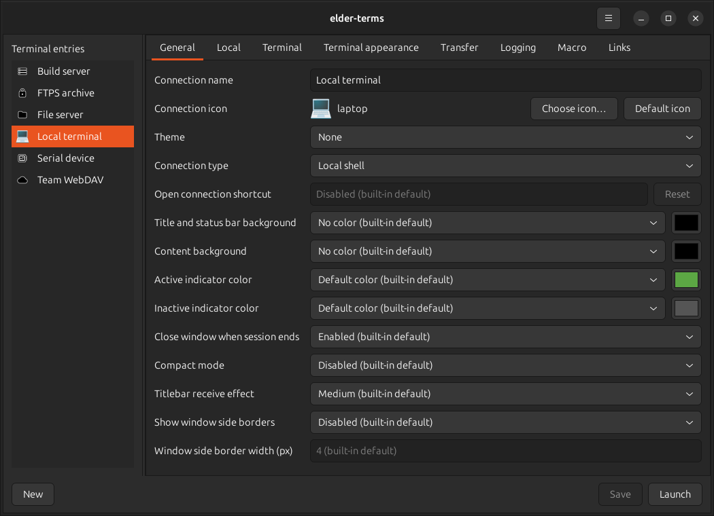

### 複雑な表示

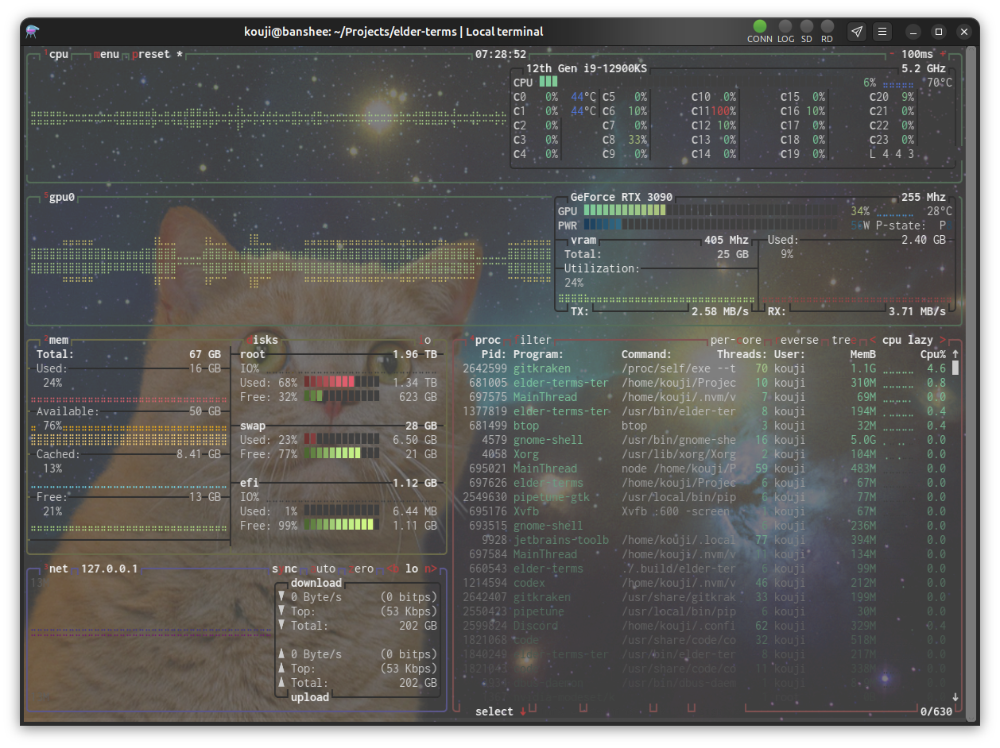

### シリアルデバイス

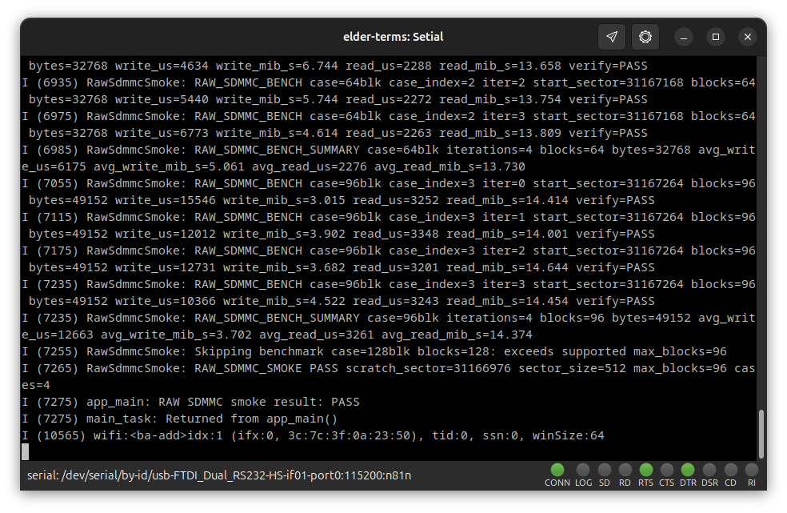

### 外郭色のカスタマイズ

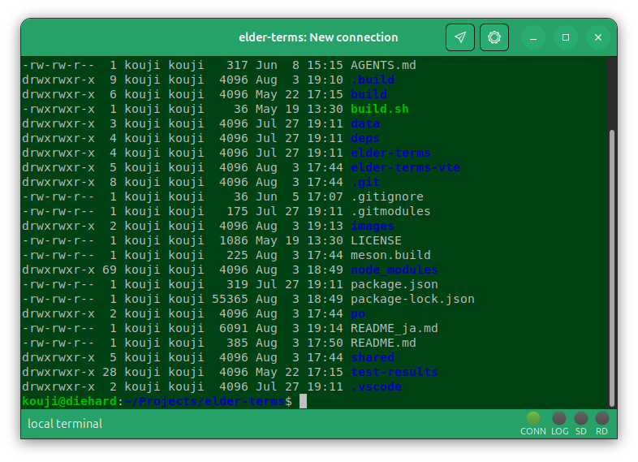

### SFTP/FTP/FTPS/WebDAV/SMB

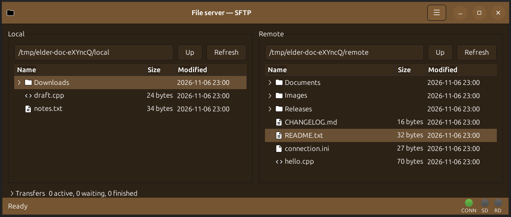

## 環境

- Linux GTK3 (Ubuntu/Debian推奨)

配布パッケージの対応環境は次のとおりです。

| ディストリビューション | リリース | アーキテクチャ |
| --- | --- | --- |
| Debian | trixie | amd64, i386, arm64, armhf, riscv64 |
| Ubuntu | 24.04 | amd64, arm64 |
| Ubuntu | 26.04 | amd64, arm64 |

Debian bookwormは対象外です。必要なライブラリの条件は[ビルドガイド](./docs/ja/building.md)を参照してください。

---

## インストール

[リリースリポジトリ](https://github.com/kekyo/elder-terms/releases/) から、
プリビルドされたパッケージ (deb形式) をダウンロードして、インストールして下さい:

```bash
sudo apt install ./elder-terms-*.deb
```

その後、elder-termsを起動して下さい:

```bash
elder-terms
```

端末を直接起動するコマンドは`elder-terms-terminal`です。接続設定を指定する場合は`elder-terms-terminal -c 接続設定.ini`を実行します。

---

## 基本的な使い方

初回起動時に、elder-termsは `Local terminal` という接続エントリを自動的に作成します。
これは、`bash` などのシェルを起動するターミナル、つまり普段あなたが目にしているターミナルとほぼ同じものです。

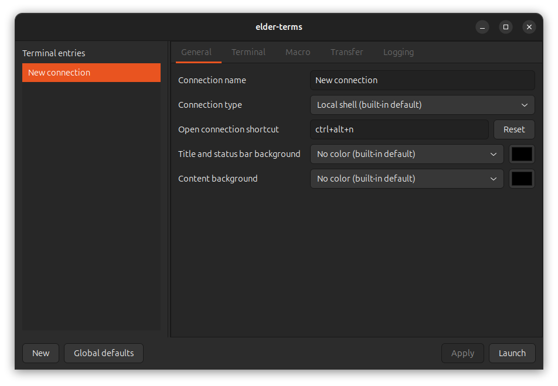

ランチャーのリストに表示されているエントリをダブルクリックすれば起動できます。
別の接続を作る場合は、ランチャー下部の "New" ボタンをクリックして、名前を "New connection" から適当な名前に変更し、
"Save" をクリックします。ほら:

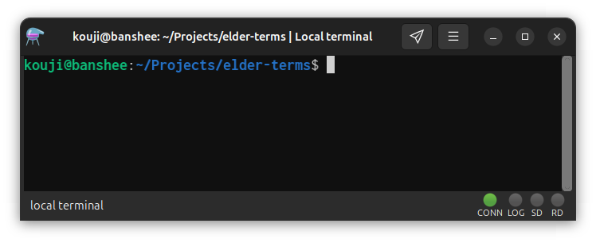

ここで、ターミナル右上のメニューを開いて「設定」を選択すると、このターミナルの様々な設定を変更することが出来ます。
"Apply" ボタンをクリックすれば、今起動しているターミナルにのみ、変更が適用されます。
"Save" ボタンをクリックすると、その設定を記憶するので、次回ターミナル起動時に反映されるようになります。
ターミナルとファイル転送ウインドウでは、「Apply」の後も設定画面は開いたままです。続けて編集できます。「Save」は変更を保存して画面を閉じます。
「Cancel」は最後に適用または保存した後の編集を破棄します。適用済みの変更は取り消しません。

入力の不足や設定の矛盾があると、「Apply」と「Save」は使えません。印の付いた欄やタブを確認してください。欄にポインターを重ねると、修正が必要な理由が表示されます。

端末の設定は二つのタブに分かれています。
「端末」には文字コード、文字幅、特殊キー、行列数、スクロール履歴、BEL、ショートカット、読み上げ、コピーの設定をまとめています。
「端末の外観」ではフォント、文字サイズ、カーソル、背景、色補正を指定します。
同じ区分で接続ごとの設定と「接続の既定値」を編集できます。
ボーダーの表示と幅は「一般」タブで指定でき、ターミナルとファイル転送ウインドウの両方に適用されます。

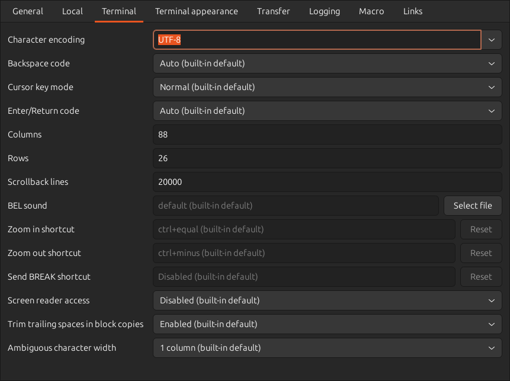

"Apply" ボタンを使って、色々な設定を変更してみると良いでしょう。
失敗しても、ターミナルウインドウを閉じれば捨てることが出来ます。

大半は、触ってみればわかる設定項目ですが、いくつかは説明が必要でしょう。これについては次の章以降で示します。

読み上げソフトで端末本文を読むには、設定の「端末」タブで「端末本文の読み上げ」を有効にしてください。
この設定は既定で無効です。起動中にも切り替えられ、有効にすると現在表示している本文を読み上げソフトへ公開します。
メニューや設定画面の読み上げには、この設定は影響しません。

保存済みの接続のINIファイルを直接編集するには、ランチャーのエントリを右クリックして「テキストエディタで編集」を選択します。
デスクトップに設定されたプレーンテキスト用の既定アプリケーションで開きます。
外部エディタで保存した変更は自動的に再読込されます。

接続を指定せず起動した端末のデスクトップアイコンで「New Window」を選んだ時の接続は、
ランチャーの「アプリケーション設定」で指定できます。
「\"New Window\"で使用」から保存済みの接続名を選んで保存して下さい。
「なし」を選ぶと既定の端末設定で起動します。
候補にはローカルシェル・TELNET・SSH・シリアル接続が表示されます。
デスクトップのメニュー名は、システムの言語設定に関係なく「New Window」です。

設定ファイルを直接編集する方法は[INI設定リファレンス](./docs/ja/configuration.md)を参照してください。

後は、`Ctrl`+`=` キーでフォントの拡大、 `Ctrl`+`-` キーでフォントの縮小、
同じことが `Ctrl` キーを押しながらのマウスホイール操作で行えることを覚えておいて損はありません。

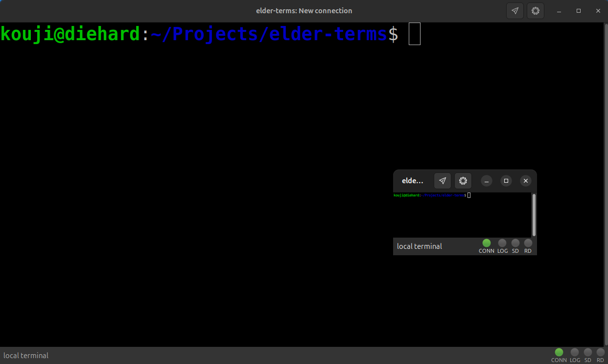

ターミナルウインドウをどのように配置するのかは、ウインドウマネージャやWaylandコンポジターに任せてあります。
つまり、あなたのウインドウシステムの環境に従って、 `Super` キーなどのキーバインドを活用して下さい。

現代に於いては、IoT開発、つまりはArduinoのようなシリアルデバイスを使ったデバッグやログ採取を行う機会が多いでしょう。
elder-termsはそのような環境でも無類の力を発揮します。

ああ、わかっていますとも。アナログモデムの事も忘れていません。
そのノスタルジーは、通常はターミナル下部に表示されるインジケータが補ってくれます:

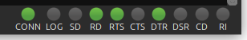

点滅がやけに規則正しくないか、だって？ もちろん。
これは [SONY NEWS ワークステーション](https://en.wikipedia.org/wiki/Sony_NEWS) のオマージュですよ。

それでは、elder-termsを楽しんで下さい！

---

## INIファイルの保存位置

elder-termsの設定は、INIファイル形式で、XDGのユーザー設定ディレクトリ以下に保存されます。
複数の接続で共有する設定に名前を付けたものを「テーマ」と呼びます。
`XDG_CONFIG_HOME` が設定されていない通常の環境では、保存位置は次の通りです。

- グローバル設定（アプリケーション設定と接続の既定値）: `~/.config/elder-terms/global.ini`
- 名前付きテーマ: `~/.config/elder-terms/theme.ini`
- 接続設定: `~/.config/elder-terms/connections/<接続名>.ini`

`XDG_CONFIG_HOME` が設定されている場合は、上記の `~/.config` がその値に置き換わります。
設定の優先順位は、接続ごとの指定、選択したテーマの指定、グローバル設定の既定値の順です。

## 設定項目の構造

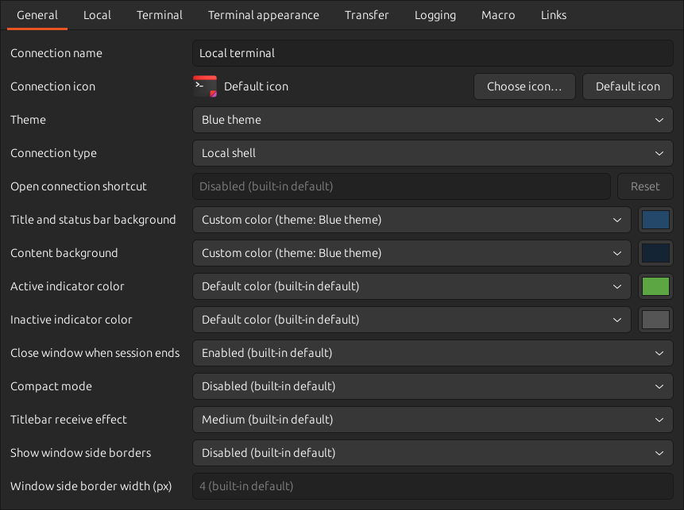

elder-termsの設定値には、次の三種類があります。後に挙げる設定ほど優先されます。

1. 組み込み既定値: elder-terms自体が持つ既定値です。接続種別などに応じて決まります。
2. INIファイルに保存された設定: アプリケーション設定の「接続の既定値」タブで編集する`global.ini`内の接続設定が組み込み既定値を上書きします。
   次に選択したテーマの指定値、各接続のINIファイルの指定値を順に重ねます。
   アプリケーション全体の設定は「アプリケーション設定」で編集し、
   「New Window」の起動接続もアプリケーション設定で選択します。
   どちらも `global.ini` に保存され、次回の起動にも引き継がれます。
3. 今回の接続だけの設定: ランチャーで未保存の変更を使って接続を起動すると、その変更は今回の接続だけに反映されます。
   起動後の設定ダイアログで「適用」した変更も同様です。
   これらは「保存」しない限りINIファイルへ記録されず、セッションの終了時に失われます。

設定ダイアログでは、継承している値に`（組み込み既定値）`、`（グローバル既定値）`、`（テーマ: 名前）`と出所が表示されます。
テキスト入力欄では既定値が薄いプレースホルダーとして表示され、選択欄では既定値の選択肢に出所が併記されます。

括弧内の出所が付かない通常の値は、接続のINIファイルまたは現在の起動セッションで明示的に指定された値です。
両者は値の表示だけでは区別されません。変更を次回も使うには「保存」してください。

テキスト入力欄を空に戻すか選択欄で既定値の項目を選ぶと、その項目の明示的な指定が削除され、
選択したテーマ、グローバル既定値、組み込み既定値の順に、指定のある値を再び継承します。

以降の各設定でも、「適用」は現在の接続へ反映し、「保存」は次回起動時のために記録します。「キャンセル」は未適用の編集を破棄します。
設定ファイルの書式と例は[INI設定リファレンス](./docs/ja/configuration.md)を参照してください。

## 名前付きテーマを共有する

タイトルバーと本文背景の色だけを定義した「赤テーマ」などを作れます。

ランチャーのメニューから「アプリケーション設定」を開き、「テーマ」タブで「新規」を押してください。名前と共有したい項目を指定し、「保存」を押します。タイトルバーと本文背景の配色は、タブ内のプレビューで確認できます。
各接続に適用するには、「一般」ページでテーマを選んでください。「なし」を選ぶと接続の既定値へ戻ります。

接続ごとの指定は、テーマを切り替えても有効です。指定を解除すると、現在のテーマの値を引き継ぎます。テーマの指定を解除した項目は、接続の既定値を使います。
接続名、アイコン、起動キー、アプリ全体の設定、マクロやリンクのルールはテーマの対象外です。

テーマを改名しても接続からの参照は維持されます。「複製」で別のテーマを作れます。使用中のテーマには接続名が表示され、参照を外すまで削除できません。外部編集で参照先を失った場合は、接続のテーマを選び直すか「なし」に戻してから起動してください。

保存したテーマは、新規起動とランチャーで編集中の接続に反映されます。起動済みの端末や転送画面では、設定を開き直して「適用」してください。プレビューや選択だけでは実行中の表示は変わりません。通信先などの変更には、従来どおり再接続が必要です。

アプリケーション設定では、タブを移動しても編集内容を保持します。「保存」の対象は、すべての編集タブです。`global.ini`と`theme.ini`の一方だけ保存できた場合は、ファイル別の結果を表示して画面を開いたままにします。再試行は未保存分が対象です。その後の「キャンセル」は、未保存分だけを破棄します。外部編集との競合が表示された場合は、保存済みの内容を確認し、設定を開き直してください。

## 接続アイコンの設定


各接続の「一般」タブにある「アイコンを選択…」から、Noto Color EmojiまたはMaterial Iconsの画像を選べます。
Material Iconsは黒・白の図柄を選択できます。「画像ファイルを選択…」からPNG・JPEGも指定できます。
「デフォルトアイコン」でelder-terms標準の画像へ戻ります。プリセットは同梱されているため、ダウンロードは不要です。

アイコンはタイトルバー、ランチャーの接続一覧、トレイの接続メニューに表示します。
接続ごとの指定で、「接続の既定値」からは継承しません。
画像ファイルを使う場合は、次回も読み込めるよう同じ場所に置いてください。

保存済みの同じ接続から開いたウインドウは、対応するデスクトップ環境のドックで一つにまとまります。
画像の上限、ドックでの表示、INIの書式は[接続アイコンの詳細](./docs/ja/connection-icons.md)を参照してください。

## IPスキャンで接続先を探す

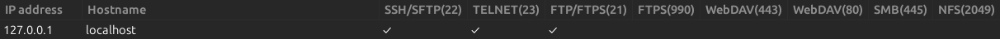

TELNET、SSH/SFTP、FTP/FTPS、WebDAV、SMB、NFSの設定では、アドレス入力欄の右側に「IPスキャン」ボタンがあります。
開くとすぐに、IPv4アドレスが設定されたすべてのネットワークインターフェイスについて、
FTP/明示的FTPS（21）、SSH/SFTP（22）、TELNET（23）、WebDAV HTTP（80）、WebDAV HTTPS（443）、SMB（445）、暗黙的FTPS（990）、NFS（2049）の標準TCPポートを探索します。
どの接続設定から開いても、探索する8ポートは共通です。

例えば `/24` のインターフェイスでは、末尾が0から255までの全アドレスが対象です。
`/24`より広いネットワークでは、そのネットワークの先頭256アドレスだけを探索します。
例えば `172.20.0.0/16` 上のアドレスでは、`172.20.0.0` から `172.20.0.255` までを探索します。

見つかったホストは、探索が終わる前から選択可能です。取得したホスト名も順次表示します。
結果表にはIPアドレス、ホスト名と8ポートの列があり、TCP接続を受け付けたポートにチェックマークが付きます。
チェックマークは接続先の候補を示すもので、WebDAVなどのサービスへの対応、認証の成功、TLS証明書の有効性を確認した結果ではありません。
「FTP/FTPS(21)」は通常のFTPと明示的FTPSで共用する列です。
プログレスバーは、探索範囲のアドレス数に対する確認状況を示します。表が収まらない場合は横にスクロールしてください。

行をダブルクリックすると探索を中断してダイアログを閉じ、その時点で取得済みの名前を設定へ入力します。
名前がない場合は数値IPアドレスを入力します。
変更するのはアドレスだけです。接続種別、ポート、接続エントリ名、WebDAVのHTTPS/HTTP、FTPのTLS方式、NFSの版、パスや認証設定は維持します。
選択後に必要な接続条件を確認し、設定を保存してください。

「キャンセル」をクリックした場合は、探索を中断してダイアログを閉じますが、アドレス設定は変更しません。

探索対象は、このマシンでIPv4アドレスが設定されたインターフェイスです。
SSH proxyを設定していても、探索はこのマシンから行います。
ループバックインターフェイスでは、割り当て済みのアドレスだけが対象です。

ホスト名を取得できない場合も、数値IPアドレスで接続先を選べます。
mDNSやLLMNRによる名前取得には、それらを有効にしたsystemd-resolvedが必要です。
取得した名前で接続するには、OSの通常の名前解決でもその名前を解決できる必要があります。
環境の条件は[systemdの名前解決APIの説明](https://github.com/systemd/systemd/blob/v257/man/org.freedesktop.resolve1.xml)を参照してください。

## SSHとSFTPの使用


SSH、SFTP、TELNET、HTTP/HTTPS、WebDAV、パッシブFTP／FTPS、SMB2/3、NFSはSSH踏み台を経由して接続できます。
独立した「SSH proxy」タブに踏み台を設定し、最終接続先は各プロトコルのタブで指定します。
設定の継承、認証、対応範囲は[SSH proxyの使用](./docs/ja/ssh-proxy.md)を参照して下さい。

SSHターミナルまたは単独のSFTPウインドウを起動すると、SSH接続を開始する前にユーザー名パネルが表示されます。
初期値は、接続設定のユーザー名、`~/.ssh/config`で接続先に一致する`User`、現在のOSユーザー名の順で選ばれます。
この接続で使用する値は変更出来ますが、保存済みの設定は変更されません。空のユーザー名は使用出来ません。

SSHは、設定された秘密鍵を最初に試し、次にSSH Agentまたは既定の鍵ファイルで利用出来る認証情報を試します。
設定された秘密鍵が暗号化されている場合は、パスフレーズパネルが表示されます。
それまでの方法で認証が完了せず、サーバーが対応している場合に限って、パスワードまたはキーボードインタラクティブ認証のパネルが表示されます。
どの認証方法も、最初のパネルで選択したユーザー名を対象にします。

認証済みのSSHターミナルから開いたSFTPウインドウは、そのターミナルのSSH接続を、選択済みのユーザー名と認証を含めて再利用します。
そのため、ユーザー名や認証情報を再入力する必要はありません。

## ファイル転送とジョブ一覧

FTP、FTPS、SFTP、WebDAV、SMBの転送画面では、左にローカル、右にリモートのファイルを表示します。
名前の前のアイコンで、フォルダー、文書、画像、ソースコード、圧縮ファイル、リンクなどを見分けられます。
SMB共有のアイコンは通常のフォルダーと異なります。

転送先の一覧でフォルダーか通常のファイルを1つ選んでから、転送元の項目を右クリックし、「送信」または「受信」を選びます。
送信先は右側のRemote、受信先は左側のLocalで選びます。フォルダーを選ぶとその配下へ、ファイルを選ぶとそのファイルがあるフォルダーへ転送します。
転送先が未選択の場合、シンボリックリンクを選んだ場合、複数選んだ場合は、送受信を選べません。
パス欄の場所は転送先として使いません。現在開いているフォルダーへ転送するには、その直下のファイルを選ぶか、「Up」で親へ移動して、そのフォルダーを選んでください。
一度の操作で選んだ項目を、一つの転送ジョブとして画面下部の「転送ジョブ」に追加します。
転送先は指示した時点で確定します。その後に選択を変えても、登録済みのジョブの転送先は変わりません。転送中に追加したジョブは順番に実行します。

「転送ジョブ」を開くと、各ジョブの状態、進捗、中止ボタンを確認できます。
一覧の高さは、ツリーとの境界をドラッグして調整してください。
一覧を折り畳んでも転送は続き、実行中・待機中の件数と進捗を要約して表示します。
探索中や総サイズが不明な転送では割合を表示せず、確認できた件数や転送済みバイト数を表示します。

各行を開くと、転送先、開始・終了時刻、コピー済み・スキップ・失敗・未処理の件数を確認できます。
探索が終わっていない場合、未処理の件数は「不明」と表示します。
失敗した箇所や、削除できずに残った一時ファイルもここに表示します。
スキップした項目はコピー済みの件数に含みません。

中止はジョブごとに指定できます。実行中のジョブは、後始末が終わるまで「中止処理中」と表示します。
失敗・中止したジョブをやり直すには「新しいジョブで再試行」を選んでください。
同じ転送元と転送先への新しい要求となり、途中からは再開しません。
切断前の待機ジョブは再接続しても実行されないため、必要なものを選んで再試行してください。

転送中もファイル一覧を操作できます。リモートの読み取りは転送の終了を待ちます。
作成・名前変更・削除などの変更操作とハッシュ計算は、転送と待機ジョブの終了後に利用してください。
「終了したジョブを消去」で履歴を消せます。履歴はウインドウを閉じるまで保持します。
ウインドウを閉じると待機ジョブを取り消し、実行中の転送と後始末を終了してから接続を閉じます。

## 切断後の再接続


接続に失敗した場合や切断された場合は、通知に表示された理由を確認してください。再接続するには、通知の「再接続」を押します。

ファイル転送ウインドウでは、通知が表示されている間は背景が暗くなり、左右のファイル一覧と転送キューを操作できません。再接続に成功すると、再び操作できます。終了する場合は「閉じる」を選んでください。

正常なセッション終了後も端末を残すには、一般設定の「セッション終了時にウィンドウを閉じる」を無効にしてください（`[general] auto_close=false`）。接続の開始に失敗した場合や、ファイル転送の通信断では、この設定によらず通知が残ります。

再接続は、前の接続の処理が終了してから行われます。シリアルでは機器を開き直し、ローカルシェルでは新しいシェルやコマンドを起動する操作です。シリアルの自動復帰を待つことや、SSH端末から開いたSFTPを転送ウインドウだけで再接続することもできます。

再接続に失敗した場合は、理由を確認して同じウインドウから再試行できます。中断した転送の自動再開は行いません。

## FTP/FTPSの使用


ランチャーで接続を作成し、接続種別に `FTP` を選択して下さい。
FTPタブでは、サーバーアドレス、制御ポート、ユーザー名、データ接続モード、ローカルとリモートの初期ディレクトリを指定出来ます。
制御ポートの既定値は21、データ接続モードの既定値は「Passive（推奨）」です。

FTPウインドウを起動するたびに、最初の認証パネルでユーザー名を尋ね、次のパネルでパスワードを非表示で入力します。
匿名でログインする場合は、ユーザー名のパネルで `anonymous` ボタンをクリックすると、パスワード入力に進みます。
ユーザー名に `anonymous` と入力して「接続」をクリックする方法も使用出来ます。
サーバーが求めるパスワードを入力して下さい。パスワードは自動で補われず、接続設定にも保存されません。
ログイン後はSFTPと同じ2ペインのファイルブラウザと転送操作を使用出来ます。

FTPはコマンド、ユーザー名、パスワード、ディレクトリ一覧、ファイルデータを暗号化せずに送信します。
elder-termsは[FTP（RFC 959）](https://www.rfc-editor.org/rfc/rfc959)、または[FTPS](https://everything.curl.dev/ftp/ftps.html)に接続します。

FTPSやFTPの詳細は、 [別のドキュメント](./docs/ja/ftp-ftps.md) を参照して下さい。

## HTTP/HTTPSからの受信

HTTP/HTTPS接続では、HTMLのリンクを展開してファイルを受信できます。基準URLで取得範囲を指定し、必要な項目だけを取得します。HTML原文の保存と、選択した配下の再帰受信を選べます。リモート側は読み取り専用です。

設定と対応範囲は[HTTP/HTTPSからファイルを受信する](./docs/ja/http.md)を参照してください。

## WebDAVの使用

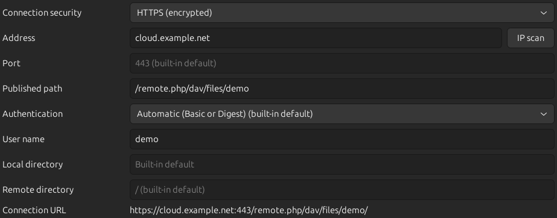

接続種別に `WebDAV` を選び、WebDAVタブでアドレス、公開パス、認証方式を設定して下さい。
例えば `https://files.example.com/dav/team/` へ接続する場合は、アドレスを `files.example.com`、公開パスを `/dav/team/` にします。
HTTPSが既定で、HTTPも選択できます。

完成する接続URLを読取り専用の表示で確認できます。アドレス欄にURL全体やユーザー名・パスワードを入れないで下さい。

公開パスがファイルブラウザの `/` になります。その上へ移動することはできません。
初期リモートディレクトリを `/Documents` にすると、この例では `/dav/team/Documents` から開始します。

SFTP/FTP/FTPSと同じ画面で、ファイルやフォルダーの送受信、フォルダー作成、名前変更、削除を行えます。
HTTPS証明書の検証に失敗した場合は、設定に応じて接続を拒否するか、FTPSと共通のオーバーレイで確認します。

設定一覧と対応範囲は [WebDAVの使用](./docs/ja/webdav.md) を参照して下さい。

## SMBの使用

ランチャーで接続種別を「SMB」にし、SMBタブへサーバーのアドレスを入力して保存します。既定の接続先はTCPポート445で、SMB2/3を自動選択します。バージョン欄でSMB1・SMB2・SMB3を指定することもできます。SMB1はIPv4の直接接続に対応します。
ウインドウを開くとユーザー名とパスワードを順に尋ねます。パスワードは保存しません。

接続後は、リモート側の`/`に共有一覧を表示します。共有を開くか、`/共有名/フォルダー`の形式でパスを入力して探索できます。
共有内では、他のファイル転送と同じ画面で送受信やフォルダーの操作ができます。
接続設定、署名と暗号化、ファイル操作の制限は[SMBの使用](./docs/ja/smb.md)を参照してください。

Windows XPへ接続する場合はSMB1を選択し、[XP向けの接続条件と設定手順](./docs/ja/smb.md#smb1でwindows-xpに接続する場合の制限と構成)を確認してください。

## NFSの使用

接続種別を「NFS」にし、サーバーのアドレスとNFSの版を指定します。NFS v2・v3・v4.0へTCPで接続し、公開ディレクトリの一覧、送受信、名前変更、削除を行えます。
ファイル名の文字コードはUTF-8が既定で、CP932やEUC-JPなども指定できます。公開パスと数値の利用者IDの設定は[NFSの使用](./docs/ja/nfs.md)を参照してください。

## SFTP/FTP/FTPS/WebDAV/SMB/NFSの項目操作

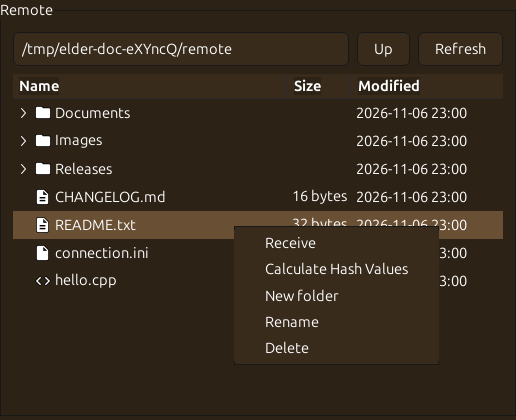

SFTP/FTP/FTPS/WebDAV/SMB/NFSは、同じ2ペインのファイルブラウザを使用します。
ローカルまたはリモートペーンで項目を選択して右クリックすると、項目メニューが開きます。
メニューを開く前に、`Ctrl`+クリックまたは矩形ドラッグで複数の項目を選択出来ます。

- 「名前の変更」は、ファイルまたはディレクトリを一つだけ選択した場合に使用出来ます。
  ウインドウ内のオーバーレイへ新しい名前を入力して下さい。項目は現在のディレクトリ内に留まり、既存の項目を上書きすることはありません。
- 「削除」は、一つ以上のファイルとディレクトリを選択した場合に使用出来ます。
  何かを削除する前に、確認オーバーレイへ実際の削除起点が一覧表示されます。
  空ではないディレクトリは再帰的に削除されます。
  ディレクトリとその子孫を同時に選択した場合、子孫はそのディレクトリに含まれるため、一覧表示も削除処理も重複しません。
- 「ハッシュ値の計算」は、通常ファイルを一つだけ選択した場合に使用出来ます。
  ローカルファイルでは、elder-termsがMD5、SHA-1、SHA-256を内部で計算します。
  SFTPのリモートファイルでは、SSHサーバーがコマンド実行を許可し、接続したアカウントのコマンド検索パスから`md5sum`、`sha1sum`、`sha256sum`を実行出来る必要があります。
  これらの条件を満たさない場合、計算は失敗します。
  FTPとSMBのリモートファイルに対するハッシュ計算はサポートしていませんが、ローカルペーンのハッシュ計算は使用出来ます。

DebianまたはUbuntuのSFTPサーバーでは、必要なコマンドは[Debianの`coreutils`パッケージ](https://packages.debian.org/stable/coreutils)
または[Ubuntuの`coreutils`パッケージ](https://packages.ubuntu.com/search?keywords=coreutils&searchon=names&suite=all&section=all)に含まれます。
次のコマンドをSFTPサーバー上で実行してインストールして下さい。

```shell
sudo apt update
sudo apt install coreutils
```

削除は完全に行われ、デスクトップのゴミ箱は使用しません。
ローカルペーンとSFTPでは、シンボリックリンクを削除してもリンク先をたどらず、リンク自体だけを削除します。
処理中はファイルブラウザが進捗オーバーレイで覆われ、完了後に表示が更新されます。

## ローカルターミナルの起動プロセス


Local接続では、Localタブの「起動コマンド」で `elder-terms-terminal` がターミナル内に起動するプロセスを指定出来ます。
この設定は次に接続を開いたときに反映され、起動済みのターミナルでは読み取り専用です。

入力欄が空の場合はグローバル既定値または組み込み既定値を継承します。
組み込み既定値では、`SHELL` で指定されたユーザーのシェルを引数なしで起動します。
`SHELL` が未設定または空の場合は `/bin/sh` を使用します。

設定値はシェル形式の引用規則を使って実行ファイルと引数に分割されますが、プロセス自体はシェルを介さず直接起動されます。
そのため、環境変数展開、グロブ、リダイレクト、パイプラインは行われません。
これらが必要な場合は、次の例のようにシェルを明示的に起動して下さい。

```text
/bin/sh -lc 'exec tmux new-session -A -s elder-terms'
```

INIでの指定は[設定リファレンス](./docs/ja/configuration.md#ローカルの起動コマンド)を参照してください。

## シリアルデバイスの選択


シリアル接続の「デバイス識別方式」で、次の3種類からデバイスを識別する方法を選択出来ます。

- 安定デバイスID: `/dev/serial/by-id` に作られるリンクを使用します。
  同じUSBシリアルデバイスを別のUSBポートへ挿し替えても追跡できるため、通常は組み込み既定値のこの方式を使用して下さい。
- 物理USBポート: `/dev/serial/by-path` に作られるリンクを使用します。
  USBシリアルデバイス個体ではなく、常に同じ物理ポートに挿されたデバイスへ接続したい場合に使用します。
- デバイスパス: `/dev/ttyUSB0` や `/dev/ttyACM0` などの現在のデバイスノードを使用します。
  抜き挿しの後にノード番号が変わる可能性があります。

「デバイス」はパスの直接入力欄ではなく、選択した識別方式で現在利用出来るデバイスの一覧です。
一覧は抜き挿しを検知して自動的に更新されます。
選択中のデバイスについて、「安定ID」「USBシリアル番号」「現在のデバイスノード」も表示されます。

接続中にデバイスが外れた場合は選択した識別情報を保持し、同じ対象が再び現れたときに再接続します。
「安定デバイスID」ではUSBシリアル番号も補助的に記憶するため、`/dev/serial/by-id` のリンク名が変わっても、
一意に一台を特定出来る場合は同じデバイスへ再接続します。
同じUSBシリアル番号の候補が複数ある場合は、誤ったデバイスを選ばず接続を待機します。

INIでの指定と既存設定の扱いは[設定リファレンス](./docs/ja/configuration.md#シリアル接続)を参照してください。

## シリアル接続の監視


「接続監視信号」では、DCD、CTS、DSRのいずれかがHighからLowへ変化したときにセッションの切断を検出します。
USBシリアルアダプタが利用可能なモデムライン信号を持たない場合や、ドライバがモデムラインのpollに対応せず「無効な引数です」と報告する場合は、
「監視しない」を選択して下さい。

「監視しない」では、モデムラインの状態を取得せず、その状態によって「セッション終了時にウインドウを閉じる」が実行されることもありません。
シリアルセッションは送受信可能な状態として維持されます。
ただし、デバイス自体の取り外しやread/writeエラーは、従来どおり実際の切断として扱います。

## 文字コードと特殊キーの設定


「文字エンコーディング」は、接続先から受信したバイト列を画面表示用のUTF-8へ変換し、
入力した文字列を接続先の文字コードへ変換するために使用されます。
デフォルトはすべての接続で `UTF-8` です。

「Backspaceコード」は、Backspaceキーを押したときに送信する制御コードを選択します。
「Auto」は端末の標準動作を使用し、通常はDELを送信します。「BS」はASCII BS（`0x08`）、「DEL」はASCII DEL（`0x7f`）を送信します。
接続先でBackspaceキーを押しても文字が消えない場合や、`^H` などが表示される場合は、この設定を切り替えて下さい。
Deleteキーはこの設定とは独立し、通常は`ESC [ 3 ~`を送信します。

「カーソルキーモード」の「通常」は、接続先が指定した端末モードに従うエスケープシーケンスを送信します。
「TRS80」は、 TRS-80 Model 100/200, IBM PC GW-BASIC/Quick BASIC, NEC PC-9800シリーズ, MSX で使用される1バイトの制御コードへ変換し、
上を `0x1e`、下を `0x1f`、右を `0x1c`、左を `0x1d` として送信します。接続先が TRS-80 系のカーソルキーを要求する場合に使用して下さい。

「Enter/Returnコード」は、修飾キーを押していないReturnキーとテンキーEnterが通常の改行を確定したときに送信するコードを選択します。
「CR」は `0x0d`、「LF」は `0x0a`、「CRLF」は `0x0d 0x0a` を送信します。
「Auto」は端末の改行モードに従い、通常はCRを送信します。
`Shift`、`Ctrl`、`Alt`、`Super`などで修飾したReturn/Enterや、アプリケーションキーパッドモードで生成された専用シーケンスは置き換えません。
接続先がKittyキーボードプロトコルを有効にした場合も、そのプロトコルのキー通知を維持します。

接続種別ごとの組み込み既定値は次の通りです。

| 接続種別 | 文字エンコーディング | Backspaceコード | カーソルキーモード | Enter/Returnコード |
| :--- | :--- | :--- | :--- | :--- |
| ローカルターミナル | UTF-8 | `Auto` | `通常` | `Auto` |
| SSH | UTF-8 | `Auto` | `通常` | `Auto` |
| TELNET | UTF-8 | `Auto` | `通常` | `Auto` |
| シリアル | UTF-8 | `BS` | `TRS80` | `CR` |

INIでの指定は[設定リファレンス](./docs/ja/configuration.md#端末の操作)を参照してください。

## 端末の文字選択とコピー

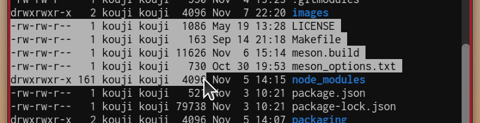

端末の文字は左ドラッグで選択します。選択範囲は灰色の塗りで表示され、設定した色補正も適用されます。
通常選択は本文の順序に沿った範囲、ブロック選択は画面上の列をそろえた矩形です。

| 操作 | 動作 |
| --- | --- |
| 左クリック | 選択を解除する。クリックだけでは文字をコピーしない |
| 左ドラッグ | 通常選択する |
| ダブルクリック／トリプルクリック | 単語／行を選択する |
| Ctrl＋左ドラッグ | ブロック選択する |
| Ctrl＋リンクのクリック | 同じリンク上でボタンを離すと起動する。ドラッグするとブロック選択になる |
| リンク上で右クリック→「リンクをコピー」 | リンク先をクリップボードへコピーする |
| ESC | 選択と進行中のドラッグを取り消す |
| ドラッグ中のホイール | 始点を保って履歴へ範囲を伸ばす。Ctrl付きでも文字サイズは変わらない |
| ドラッグ中に上下の端を越える | 履歴を自動スクロールする。ボタンを離すと止まる |
| Ctrl＋Shift＋C、右クリックの「コピー」 | 選択本文をクリップボードへコピーする |

マウス入力を使う端末内アプリでは、Shift＋ドラッグで通常選択、Ctrl＋ドラッグでブロック選択を優先できます。
Ctrl＋Shift＋ドラッグもブロック選択です。選択操作をしていないときのCtrl＋ホイールは、従来どおり文字サイズを変更します。

ドラッグ中にCtrlを押すと、次のマウス移動でブロック選択へ切り替わります。Ctrlを離すと、次のマウス移動で通常選択へ戻ります。
Ctrlの操作だけでは選択は変わりません。切替後も同じ開始点を保ちます。

選択した文字は中央ボタンでも貼り付けられます。
ブロック選択では、既定で行末の空白を除去します。保持したい場合は「端末」タブの「ブロックコピーの行末空白を除去」を無効にしてください。
通常選択には影響しません。
クリップボードの違い、コピー結果の細則、コピーできない場合の対処は[文字選択とコピーの詳細](./docs/ja/text-selection.md)を参照してください。

## テキスト送信とペーストの改行


「テキスト送信時にEnter/Returnコードに従う」は、テキストファイル送信、マクロ送信と、クリップボード、選択クリップボード、
キーボードショートカット、コンテキストメニューからの全てのテキストペーストに適用されます。
組み込み既定値は有効です。

有効にすると、元の改行がCR・LF・CRLFのどれであっても「Enter/Returnコード」で選んだ形式に変換します。
「Auto」ではCRを送信します。無効にすると、元の改行形式を保持します。

ペーストにも、テキストファイル送信と同じ送信速度・文字コード・改行の設定を使います。
ペースト範囲を接続先へ知らせるBracketed Pasteには対応していません。
INIでの指定は[設定リファレンス](./docs/ja/configuration.md#テキスト送信とペースト)を参照してください。

## BREAKの送信


「BREAK送信ショートカット」にキーの組み合わせを指定すると、一回の物理的なキー押下につき一回だけBREAKを送信します。
キーを押し続けた際の自動リピートは抑止されます。空欄はショートカットを無効にします。
拡大・縮小・BREAKの各ショートカットには同じキーの組み合わせを指定出来ません。

ターミナルを右クリックして「BREAKを送信」を選ぶことでも同じ操作を実行出来ます。
接続されていない場合、転送中、またはローカルターミナルではメニュー項目が無効になります。
送信中と送信結果はステータスバーへ表示され、送信時にはSDインジケータが点灯します。

接続方式ごとの送信内容は次の通りです。

| 接続種別 | BREAKの動作 |
| :--- | :--- |
| ローカルターミナル | 非対応 |
| TELNET | `IAC BRK`を送信 |
| シリアル | 回線のBREAK状態を500ミリ秒間有効化してから解除 |
| SSH | 500ミリ秒のSSH BREAK要求を送信 |

## 文字コードの補足

文字コードは iconv の定義名を受け入れますが、文字コード名には似て異なる定義がいくつか存在することに注意してください。

例えば、日本語圏において、BBSシリアル通信でよく使われる「シフトJIS」は、
iconv の定義名で `SHIFT_JIS` というわかりやすい対応名がありますが、
実際には慣例的に NEC PC-9800 シリーズで使われている、拡張された `CP932` がベターです。

異なる文字コードを使用した場合、拡張されたり変更されている文字を受信すると、文字化けの原因となります。

## スクロールバッファの設定


「端末」タブの「スクロールバッファ行数」では、通常画面の履歴を1000〜100000行の範囲で指定出来ます。
組み込み既定値は10000行です。

## BELサウンドの設定


「端末」タブの「BELサウンド」では、BELを受信したときに再生するサウンドを指定出来ます。
組み込み既定値の `default` は、デスクトップ環境のビープ音を使用します。

カスタムサウンドには、既存ファイルの絶対パスを入力するか、「ファイルを選択」ボタンからファイルを指定します。
対応する形式はOgg Vorbis（`.oga`、従来の拡張子 `.ogg` も可）とWAV（PCM）です。

## タイトルバーの通知

BELを受信すると、タイトルバーが短く明暗を変えて知らせます。
データを受信すると、タイトルバーに淡い帯が移動します。受信の通知は端末とファイル転送の両方で使えます。

「端末の外観」タブの「BELの視覚通知」と、「一般」タブの「受信時のタイトルバー演出」で、それぞれ無効・弱・中・強を選べます。
初期値は両方とも中です。BELの視覚通知を無効にしても、BELサウンドの設定は変わりません。
デスクトップのアニメーション設定が無効の場合は、どちらの効果も停止します。

## コンパクトモード


接続の「一般」タブにある「コンパクトモード」で「有効」を選ぶと、下部のステータスバーを隠し、
インジケーターをタイトルの隣に表示します。既定値の選択肢でグローバル設定を継承するか、
「無効」を明示的に選ぶこともできます。ターミナルとFTP、FTPS、SFTP、WebDAVの
ファイルブラウザで使用出来ます。組み込み既定値はオフです。
「一般」タブで左右ボーダーを有効にすると、ウインドウの左右に指定した幅のボーダーを表示します。
コンパクトモードでは下辺にも同じ幅のボーダーを表示します。

## インジケーターの色の設定


「一般」タブでは「点灯時の色」「消灯時の色」を独立して指定出来ます。
それぞれをCONN、LOG、SD、RDとすべてのシリアル信号のインジケーターに共通適用します。
SFTP、FTP/FTPS、WebDAV、SMBウインドウのCONN、SD、RDにも同じ設定を適用します。
ランプの陰影やハイライトは残りますが、点灯と消灯を区別するには異なる色を選んで下さい。

「既定の色」は点灯時を緑色、消灯時を灰色に戻します。
接続の既定値で共通色を設定し、接続ごとに変更することもできます。
INIの色指定は[設定リファレンス](./docs/ja/configuration.md#ウインドウと通知)を参照してください。

## 文字サイズの設定


「端末の外観」タブの「文字サイズ（DIP）」で文字の大きさを指定します。DIPは1/96インチを基準とする単位で、既定値は12 DIPです。
`Ctrl`+`=`、`Ctrl`+`-`、`Ctrl`を押しながらのマウスホイールでも変更でき、確定した値を接続設定に保存します。
拡大・縮小中も接続先へ伝える行列数を保ち、ウィンドウを手動でリサイズしたときに新しい行列数を通知します。

## カーソルと背景の設定

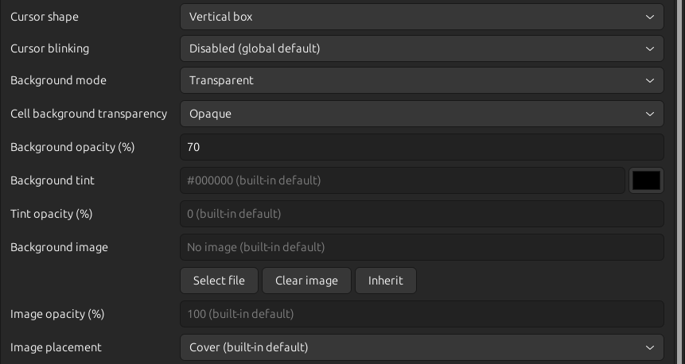

カーソル、背景、色補正は「端末の外観」タブで指定します。
画像の読み込みに失敗した場合は理由が表示され、直前に適用した表示が保たれます。

カーソルは「フルボックス」「縦ボックス」「下線ボックス」から選択します。
端末に入力フォーカスがある間は塗りつぶし、外れている間は同じ形の輪郭を表示します。
点滅の有無は形状と別に指定できます。フォーカスが外れた輪郭は点滅しません。

背景モードには「不透明」「単純透過」「すりガラス」があります。
「背景色の不透明度」を下げると、背景画像や背後のデスクトップが見える割合が増えます。
画像とデスクトップの上に色を重ねるには、「混色」と「混色の不透明度」を指定してください。
不透明度は0〜100%で、混色を0%にすると追加の色は見えません。文字自体の不透明度は変わりません。

端末が指定した文字の背景色を透けさせたくない場合は、「文字背景の透過」を「不透明」にしてください。
通常の背景は元の透過設定を保ち、指定された文字背景だけを不透明にします。既定値の「単純透過」では、文字背景にも「背景色の不透明度」を使います。
実行中に切り替えると、すでに表示した文字や履歴にも反映されます。

背景画像はローカルのPNG・JPEGファイルを選択するか、絶対パスで指定してください。
「画像の配置」では、縦横比を保って領域を覆う方法、画像全体を収める方法、縦横に引き伸ばす方法を選べます。
画像はスクロールに追従せず、端末の表示領域に固定されます。

透過背景と組み合わせるには、画像の不透明度とPNGの透過部分を使ってください。
不透明モードでも画像を使えます。画像が見えにくい場合は「背景色の不透明度」を下げてください。
「画像を解除」はこの接続を画像なしにし、「継承する」は選択したテーマや接続の既定値へ戻します。

画像ファイルは移動・埋め込みされないため、次回起動時も同じパスで参照できる場所に置いてください。
画像の容量・寸法の上限とINIでの指定は[設定リファレンス](./docs/ja/configuration.md#背景と色補正)を参照してください。

デスクトップの透過には、背後のウィンドウを合成するコンポジターの対応が必要です。
すりガラスは対応するコンポジターへ要求し、背後のデスクトップをぼかします。端末の文字や背景画像はぼかしません。
設定画面には実際の利用状態を表示します。すりガラスが使えない場合は単純透過へ、透過自体を使えない場合は不透明へ切り替わります。
「すりガラスを要求しています」は要求が受け付けられた状態です。ぼかしの表示には、コンポジター側の効果設定も影響します。
対応条件は[boxrigの背景効果](https://github.com/kekyo/boxrig/blob/0.12.0/docs/ja/background.md#osのすりガラス効果を要求する)を参照してください。

## 文字色の視認性を改善する


「端末の外観」タブの「色フィルタ」で「明暗差を改善 (Oklch)」を選ぶと、背景と区別しにくい文字やマーカーの明暗差を補正します。赤、緑、青などの全色相と、灰色、黒、白の無彩色が対象です。
Oklchは明るさ、鮮やかさ、色相を分けて表す色の方式です。この補正では色相を保ち、主に明るさを調整します。
十分な明暗差がある色は変えず、読みにくい色を調整します。既定値は「補正しない」です。
Oklch単独では背景色を変えません。背景画像、送受信内容、コピー、ログにも補正は加わりません。
補正の基準は文字の背景色です。透過したデスクトップや背景画像の各画素に合わせて補正する機能ではありません。

## 背景と文字の明暗を反転する


「端末の外観」タブの「色フィルタ」で、次の5方式を選べます。黒背景と白文字を白背景と黒文字へ変え、白黒に近い色にも連続的に適用します。色ごとの見え方が異なるため、「補正前後を比較」で普段使う配色に合う方式を選んでください。

パレットは、番号と色の対応表です。DのCAM16は、観察環境に応じた色の見え方を計算するモデルを指します。

| 選択肢 | 特徴 |
| --- | --- |
| 明度を反転 (A) | 人が感じる明るさを反転し、色相を保ちます。明るい黄色や緑は黒に近づきます |
| コントラスト比を保って反転 (B) | 元の明暗差の比率をほぼ保ちます。元の読みにくい組み合わせも残ります |
| 文字と背景に合わせて反転 (C) | 背景を反転し、有彩色の文字は色相と明るさの違いを保ちながら読みやすく調整します |
| 見え方を補償して反転 (D, CAM16) | 暗い配色から明るい配色への変更を想定し、背景や観察環境による色の見え方を補償します |
| 配色を最適化して反転 (E) | 端末のパレット全体を基準に、色同士の区別を調整します |

Eのプレビューは標準パレットを使った見本です。接続先がパレットを変更した場合は、実際の表示と異なることがあります。

選べる色フィルタは一つです。既存のOklchと反転フィルタを同時に指定することはできません。「色の区別を補助」は各方式と併用でき、その再配色の後に反転します。端末に保存された文字や色、通信内容、コピー、ログは変わりません。

背景画像、透過先のデスクトップ、Kitty画像、カラー絵文字そのものの画素は反転しません。透過や画像を重ねた場合の読みやすさは、実際の表示で確認してください。[boxrigの色補正の対象範囲](https://github.com/kekyo/boxrig/blob/0.12.0/docs/ja/color-filters.md)

INIでの指定は[設定リファレンス](./docs/ja/configuration.md#背景と色補正)を参照してください。

## 色の区別を補助する


「端末の外観」タブの「色の区別を補助」で、P型向け、D型向け、T型向けの再配色を選べます。
再配色は、見分けにくい色の情報を別の色の違いで表す補正です。
P型・D型では主に赤緑系、T型では主に青黄系の区別を補助します。既定値は「補正しない」です。

「補正前後を比較」を開き、差分の`- removed`と`+ added`、ログ、色付き背景の見本を比べてください。
ANSI16色は端末の基本パレット、256色は番号で指定する拡張パレット、TrueColorはアプリが直接指定するRGB色です。
見本にはこの三種類を含め、暗い背景、明るい背景、接続の背景を切り替えられます。
型名だけに頼らず、普段使う表示を見分けやすい設定を選んでください。

「補正の強さ」は0〜100で調整し、0で再配色を無効にします。種類を選んだときの既定の強さは100です。
この値は色覚特性の程度を測るものではありません。
補正によって別の色同士が似ることもあるため、見分けにくくなった場合は強さを下げるか、別の種類を選んでください。
数値試験と表示の確認は行っていますが、当事者による読み取り評価は未実施です。

再配色は文字、アプリが指定したセル背景、下線、カーソル、検索・選択などのマーカーに適用します。
接続の既定背景は再配色しません。
「明暗差を改善 (Oklch)」と併用すると、再配色後の背景を基準に文字やマーカーの明暗差を整えます。
再配色の強さを0にしても、Oklchの設定は独立して働きます。

補正は表示だけに適用し、送受信内容、端末が保持する色、コピー、ログは変えません。
背景画像、透過先のデスクトップ、Kitty画像、カラー絵文字の画素は対象外です。
対象範囲の詳細は[boxrigの表示色補正](https://github.com/kekyo/boxrig/blob/0.12.0/docs/ja/color-filters.md)を参照してください。

## 曖昧幅文字の幅

「①」のように、端末によって1列または2列を占める文字を曖昧幅文字と呼びます。
「端末」タブの「曖昧幅文字の幅」で「1列」「2列」「フォント依存」を選べます。既定は「1列」です。
この設定は文字の配置に使う列数を決めるもので、フォントサイズの設定とは別です。

フォント依存では、実際のフォントに合わせて必要な列幅を使います。

この列数設定の変更は新しく開く端末から反映されます。保存後に端末を開き直してください。
「適用」や同じウインドウでの再接続では、既存端末の幅の決め方は変わりません。
フォント依存を選んだ端末では、フォントを変更すると文字の配置も変わります。

フォントの幅から、接続先のアプリが想定する列数までは判断できません。
入力位置や罫線がずれる場合は、接続先に合わせて1列または2列を指定してください。

## フォントファミリーの設定


「端末の外観」タブで、優先順位付きのフォントファミリー一覧を編集出来ます。
行を追加・削除し、上下ボタンで順序を変更出来ます。
各行には名前を直接入力するか、フォント選択ダイアログから指定します。

リスト全体のドロップダウンの「継承元：グローバル設定」「継承元：アプリ標準」は継承する指定で、後からグローバル設定を変更した場合も追従します。
テーマにフォント一覧が指定されていれば、そのテーマ名を表示して一覧を継承します。
「アプリ標準に固定」はグローバル設定に関係なく `Noto Sans Mono`、`Monospace` の順に固定します。
「この接続で指定」は独自の一覧を設定します。グローバル画面は「アプリ標準」「指定する」の2択です。
接続単位の指定はテーマやグローバルの一覧全体を置き換え、末尾への追加にはなりません。

先頭のフォントを最優先に使用し、字形が無い文字を後続の候補で描画します。
例えば欧文フォントに無い漢字やひらがなを、後続の日本語フォントで描画出来ます。
未インストールの名前も保存でき、描画時には後続の候補へフォールバックします。

この設定が保存するのはフォントファミリーだけで、文字サイズ、太さ、スタイルは含みません。
文字サイズは「文字サイズ（DIP）」、`Ctrl`+`=`、`Ctrl`+`-`、または `Ctrl` キーを押しながらのマウスホイール操作に従います。

INIの一覧の書式とエスケープ方法は[設定リファレンス](./docs/ja/configuration.md#フォントと文字幅)を参照してください。

## ホットキーの設定


ホットキーは、elder-termsのランチャーが起動している間だけ機能します。
システムトレイに対応した環境では、ランチャーのアプリケーションメニューにある「アプリケーション設定」で「起動モード」を
「システムトレイのみ」または「システムトレイとメインウィンドウ」に設定すると、ランチャーをシステムトレイに常駐させられます。

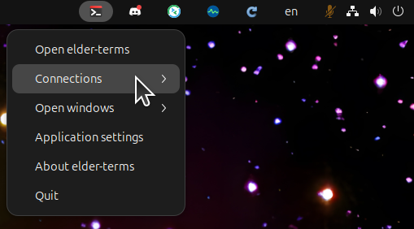

トレイメニューの「接続」には、保存済みの全接続をアイコンと接続名で表示します。
ホットキーを設定した接続には、`Ctrl+Alt+X`のような組み合わせも表示します。
ホットキーの有無や登録結果にかかわらず項目を選んで起動でき、ランチャーを非表示にしていても使えます。
メニューの起動には保存済みの設定を使います。ランチャーで編集中の未保存の値は渡しません。
接続の追加、削除、名前、画像、ホットキーの保存はメニューにも反映されます。
「起動中のウインドウ」には、このランチャーから開いて現在も起動している端末とファイル転送ウインドウを表示します。
項目を選ぶと、そのウインドウの表示を要求します。前面への移動はデスクトップ環境の制御に従います。
直接コマンドで起動したウインドウ、SSHターミナルから開いたSFTP、ランチャー再起動前のウインドウは一覧に含まれません。
セッションバスに接続できない環境では、一覧を表示してもウインドウの表示操作はできません。

debパッケージまたはMesonのインストールは、elder-termsをデスクトップへのログイン時に起動するXDG自動起動エントリをインストールします。
自動起動時のランチャー表示とシステムトレイ常駐は、「アプリケーション設定」の「起動モード」に従います。
そのため、ログイン直後からホットキーを使用出来ます。

自動起動を無効にする場合は、デスクトップ環境の自動起動アプリケーション設定を使用して下さい。

> 同じ名前の `net.kekyo.elder-terms.desktop` をユーザーの `~/.config/autostart` に配置して `Hidden=true` を指定することでも、
> システム共通の自動起動エントリを無効化出来ます。

各接続の「接続を開くショートカット」にキーの組み合わせを設定すると、ランチャーが非表示でも、そのホットキーで接続を直接起動出来ます。
「アプリケーション設定」の「アプリケーションを開くショートカット」はランチャーを表示するためのホットキーで、デフォルトは `Ctrl+Alt+T` です。

ホットキーの自動登録はデスクトップ環境に依存します。
Swayとlabwcでは、ランチャーが利用者のコンポジター設定ファイルにホットキーを保存します。
動作しない場合の確認、手動登録、解除方法は[ホットキーの環境別設定](./docs/ja/hotkeys.md)を参照してください。

## ログの設定


「ログを有効にする」を有効にすると、接続先から受信した内容がファイルに記録されます。
「ログディレクトリ」は保存先の基準となるディレクトリで、デフォルトは `${documents}/logs/` です。
「ファイル名形式」はそのディレクトリからの相対パスで、デフォルトは `${YYYYMMDD}_${hhmmss}_${fff}.txt` です。

どちらの項目でも、次のプレースホルダーを使用出来ます。

- `${documents}`、`${downloads}`、`${home}`: それぞれユーザーのドキュメント、ダウンロード、ホームディレクトリ
- `${name}`: 接続名
- `YYYY`、`MM`、`DD`: ログの記録を開始したローカル時刻の年、月、日
- `hh`、`mm`、`ss`、`fff`: 同じ時刻の時、分、秒、ミリ秒

日時の要素は、`${YYYYMMDD}` や `${YYYY-MM-DD}` のように一つのプレースホルダー内で組み合わせることも出来ます。
リテラルの `$` は `$$` と記述します。
「ファイル名形式」には `/` を含められ、必要なディレクトリは自動的に作成されます。
例えば、ログディレクトリを `${documents}/elder-terms`、ファイル名形式を `${name}/${YYYY}/${MM}/${YYYYMMDD}_${hhmmss}.txt` とすれば、
接続先、年、月ごとにログを分割出来ます。

「ログ内容」で、保存形式と文字コードを選択します。
「生バイト列（文字変換前）」は接続先から受信したバイトを変換せずに保存するため、接続に設定した文字コードのまま記録されます。
「UTF-8テキスト（文字変換後）」は画面表示用に文字コードを変換した後のテキストをUTF-8で保存します。

## マクロの設定


マクロは、接続先から受信した文字列に応じて、文字列の送信や外部コマンドの実行を自動化する機能です。
例えば、特定の案内が表示されたらEnterを送信したり、エラーメッセージをログへ記録したりできます。
ローカルターミナル、TELNET、シリアル、SSHで使えます。

接続設定の「マクロ」タブで、受信文字列に一致させる正規表現と、実行する操作を指定してください。
ルールは一覧の上から評価し、最初に一致した一つだけを実行します。
設定例やキャプチャの使い方は[マクロの詳細](./docs/ja/terminal-links.md#マクロの設定)を参照してください。

## 端末リンクアクションの設定

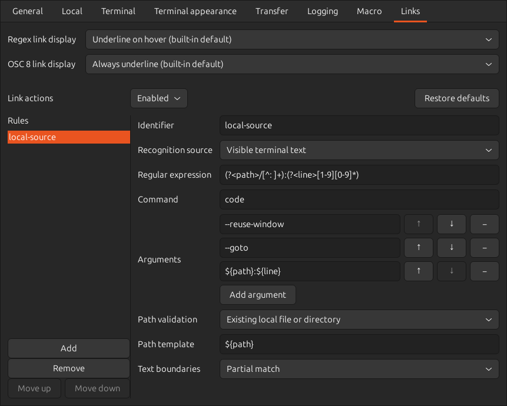

Ctrlキーを押しながらリンクをクリックすると、設定したアプリケーションで開きます。
右クリックの「リンクをコピー」でリンク先をコピーできます。

標準では、HTTP/HTTPSのURL、ローカルに存在する絶対パスやホームディレクトリからのパス、VS Code用のリンクに対応しています。
ローカルパスはelder-termsを実行しているコンピューター上のファイルを指します。

接続設定の「リンク」タブで、有効・無効、リンクの表示方法、独自のルールを設定できます。
表示中の文字列から認識したリンクは、既定でポインターを重ねると下線を表示します。
接続先がリンク先と表示範囲を明示するOSC 8リンクは、既定で常に下線を表示します。
存在確認付きの表示を選ぶと、確認できていないローカルパスは暗く表示されます。

独自ルールは最初に一致した一つを実行します。外部コマンドを起動するため、受け入れる形式を必要な範囲に限定してください。
区切り文字の扱い、表示の選択肢、正規表現、INIの書式は[端末リンクの詳細](./docs/ja/terminal-links.md)を参照してください。

---

## 表示言語の設定


ランチャーの「アプリケーション設定」にある「表示言語」では、
システムの既定言語、英語、アラビア語、スペイン語、フランス語、ヒンディー語、日本語、韓国語、ポルトガル語、ロシア語、簡体字中国語を選択出来ます。

表示言語はelder-termsの起動時に読み込まれるため、変更を保存した後にelder-termsを再起動する必要があります。
保存時に表示されるダイアログで「今すぐ再起動」を選ぶか、後で手動で再起動して下さい。
既に開いているターミナルやファイル転送ウインドウも、その場では表示言語が切り替わりません。

> 注記: elder-termsのプロジェクトオーナーは日本語話者で、日本語及び英語が分かりますが、
> 他の言語は全く読めません。そのため、elder-termsに含まれている多国語表記は完全に機械翻訳に頼っています。
> もし、望ましくない表記を見つけた場合は、PRを送って下さい。

## ターミナル種別の設定


ターミナル種別は、接続先にelder-termsがエミュレートする端末の種類を伝えるための名前です。
TELNETではターミナル種別のネゴシエーション時に、SSHでは仮想端末の確保時に、この値が接続先へ自動的に通知されます。

接続先のシェルや `curses` を使用するアプリケーションは、
この値に対応する `terminfo` を参照して、色、カーソル移動、ファンクションキーなどの制御シーケンスを選択します。
通常はデフォルトのままで構いませんが、接続先がそのターミナル種別に対応していない場合は、
接続先にインストールされている `xterm` などの値を指定して下さい。

TELNETとSSHのデフォルトは`xterm-256color`です。グローバル設定または接続設定で、接続先に合う端末種別を指定できます。

## 動作中のバージョンの確認


ランチャーまたはターミナルウインドウのアプリケーションメニューから「elder-termsについて」を選択して下さい。
「情報」ページで、動作中のelder-termsのバージョンを確認できます。

---

## ソースから利用する

ソースからビルドして使う場合は、[ビルドガイド](./docs/ja/building.md)を参照してください。
必要な環境、ビルドと起動の手順、テスト、debパッケージの生成方法を説明しています。

## License

Under MIT.

### 同梱されるサードパーティライブラリ

elder-termsに同梱しているライブラリと、それぞれに適用されるライセンスは次のとおりです。

| ライブラリ | 用途 | ライセンス |
| --- | --- | --- |
| [boxrig](https://github.com/kekyo/boxrig) | 端末の制御シーケンスの解釈と画面描画 | [MIT](https://github.com/kekyo/boxrig/blob/8ae3e3f8caa5499b20eee7896eaa568bfdfdc9a9/LICENSE) |
| [cardio](https://github.com/kekyo/cardio) | 非同期I/O | [MIT](https://github.com/kekyo/cardio/blob/31e8149ce52cdfdaaa48838ca9de39288074885c/LICENSE) |
| [libxyzm](https://github.com/kekyo/libxyzm) | X/Y/ZMODEMによるファイル転送 | [MIT](https://github.com/kekyo/libxyzm/blob/b1cd04cfd2769bbd1a5a6bc6990d60338b5a3cf5/LICENSE) |
| [jemalloc](https://github.com/jemalloc/jemalloc) | メモリの確保と管理 | [BSD-2-Clause](https://github.com/jemalloc/jemalloc/blob/7a34f18502e7b222724097cdcd499b437d189acc/COPYING) |
| [libsmb2](https://github.com/sahlberg/libsmb2) | SMB2/3によるファイル転送と共有一覧の取得 | [LGPL-2.1-or-later](https://github.com/sahlberg/libsmb2/blob/727feaaa6d0f4fed1bae57745fbc2c5db9a30e64/COPYING) |
| [libdsm](https://github.com/videolabs/libdsm) | SMB1によるファイル転送と共有一覧の取得 | [LGPL-2.1-or-later](https://github.com/videolabs/libdsm/blob/0f3edc6df6ab5950f2550d453035351440f71e31/COPYING) |

boxrigには、utf8proc、libpng、zlibのほか、Unicode、WHATWG Encoding、Waylandプロトコル由来のデータや生成コードが含まれます。
各コンポーネントのライセンスは、[boxrigのライセンス一覧](https://github.com/kekyo/boxrig/blob/8ae3e3f8caa5499b20eee7896eaa568bfdfdc9a9/packaging/licenses/README_ja.md)を参照してください。

配布パッケージには、boxrig、jemalloc、libsmb2、libdsmのライセンスと通知を、`/usr/share/doc/elder-terms/licenses/`内の各ライブラリ名のディレクトリに同梱します。
libsmb2とlibdsmのディレクトリには対応するソースも収録し、libdsmには適用した修正パッチを添付します。
詳しくは[SMBライブラリのソースとライセンス](./docs/ja/smb.md#同梱ライブラリのソースとライセンス)を参照してください。

### アイコンと絵文字画像

同梱する接続アイコンと絵文字名には、それぞれの素材のライセンスが適用されます。
[素材の配布元とライセンス](./docs/ja/connection-icon-artwork.md)を参照してください。
配布パッケージには、`/usr/share/doc/elder-terms/licenses/connection-icons/`へライセンスと通知を同梱します。
