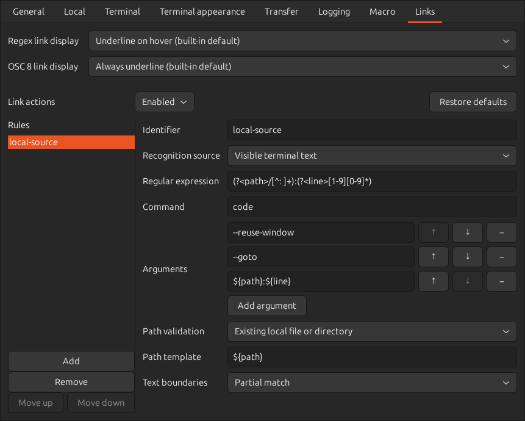

# Configuring Terminal Links and Macros

OSC 8 links have a target and display range explicitly supplied by the connection. Links can also be recognized in visible text using regular expressions.
A regular expression describes a text pattern. Captures assign numbers or names to parts of the matched text so they can be referenced in command arguments and other values.

## Opening and Copying Links



Hold `Ctrl` and left-click a recognized link to run its configured external
command. A rule can inspect either the target of an OSC 8 escape sequence or a
matching substring in visible terminal text. Rules are evaluated in their
displayed order, and only the first matching rule is run.

Right-click a recognized link and choose "Copy Link" to copy its target to the
clipboard. For visible-text links, this copies the entire matched text. For
OSC 8 links, it copies the original target URI. If terminal output changes while
the menu is open, the target from when you opened the menu is still copied.

Select a connection in the launcher and open its "Links" tab to enable or
disable link actions, add and remove rules, change their order, edit command
arguments, and restore the built-in defaults. The same tab is available from
the settings dialog in a running terminal. Link rules are saved separately
for each connection.

When a connection defines no link rules, the built-in rules recognize:

- HTTP and HTTPS URLs in OSC 8 targets and visible terminal text, opened with
  `xdg-open` in the desktop's default application.
- OSC 8 targets in `vscode://file/absolute/path:line` and
  `vscode://file/absolute/path:line:column` form, opened with `code
  --reuse-window --goto`.
- Absolute paths such as `/foo/bar/baz` and home-relative paths such as
  `~/Downloads/` in visible terminal text, opened with
  `xdg-open` when they name a local file or directory. Surrounding quotes are
  excluded from the link.

The built-in HTTP/HTTPS recognition excludes following Japanese punctuation and
closing brackets without a matching opening bracket. For example,
`参照: https://host/a、詳細は後述` and `[label](https://host/a)` both open and
copy `https://host/a`.
Balanced brackets inside a URL, IPv6 address brackets, percent escapes, queries,
and fragments are preserved. A URL continues across screen-width wrapping;
an explicit newline ends it.
Punctuation in prose cannot always be distinguished from part of a URL. For
example, commas in a query are retained as values. These boundaries apply to
the built-in URL expression. They do not trim matches of an edited expression
or the URI explicitly supplied by OSC 8.

URI escapes in captures, such as `%20`, can be decoded before a value is
passed to the command. "Restore defaults" removes the connection's explicit
link settings, so later built-in default changes also take effect.

## Custom Link Rules

Each rule selects one recognition source:

- "OSC 8 target" applies the regular expression to the complete raw target.
- "Visible terminal text" finds a matching substring under the pointer. The
  expression must not match an empty string.

The default local path rule recognizes paths starting with `/` or `~/`, with
components containing letters, digits, combining marks, `_`, `.`, and `-`.
A trailing `/` is allowed. Substrings of `relative/foo/bar` or `/foo//bar` do not
become links.
Setting "Text boundaries" to "Whitespace, punctuation or line ends" requires
delimiters around a match. The default local path rule enables this option.
The following punctuation also acts as a delimiter, so only the path becomes a
link in `user@host:~/dir$`, `path=/tmp;`, and `「/tmp」`.

| Delimiter position | Accepted characters |
| --- | --- |
| Either side | Whitespace, quotes `'` and `"`, backticks, `:`, `=`, `;`, `\|`, `&`, `<`, `>`, `,`, `、`, `。`, and line ends |
| Before the match only | `(`, `[`, `{`, `（`, `「`, `『` |
| After the match only | `)`, `]`, `}`, `）`, `」`, `』`, `$` |

Delimiter characters are excluded from copied links and launch targets.
The same rules apply across screen line wraps. A period remains part of a
filename; quote or otherwise enclose a path before adding a sentence-ending
period. Custom rules can change both the expression and boundary setting.

## Regular Expressions and Command Arguments

Received-text macros automate text sending or command execution in response to received text.
Link rules and received-text macros use [boxrig pattern syntax](https://github.com/kekyo/boxrig/blob/0.14.0/docs/en/regex.md).
Character classes, groups, alternatives, repetition, and numbered or named captures are supported. Backreferences, lookahead, lookbehind, and expressions matching an empty string are not supported.
`\d`, `\s`, and `\w` cover ASCII. Use Unicode general categories such as `\p{L}` for letters and `\p{Nd}` for decimal digits.
`.` also matches newlines, and `^` and `$` anchor the complete input. Matching is case-sensitive and chooses the longest match at the same starting position.
A complete match cannot split a visible character composed of multiple Unicode characters. Use an expression such as `[\p{L}\p{M}]+` to include combining marks.

A link command is a fixed executable name or path. It is launched directly without a shell,
so pipes, redirections, and other shell syntax are not interpreted. Capture
templates are expanded only in arguments and in the optional validation path.
An expanded argument or validation path starting with `~/` uses the home
directory specified by `HOME` on the computer running elder-terms. If `HOME`
is unset or is not an absolute path, the home-relative link cannot be opened.
A tilde inside a URL or path is preserved, and copying a link retains its
original text.

Each rule's "Path validation" setting can be switched between "Do not validate"
and "Existing local file or directory". In the latter
mode, the expanded path must be absolute and must name an existing regular
file or directory on the computer running elder-terms; otherwise the command
is not run. Relative paths are rejected because terminal display text does not
provide a reliable local working directory, particularly for remote sessions.

## Link Display

The top of the "Links" tab offers separate "Regex link display" and "OSC 8 link
display" settings. Regex links are found by regular expressions in visible
terminal text. OSC 8 links have a target and display range explicitly supplied
by the connection.
The defaults are "Underline on hover" for regex links and "Always underline"
for OSC 8 links. Each setting offers four choices:

| Choice | Display |
| --- | --- |
| No decoration | Adds no link styling. |
| Always underline | Adds underlines without changing brightness. |
| Underline on hover | Underlines only the link under the pointer. Holding Ctrl is unnecessary. |
| Validate links (with dimming) | Adds underlines and dims local paths until confirmed valid. Valid paths return to normal brightness; other links look the same as always underline. |

Recognition, copying, and Ctrl+click remain available in every display mode.
When the two sources overlap, the OSC 8 display setting takes precedence.
OSC 8 links without a matching action rule also receive the chosen display;
a display setting does not authorize additional targets to open.
Dimming affects display only; terminal text and copied content remain unchanged.
The built-in local path rules enable path validation. OSC 8 also recognizes
absolute paths, home-relative paths starting with `~/`, and URIs starting with
`file:///` or `file://localhost/`. The decoded URI path is validated and its
visible label is decorated. Terminal input and drawing continue
while existence checks run. `Ctrl`+click checks the path again, running the
command if valid or showing a modal dialog with the reason if invalid.
Each display setting can inherit connection defaults or be specified for an individual connection.
In INI files, set `regex_link_decoration` and `osc8_link_decoration` under
`[terminal]` to `none`, `underline`, `hover`, or `validated`. This example
matches the built-in defaults:

```ini
[terminal]
regex_link_decoration=hover
osc8_link_decoration=underline
```

## Defining Link Rules in INI Files

The same settings can be edited directly in a connection's INI file. This
example recognizes an absolute local source path followed by a line number:

```ini
[hyperlink]
enabled=true

[hyperlink.local-source]
source=terminal-text
regex=(?<path>/[^\s:]+):(?<line>[1-9][0-9]*)
command=code
arguments=--reuse-window;--goto;${path}:${line};
path_validation=existing-local-path
path=${path}
```

`source` is `osc8` or `terminal-text` and defaults to `osc8` when omitted.
`whole_token=true` requires the whitespace, punctuation or line-end boundaries
listed above around visible-text matches. It defaults to `false` and does not
affect OSC 8 targets.
`path_validation` is `none` or `existing-local-path`; `path` is required for
the latter. `[hyperlink.<rule-id>]` sections are evaluated in file order. Rule
IDs may contain letters, digits, `-`, and `_`.

`arguments` is semicolon-delimited, and each item becomes a separate command
argument. `${0}` refers to the entire match, `${1}` and `${2}` to numbered
captures, and `${name}` to a named capture. `${path|uri-decode}` decodes URI
escapes in that capture. Write a literal `$` as `$$`.

Defining at least one `[hyperlink.<rule-id>]` section replaces all built-in
rules for that connection. When no rule section is defined, the built-in rules
apply. To disable all link actions, set `[hyperlink]` `enabled=false` in the
connection file. Link sections in `global.ini` are ignored.

OSC 8 targets and visible text may be supplied by a remote host. Restrict each
regular expression to the formats you intend to accept. Invalid rules,
undefined captures, invalid URI escapes, and failed path validation do not run
the command.

## Configuring Macros


Macros (automatic macros) monitor text received from the remote host with
regular expressions. When a match is found, they either send text to the host
or run a specified command. They are available for local terminal, TELNET,
serial, and SSH connections, but cannot be defined for file transfer connections
or Connection defaults.

In text to send, commands, and command arguments, `${0}` refers to the entire
regular-expression match, `${1}` and `${2}` refer to numbered captures, and
`${name}` refers to a named capture. Write a literal `$` as `$$`.

Macro rules are evaluated from top to bottom. Even if multiple regular
expressions match the same received line, only the first matching rule runs.
Use "Move up" and "Move down" to place higher-priority rules nearer the top.
When editing the INI file directly, the order in which `[macro.<rule-id>]`
sections appear determines their priority.

The following examples show the format used when editing a connection's INI
file directly. You can configure the same values on the "Macro" tab in the
settings dialog.

This rule automatically sends Enter when the remote host displays
`Press ENTER to continue`:

```ini
[macro.continue]
regex=^Press ENTER to continue$
send=\r\n
```

This rule extracts a token from text such as `CHALLENGE TOKEN` and responds
with `RESPONSE TOKEN` followed by a newline:

```ini
[macro.challenge]
regex=^CHALLENGE (?<token>[A-Z]+)$
send=RESPONSE ${token}\r\n
```

When a line such as `ERROR: Connection failed` is received, this rule passes
the message portion to the `logger` command and records it in the system log.
`arguments` is semicolon-delimited, and each item becomes a separate command
argument.

```ini
[macro.log-error]
regex=^ERROR: (.+)$
command=/usr/bin/logger
arguments=-t;elder-terms;${1};
```

Commands are launched directly without a shell, so shell syntax such as pipes
and redirections is not interpreted. Specify each required value as a separate
item in `arguments`.
