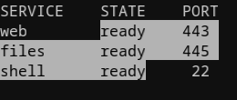
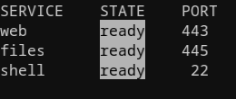

# Selection and Copying Details

See the [README selection and copying instructions](../../README.md#selecting-and-copying-terminal-text) for basic operations.

## Selection Mode During a Drag

These examples drag between the same positions in the same text. Linear selection follows the lines from the starting point to the endpoint.



Block selection selects a rectangle. This example selects only `ready` in the STATE column.



Holding Ctrl when pressing the left button starts a block selection.
During a drag, changes to Ctrl take effect on the next mouse movement: Ctrl selects a block, and no Ctrl selects normally.
Movement within the same character also switches modes. Pressing or releasing Ctrl alone, wheel scrolling, autoscrolling, and releasing the left button do not switch modes.

Switching preserves the starting point, even after scrolling moves it off screen.
A normal selection started with a double click returns to word selection; one started with a triple click returns to line selection.
A selection started with Ctrl held switches to character selection when returning to normal mode.

Switching alone does not update either clipboard. Releasing the left button completes the selection using the last applied mode.

## Clipboards

Completing a selection copies its text to the selection clipboard (PRIMARY), which supports middle-button pasting.
This is separate from the regular clipboard (CLIPBOARD) used by "Copy" and Ctrl+Shift+C.
Escape and left click clear the selection without erasing previously copied text.

During IME composition, Escape cancels composition first; the next Escape clears the selection.
The IME's key handling can take priority in some environments. See [IBus key handling](https://github.com/ibus/ibus/blob/1.5.29/client/gtk2/ibusimcontext.c#L643-L752).

## Block Copy Results

Selections can span more history than fits on screen. Copying preserves whole wide characters, combining sequences, and emoji.
Each screen row, including a wrapped row, is separated by a newline. No extra newline is added at the end.
Bidirectional text is copied in logical order within each row.

By default, spaces continuing to the screen row's right edge are removed only where they overlap the selection.
If text exists to the right of the selection, spaces before it are preserved.
Only empty cells and standalone ASCII spaces are removed. Full-width spaces, non-breaking spaces (NBSP), and spaces with combining characters remain.
Rows made empty by trimming remain as rows.

To preserve spaces, disable "Trim trailing spaces in block copies" on the "Terminal" tab.
In an INI file, use the following setting.

```ini
[terminal]
block_copy_trim_trailing_spaces=false
```

The built-in default is `true`; normal selection is unaffected.
After changing the setting, you can copy the same selection again using the new preference.
It applies to both PRIMARY and CLIPBOARD, including replacing the destination with an empty string when trimming removes all selected text.

## When a Selection Cannot Be Copied

Zero-width selections and ranges invalidated by terminal output cannot be copied. Existing clipboard contents remain intact.
Selections or copies exceeding capacity limits also leave the clipboard intact rather than replacing it with partial text. Select a smaller range and try again.
Focus changes, menus, and disconnection end an active drag. Losing focus alone does not clear a completed selection.
