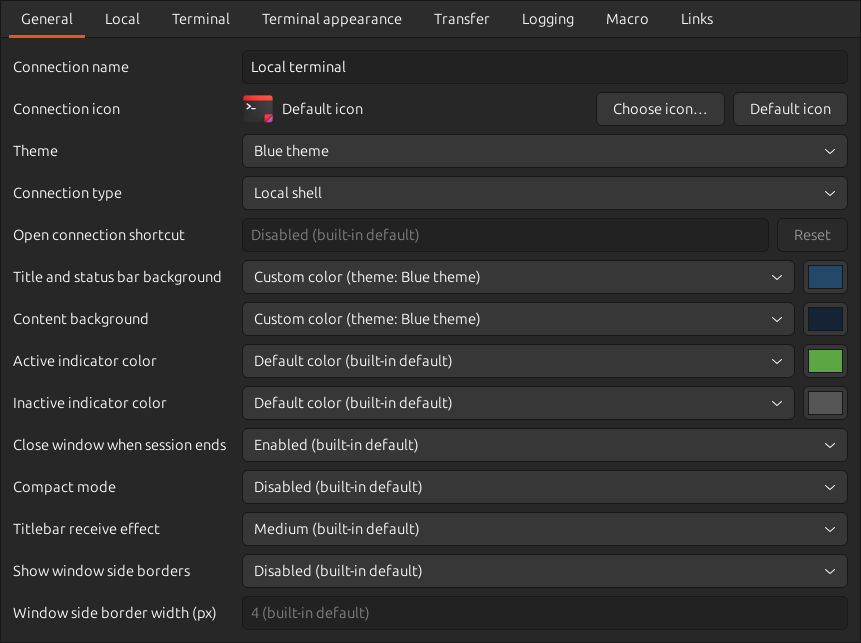
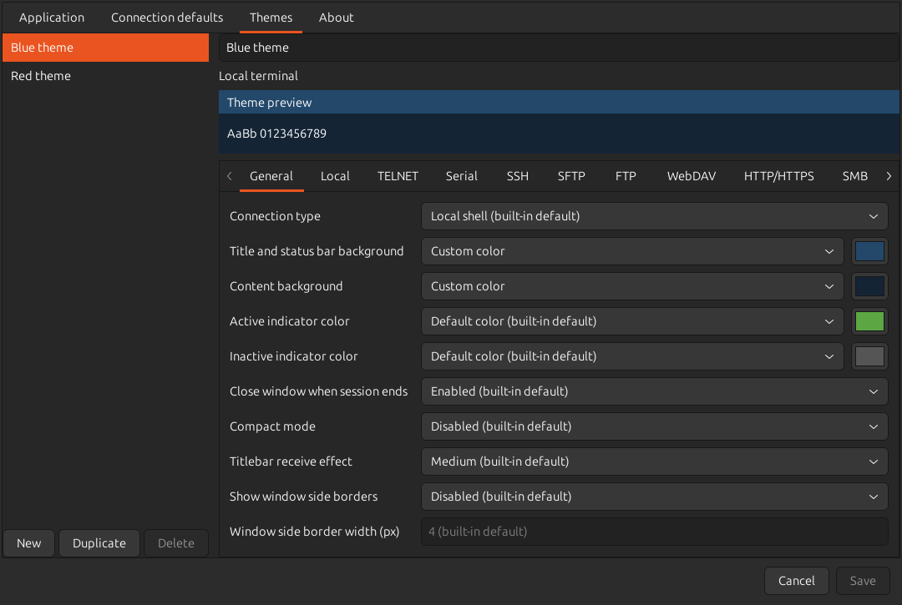

# INIファイルで設定する

保存済みの接続は、ランチャーで右クリックして「テキストエディタで編集」を選ぶと編集できます。
設定ファイルの場所と、既定値・接続別設定の関係は[README](../../README_ja.md#設定項目の構造)を参照してください。
ここではREADMEで紹介している設定の書式を示します。

## 設定の継承

テーマは、複数の接続で共有する設定の集合です。
接続のINIファイルで項目を省略すると、選択したテーマ、接続の既定値、組み込み既定値の順に、指定のある値を引き継ぎます。
アプリケーション全体の設定先は`global.ini`です。
接続アイコンやマクロ、リンクルールなど、接続ごとに指定する項目は各ガイドを参照してください。



空の値とキーの省略は、項目によって意味が異なります。例えば`font_families=`は組み込みのフォント一覧を明示的に選びます。

## 名前付きテーマ



テーマの保存先は、`global.ini`と同じディレクトリの`theme.ini`です。テーマごとに参照用IDと表示名を持ちます。画面で改名してもIDは変わりません。

```ini
; theme.ini
[theme.red]
name=赤テーマ

[theme.red.general]
exterior_background=#7A2222
background=#281818
```

接続INIの`[general]`で、表示名ではなくIDを指定してください。

```ini
[general]
theme=red
```

テーマでは`[theme.ID.元のセクション名]`に共有する項目だけを指定します。値の型や範囲は接続INIと同じです。接続で指定した値はテーマより優先されます。キーを省略すると継承し、`false`、0、空文字、色の`none`などは、各項目で有効な場合に明示値として扱います。継承元と同じ値でも、接続で明示すれば独立した指定です。

接続にはテーマの参照と接続独自の指定だけを保存します。テーマの値は接続INIへ展開されません。テーマ名は空欄にできず、重複もできません。IDには英数字、ハイフン、アンダースコアを使えます。IDの重複、未知のキー、不正な値は診断対象です。ファイルが未作成ならテーマ一覧は空ですが、読み取り失敗や不正な内容を空の一覧として上書きしません。

起動時INIも使う場合、優先順は「組み込み値 → `global.ini` → 選択テーマ → 接続INI → 起動時INI → 実行中の適用」です。起動時INIに`theme`がなければ接続の選択を使い、`theme=`と書けばテーマを外します。参照先が見つからない接続は起動できません。IDを修正するか、`theme=`で解除してください。

画面での編集、保存後の反映時期、一部だけ保存できた場合の操作は[名前付きテーマを共有する](../../README_ja.md#名前付きテーマを共有する)を参照してください。

## New Windowで開く接続

`global.ini`の`[general]`に、保存済みの端末接続の名前を指定してください。

```ini
[general]
new_window=Local terminal
```

ランチャーで接続名を変更すると、この設定も追従します。
接続を削除したり、ファイル転送用の接続へ変更したりすると選択が解除されます。
未指定の場合は既定の端末設定で起動します。指定した接続が見つからない、読み込めない、端末接続ではない場合は起動に失敗します。

## ウインドウと通知

```ini
[general]
auto_close=false
compact_mode=true
show_border=true
border_width=4
indicator_color=#3584E4
indicator_off_color=#808080
receive_effect=strong

[terminal]
visual_bell=disabled
```

| キー | 指定方法 |
| --- | --- |
| `auto_close` | 正常なセッション終了時に閉じる場合は`true`、残す場合は`false` |
| `compact_mode` | `true`でコンパクトモード。組み込み既定値は`false` |
| `show_border` | `true`でボーダーを表示。組み込み既定値は`false` |
| `border_width` | 1〜1000ピクセル。組み込み既定値は4 |
| `indicator_color`、`indicator_off_color` | `#RRGGBB`形式の色、または`default`。`default`はそれぞれ元の緑色、灰色 |
| `receive_effect`、`visual_bell` | `disabled`、`weak`、`medium`、`strong`。組み込み既定値は`medium` |

インジケーターの色が不正な場合は警告し、有効な継承値または組み込み既定値を使います。
接続アイコンの`icon`は[接続アイコンの設定](connection-icons.md#iniでの指定)を参照してください。

## 端末の操作

```ini
[terminal]
accessibility_enabled=true
return_code=crlf
send_break_key=F12
scrollback_lines=20000
bell_sound=/home/user/.local/share/sounds/terminal-bell.oga
block_copy_trim_trailing_spaces=false
```

| キー | 指定方法 |
| --- | --- |
| `accessibility_enabled` | `true`で端末本文を読み上げソフトへ公開。組み込み既定値は`false` |
| `return_code` | `auto`、`cr`、`lf`、`crlf` |
| `send_break_key` | BREAK送信のキーの組み合わせ。空欄で無効 |
| `scrollback_lines` | 1000〜100000行。組み込み既定値は10000 |
| `bell_sound` | `default`でデスクトップのビープ音。カスタム音はOgg VorbisまたはWAV（PCM）の絶対パス |
| `block_copy_trim_trailing_spaces` | `false`でブロックコピーの行末空白を保持。組み込み既定値は`true` |

コピー時の空白やクリップボードの扱いは[文字選択とコピー](text-selection.md)を参照してください。

## フォントと文字幅

```ini
[terminal]
font_size_dip=14.5
font_zoom_mode=preserve-window
ambiguous_width=wide
font_families=DejaVu Sans Mono;Noto Sans Mono CJK JP;Monospace;
```

文字サイズの単位はDIPで、1/96インチを基準とします。組み込み既定値は12 DIPです。

`font_zoom_mode`はCtrl+Wheelや拡大・縮小キーで維持する対象を指定します。

| 値 | ズーム時の動作 |
| --- | --- |
| `preserve-grid` | 行・桁数を保ち、文字サイズに合わせてウインドウを変更。組み込み既定値 |
| `preserve-window` | ウインドウサイズを保ち、表示できる行・桁数を接続先へ通知 |

キーを省略すると、接続で選んだテーマまたはグローバル設定を継承します。不正な値は警告し、有効な継承値または組み込み既定値を使います。
モードの適用だけでは現在の文字サイズやウインドウサイズは変わらず、適用後のズーム操作から有効になります。
文字サイズ・行数・桁数の直接指定や手動リサイズは、この設定によらず使用できます。
最大化や全画面などでウインドウサイズが制限される場合は、どちらのモードでも実際の表示領域に行・桁数を合わせます。

`ambiguous_width`は`narrow`で1列、`wide`で2列、`font`でフォント依存になります。組み込み既定値は`narrow`です。
幅の決め方を変更した後は、保存して端末を開き直してください。
不正な幅の指定は警告し、有効な継承値または組み込み既定値を使います。

`font_families`は優先順のセミコロン区切りです。キーの省略は継承、`font_families=`は`Noto Sans Mono`、`Monospace`の順への復帰を意味します。
接続別の一覧は、継承元の一覧全体を置き換えます。
名前の前後の空白は除去されます。空の名前、重複、カンマ、制御文字は指定できません。
名前に含まれるセミコロンとバックスラッシュは、[GLib KeyFileのエスケープ規則](https://docs.gtk.org/glib/struct.KeyFile.html)に従い`\;`、`\\`と記述します。
不正な一覧は警告し、有効な継承値または組み込み既定値を使います。

## 背景と色補正

次は、縦型カーソル、すりガラス背景、背景画像、文字の明暗差の補正を組み合わせた例です。

```ini
[terminal]
cursor_shape=bar
cursor_blink=false
background_mode=blur
background_opacity=40
cell_background_mode=opaque
background_tint_color=#203040
background_tint_opacity=20
background_image=/home/user/Pictures/terminal.png
background_image_opacity=70
background_image_fit=cover
color_filter=oklch
```

不透明度は0〜100%です。画像はPNGまたはJPEGの絶対パスで指定します。
画像ファイルと展開後のRGBA画像はそれぞれ64 MiB以内、各辺は16384画素以内です。
画像を移動すると次回起動時に読み込めなくなるため、同じ場所に置いてください。
透過・すりガラスの利用条件は[READMEの背景設定](../../README_ja.md#カーソルと背景の設定)を参照してください。

`cell_background_mode`は、端末が文字ごとに指定した背景色の透過を切り替えます。
既定値の`transparent`では、文字背景の不透明度も`background_opacity`と共通です。
`opaque`では、16色・256色・RGBで指定した背景を不透明にします。通常背景と同じRGBの指定や、空白・文字消去後の背景も対象です。
通常背景は従来の不透明度を保ち、背景色を既定値へ戻すエスケープシーケンスSGR 49でも通常の透過に戻ります。
反転表示で不透明になるのは、反転後に背景へ移った色です。色補正を使う場合は補正後の色を表示します。

この設定は背景モード・背景画像と併用できます。選択・カーソル・IMEの不透明度はそれぞれの設定を保ちます。
未設定なら接続の既定値を継承し、実行中に適用すると表示済みの文字や履歴にも反映されます。

`color_filter`には次の値を指定できます。各方式の見え方は[READMEの色フィルタ](../../README_ja.md#背景と文字の明暗を反転する)で説明しています。

| 値 | 補正 |
| --- | --- |
| `none` | 補正しない |
| `oklch` | 明暗差を改善 |
| `reverse-lightness` | 明度を反転（A） |
| `reverse-contrast` | コントラスト比を保って反転（B） |
| `reverse-roles` | 文字と背景に合わせて反転（C） |
| `reverse-cam16` | 見え方を補償して反転（D） |
| `reverse-palette` | 配色を最適化して反転（E） |

色の区別を補助する場合は、次のように指定してください。色フィルタと併用できます。

```ini
[terminal]
color_vision=deutan
color_vision_strength=60
color_filter=oklch
```

`color_vision`は`none`、`protan`、`deutan`、`tritan`から選びます。
`color_vision_strength`は0〜100で、0は補助を無効にします。種類を選んだときの既定の強さは100です。
リンクの表示設定は[端末リンクアクション](terminal-links.md)を参照してください。

## ローカルの起動コマンド

```ini
[local]
command_line=/bin/sh -lc 'exec tmux new-session -A -s elder-terms'
```

起動コマンドはシェルを介さず実行します。パイプやリダイレクト、環境変数の展開が必要な場合は、この例のようにシェルを指定してください。
空欄では既定値を継承します。組み込み既定値は`SHELL`のシェルで、未設定または空の場合は`/bin/sh`です。

## シリアル接続

```ini
[serial]
device_match_mode=by-id
device=/dev/serial/by-id/usb-Example_Serial_Device_1234-if00
device_usb_serial=1234
carrier_detect=ignore
```

`device_match_mode`は`path`、`by-id`、`by-path`から選びます。省略時は`by-id`です。
`device_usb_serial`は、設定画面が取得できたUSBシリアル番号を保存する補助情報です。
同じ番号の候補が複数ある場合は、接続を待機します。
`device_match_mode`がない従来のINIファイルにデバイスパスが保存されている場合も、そのパスは引き続き使用されます。
`carrier_detect=ignore`は接続監視信号を「監視しない」にします。

## テキスト送信とペースト

```ini
[transfer]
text_send_follow_return_code=true
```

`true`ではテキスト送信・ペースト・マクロ送信の改行を`return_code`に合わせます。`auto`の場合はCRです。
`false`では元のCR・LF・CRLFを保持します。組み込み既定値は`true`です。

## 接続方式と自動操作の設定

接続方式の設定は、[FTP/FTPS](ftp-ftps.md)、[HTTP](http.md)、[WebDAV](webdav.md)、[SMB](smb.md)、[NFS](nfs.md)、[SSH踏み台](ssh-proxy.md)のガイドを参照してください。
マクロと独自のリンクルールは[端末リンクとマクロのガイド](terminal-links.md)に例を掲載しています。
