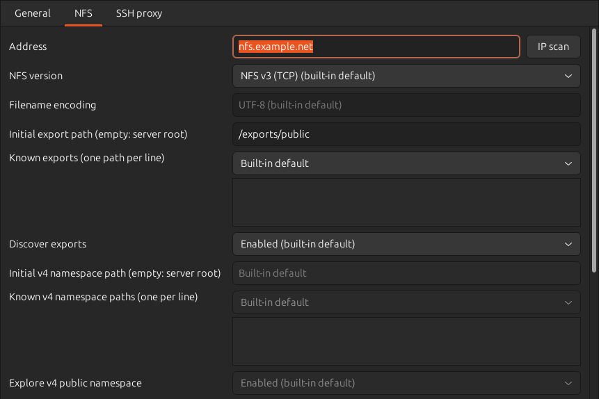
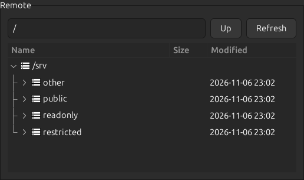

# NFSの使用

NFSは、サーバーが公開するディレクトリへ接続する方式です。公開ディレクトリをexportと呼びます。elder-termsはNFS v2・v3・v4.0へTCPで接続し、ファイルとフォルダーを送受信できます。通信にはシステムにインストールされたlibnfs 5.0.2以上を使います。

## 接続する



ランチャーで接続種別を「NFS」にし、NFSタブでサーバーのアドレスと版を指定します。既定の版はv3です。サーバーが受け付ける版を選んでください。接続に失敗しても、別の版へ自動で切り替えません。

アドレス欄の「IPスキャン」から接続先を探せます。「NFS(2049)」のチェックマークは、TCPの2049番ポートが応答した候補を示します。対応する版や公開パスへのアクセス権は、実際に接続して確認してください。候補を選んでも、版やNFS・MOUNTポート、認証の設定は変わりません。2049以外のポートを使う接続先は、アドレスとポートを手入力してください。

認証には数値の利用者IDとグループIDを渡すAUTH_SYSを使います。パスワードの入力はありません。UIDとGIDの既定値は現在のプロセスのIDで、サーバー側のアクセス権に合わせて指定できます。補助グループは最大16個です。UDP、RPCSEC_GSS、NFS v4.1/v4.2は対応範囲に含みません。

v2・v3では、サーバーからexportの一覧を取得します。一覧を取得できないサーバーでは、「既知のexport」に公開パスを登録してください。既知パスがあれば、一覧の取得に失敗してもそこへ接続できます。

v4.0では、サーバーが公開する一つのディレクトリツリーを探索します。v2・v3のexport一覧とは異なります。例えばv3の`/srv/public`がv4では`/public`になるサーバーでは、v4専用の公開パス欄へ`/public`を指定します。途中のディレクトリを一覧できない場合も、既知の公開パスを直接登録できます。

公開パスは、共通の親ディレクトリごとにまとめて表示します。例えば`/storage1/home`と`/storage1/public`は、ルートにある`/storage1`を展開すると表示されます。親が公開されていなくても、登録済みの公開パスをたどれます。

`/`自体が公開されている場合は、その内容をリモート側のルートに表示します。公開されていない場合は、公開パスをまとめた一覧をルートに表示します。

次の画像は、NFS v3で`/srv`を展開した例です。



公開ルートを開くと、その配下を通常のフォルダーとして操作できます。「Up」でツリー上の親へ戻ります。パス欄は`/srv/public/Documents`のような絶対パスで現在位置を表示します。パスを入力してEnterを押すと、その場所へ移動できます。`.`や`..`、途中の連続した`/`は使えません。末尾の`/`は、ルートを除いて省いて表示します。

公開パスが入れ子の場合は、入力した場所を含む最も深い公開パスを使います。例えば`/srv/public`と`/srv/public/archive`が既知なら、`/srv/public/archive/Documents`には後者を使います。途中の親を一覧できなくても、既知の公開パスへ直接移動できます。

## SSH proxyで接続する

「SSH proxy」タブで踏み台を有効にすると、NFSサーバーへの通信を踏み台経由で行います。NFSタブには最終接続先を指定してください。そのホスト名は踏み台で解決します。複数のexportを開く場合も、SSH接続は共通です。

v2・v3では、NFSとMOUNTの通信を中継します。ポートが0の場合は、踏み台からサーバーのTCP 111番へ接続してポートを探索します。両方のポートを指定した場合は探索しません。v4.0では、指定したNFSポートへ接続し、0の場合はTCP 2049番を使います。MOUNTやポート探索への接続は不要です。[libnfsのポート設定](https://github.com/sahlberg/libnfs#readme)も参照してください。

「予約済みポートを必須にする」とSSH proxyは併用できません。両方を有効にすると、設定画面と接続開始時にエラーを表示します。設定を自動で変更することはありません。通常のSSH転送では、踏み台側の送信元ポートを1024未満に指定できないためです。[SSHのTCP転送仕様](https://www.rfc-editor.org/rfc/rfc4254.html#section-7.2)を参照してください。

サーバーから見た接続元は踏み台になります。exportsで踏み台からの接続を許可し、予約済みポートを要求するサーバーでは、その接続に対して`insecure`を指定してください。ファイルへのアクセスにはNFSタブのUID・GIDを使います。SSHのログインユーザーへ切り替わることはありません。[exportsの仕様](https://man7.org/linux/man-pages/man5/exports.5.html)に従って設定してください。

SSHで暗号化されるのは、手元から踏み台までです。踏み台がNFSサーバーとは別のマシンの場合、その先の通信はSSHの暗号化範囲外となります。接続や中継に失敗しても直接接続へ切り替えません。認証と設定の継承は[SSH proxyの使用](ssh-proxy.md)を参照してください。

## 送受信とファイル操作

左右の項目を右クリックすると、送受信、新しいフォルダーの作成、名前変更、削除を選べます。フォルダーの送受信と削除は配下も対象です。シンボリックリンクはリンクとして扱い、参照先を再帰的に辿りません。権限とアクセス・更新時刻も、サーバーが許可する範囲で保持します。

送信する前にRemoteで、受信する前にLocalで、フォルダーか通常のファイルを1つ選んでください。フォルダーを選ぶとその配下へ、ファイルを選ぶとそのファイルがあるフォルダーへ転送します。未選択の場合や、シンボリックリンクまたは複数の項目を選んだ場合は、送受信を選べません。パス欄の場所は転送先として使いません。公開ルートを選んで、その配下へ送信することもできます。

公開ルートは入れ子の場合も名前変更・削除できません。公開パスをまとめた一覧や未公開の親は、項目の作成や一覧自体の変更ができず、転送先にも指定できません。`/`自体が公開されている場合は、サーバーが許可すればその配下へ作成できます。異なる公開ルート間の名前変更はできないため、必要なら受信と送信を行ってください。

同名の転送先がある場合は、上書きまたはスキップを選びます。送信は一時領域へ書き込み、全体を送り終えてから目的の名前へ確定します。v2の一時領域はフォルダーです。通信が切れて所有や後片付けを確認できない場合は、ジョブ結果に一時パスを残します。再接続して内容を確認し、不要なら削除してください。

読み取り専用の公開領域では、一覧と受信を利用できます。送信や変更を試みると、サーバーの拒否を表示します。利用者IDの制約や、rootの権限を一般利用者へ変換するroot squashもサーバーの設定に従います。

「Close window when session ends」を無効にすると、切断後も画面が残り、「再接続」からやり直せます。失敗した変更操作を自動で再実行しません。再接続後に一覧を確認してから、必要な操作を選び直してください。

## ファイル名の文字コード

既定値はUTF-8です。サーバー上の名前がCP932、Shift_JIS、EUC-JPなどの場合は、接続の「ファイル名の文字コード」へ指定します。ファイル本文は変換しません。CP932とShift_JISは別の文字コードとして扱います。

各項目は、選択したテーマやグローバルな接続の既定値から継承するか、その接続だけで上書きできます。接続中に文字コードを保存しても、その接続は元の設定を維持します。新しい文字コードは再接続後に反映され、過去のジョブ名は変わりません。

文字列や数値の入力欄は、空欄にすると継承値が表示されます。版や有効・無効の選択欄では、既定値の選択肢で継承に戻せます。複数行の一覧を編集するには「独自指定」を選んでください。この一覧を空にすると、継承元に値があっても空の一覧を使います。

同じディレクトリに異なる文字コードの名前が混在していても、自動判定しません。変換できない名前は`[undecodable: FF]`のように元のバイトを表示します。一覧の表示名が同じでも、異なる元の名前は別の項目として扱います。受信時にローカルの名前を作れない場合や名前が衝突する場合は、判断を求めます。スキップすれば、ほかの項目を続けて転送できます。

複数の項目が同じ表示パスになる場合は、パス欄からの移動をエラーにします。ツリーから対象を選んでください。ツリーの操作では、表示名が同じでも元の名前で区別します。

新しい名前を指定文字コードへ正確に変換できない場合は、作成や名前変更を止めます。代替文字への置換やUnicodeの正規化は行いません。リンク先の名前も正確に変換できる場合だけ複製します。

v4はUTF-8を基本とするプロトコルです。非UTF-8名の設定は、その名前を受け付けるサーバーで使ってください。拒否された名前を別の文字コードで送り直すことはありません。[RFC 7530の文字列の規定](https://www.rfc-editor.org/rfc/rfc7530.html#section-12.4)を参照してください。

## 設定項目

INIファイルでは`[nfs]`に保存します。パスの一覧と補助グループは、セミコロンで区切ります。

| INIキー | 既定値 | 内容 |
| --- | --- | --- |
| `address` | 空 | ホスト名、IPv4、IPv6。URLやパスを含めない |
| `version` | `3` | `2`、`3`、`4.0` |
| `nfs_port` | `0` | 自動設定。固定する場合は1〜65535 |
| `mount_port` | `0` | v2・v3のMOUNTポート。0は自動探索 |
| `require_reserved_port` | `false` | 1024未満の送信元ポートを必須にする |
| `export_path` | 空 | v2・v3で最初に開くexport。空なら`/` |
| `known_exports` | 空 | v2・v3の既知のexportの絶対パス |
| `discover_exports` | `true` | v2・v3のexport一覧を要求する |
| `namespace_path` | 空 | v4.0で最初に開く公開パス。空なら`/` |
| `known_namespace_paths` | 空 | v4.0の既知の公開パス |
| `discover_namespace` | `true` | v4.0の公開ツリーを探索する |
| `filename_encoding` | `UTF-8` | 名前とリンク先の文字コード |
| `local_directory` | 空 | ローカルの初期フォルダー。空なら共通の転送先設定 |
| `uid`、`gid` | `-1` | 現在のプロセスのID。固定する場合は0〜4,294,967,295 |
| `supplementary_gids` | 空 | 補助グループID、最大16個 |
| `connect_timeout_seconds` | `30` | 接続を待つ秒数、1〜86400 |
| `request_timeout_seconds` | `60` | 各要求を待つ秒数、1〜86400 |

次の例では、v3の公開一覧を要求せず、登録したexportへCP932で接続します。

```ini
[general]
type=nfs
name=Archive files
auto_close=false

[nfs]
address=files.example.com
version=3
export_path=/srv/archive
discover_exports=false
filename_encoding=CP932
uid=1000
gid=1000
```

## 接続とサイズの制限

予約済みポートは、1024未満の送信元ポートです。サーバーが予約済みポートを要求する場合は、そのポートを使える実行権限が必要です。権限がなければ接続に失敗します。接続できない場合は、サーバーの公開設定と利用者IDも確認してください。予約済みポートの条件は[nfs-utilsのexports(5)](https://man7.org/linux/man-pages/man5/exports.5.html)で説明されています。

NFSタブの「予約済みポートを必須にする」は既定では無効です。有効にすると、送信元ポートが1024未満であることを確認します。条件を満たさない場合はNFSの要求を送らず、理由を表示します。この設定はv2・v3・v4.0のIPv4・IPv6接続に適用されます。有効にしても実行権限は変わりません。

v2のファイルサイズとオフセットは32ビットです。elder-termsは、上限での曖昧な応答を避けるため、4,294,967,295バイト以上の送信と、その値をサイズとして返すファイルの受信を拒否します。受信データとサイズの不一致もエラーにします。大きいファイルにはv3かv4.0を使用してください。プロトコルの範囲は[RFC 1094](https://www.rfc-editor.org/rfc/rfc1094.html)を参照してください。
