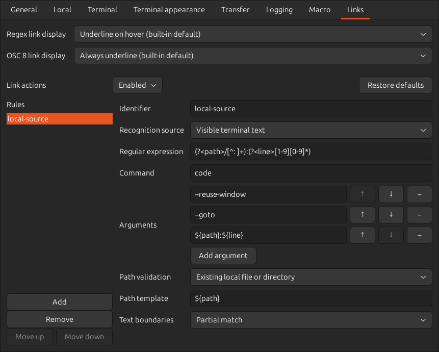

# 端末リンクとマクロの設定

OSC 8リンクは、接続先がリンク先と表示範囲を明示したリンクです。表示中の文字列から正規表現で見つけるリンクも扱えます。

## リンクを開く・コピーする



認識されたリンクを`Ctrl`キーを押しながら左クリックすると、設定した外部コマンドを実行します。
各ルールではOSC 8エスケープシーケンスのターゲット、または表示中の端末テキスト内の一致部分のどちらを検査するか選択出来ます。
ルールは画面の表示順に評価され、最初に一致した一つだけが実行されます。

リンクの上で右クリックし、「リンクをコピー」を選ぶとリンク先をクリップボードへコピーできます。
表示テキストから検出したリンクでは、一致した文字列全体をコピーします。
OSC 8リンクでは元のリンク先URIをコピーします。メニュー表示中に端末の出力が変わっても、開いた時点のリンク先が対象です。

ランチャーで接続先を選択し、その「リンク」タブを開くと、リンクアクション全体の有効・無効、
ルールの追加・削除・並べ替え、コマンド引数の編集、組み込み既定値への復元を行えます。
実行中の端末の設定ダイアログからも同じタブを利用出来ます。リンクルールは接続先ごとに個別に保存されます。

接続先にリンクルールが一つも定義されていない場合は、次の組み込みルールが使用されます。

- OSC 8ターゲットと表示中の端末テキストにあるHTTP/HTTPS URLを認識し、`xdg-open`を使ってデスクトップの既定アプリケーションで開きます。
- `vscode://file/absolute/path:line`または`vscode://file/absolute/path:line:column`形式のOSC 8ターゲットを認識し、`code --reuse-window --goto`で開きます。
- 表示中の端末テキストにある`/foo/bar/baz`のような絶対パスや`~/Downloads/`のようなホームディレクトリからのパスを認識し、ローカルに存在するファイルやディレクトリを`xdg-open`で開きます。パスを囲む引用符はリンクに含めません。

組み込みのHTTP/HTTPS認識では、URLに続く日本語の句読点や、対応する開き括弧のない閉じ括弧をリンクに含めません。
例えば、`参照: https://host/a、詳細は後述`や`[label](https://host/a)`では、開く対象もコピーする内容も`https://host/a`です。
URL内部の対応する括弧、IPv6アドレスの角括弧、パーセント表記、クエリー、フラグメントは保持します。画面幅による折り返しは一つのURLとして扱い、明示的な改行で区切ります。
文章の記号とURLの一部を常に判別できるわけではありません。例えば、クエリー中のカンマは値の一部として保持します。この区切り方は組み込みのURL正規表現を使う場合の動作です。変更した正規表現の一致範囲や、OSC 8が明示したURIから末尾の記号を取り除くことはありません。

キャプチャに含まれる`%20`などのURIエスケープは、コマンドへ渡す前にデコード出来ます。
「既定値に戻す」を実行するとその接続先の明示的なリンク設定が削除されるため、将来組み込みの既定値が変更された場合も反映されます。

## 独自のリンクルール

各ルールでは次の認識元を選択します。

- 「OSC 8ターゲット」は生のターゲット全体に正規表現を適用します。
- 「表示中の端末テキスト」はポインター位置にある一致部分を検索します。空文字列に一致する正規表現は指定出来ません。

ローカルパスの既定ルールは、`/`または`~/`で始まり、各要素が文字、数字、結合文字、`_`、`.`、`-`からなるパスを認識します。末尾の`/`も使えます。`relative/foo/bar`や`/foo//bar`の途中だけをリンクにすることはありません。
「テキストの区切り」を「空白・記号・行端」にすると、一致部分の前後に区切りを要求します。既定のローカルパスルールではこの指定が有効です。次の記号も区切りとして扱うため、`user@host:~/dir$`、`path=/tmp;`、`「/tmp」`ではパスの部分だけがリンクになります。

| 区切りの位置 | 使用できる文字 |
| --- | --- |
| 前後どちらでも | 空白、引用符`'`と`"`、バッククォート、`:`・`=`・`;`・`\|`・`&`・`<`・`>`・`,`・`、`・`。`、行端 |
| 開始側のみ | `(`・`[`・`{`・`（`・`「`・`『` |
| 終了側のみ | `)`・`]`・`}`・`）`・`」`・`』`・`$` |

区切りの記号はリンクのコピーや起動先に含めません。画面上で行が折り返されても同じ規則で認識します。`.`はファイル名の一部として扱うため、文末にピリオドを付ける場合はパスを引用符などで囲んでください。独自ルールでは正規表現と区切りの設定を変更出来ます。

## 正規表現とコマンド引数

受信マクロは、受信文字列に応じて文字列の送信やコマンドの実行を自動化する機能です。
リンクと受信マクロの正規表現には、[boxrigのパターン構文](https://github.com/kekyo/boxrig/blob/0.12.0/docs/ja/regex.md)を使用します。
文字クラス、グループ、選択、反復、番号付き・名前付きキャプチャを使えます。後方参照、先読み・後読み、空文字列に一致する式には対応していません。
`\d`、`\s`、`\w`はASCIIの範囲です。Unicodeの文字には`\p{L}`、十進数字には`\p{Nd}`などの一般カテゴリを指定します。
`.`は改行にも一致し、`^`と`$`は照合する入力全体の先頭・末尾を指します。同じ開始位置では最長の一致を選び、大文字・小文字を区別します。
一致全体は結合文字を含めた一つの見た目の文字の途中では区切りません。結合符号も含めた文字列には`[\p{L}\p{M}]+`のような式を使います。
コマンドには固定の実行ファイル名またはパスを指定します。シェルを介さず直接起動されるため、パイプ、リダイレクトなどのシェル構文は解釈されません。
キャプチャテンプレートは、引数と任意の検証対象パスの中でのみ展開されます。
展開後の引数や検証対象パスが`~/`で始まる場合は、elder-termsを実行しているコンピューターの環境変数`HOME`で指定されたホームディレクトリに置き換えます。`HOME`が未設定または絶対パスでない場合は、そのリンクを開けません。URLやパスの途中にある`~`はそのまま扱い、リンクのコピーでは元の表記を保持します。

各ルールの「パス検証」では「検証しない」と「存在するローカルファイルまたはディレクトリ」を切り替えられます。
後者を選ぶと、展開後のパスが絶対パスであり、elder-termsを実行しているコンピューター上に通常ファイルまたはディレクトリとして存在しなければ、コマンドを実行しません。
端末の表示テキストからは特にリモート接続において信頼出来るローカル作業ディレクトリを特定出来ないため、相対パスは拒否されます。

## リンクの表示

「リンク」タブの先頭で「regexリンクの表示」と「OSC 8リンクの表示」を別々に設定できます。regexリンクは表示中の端末テキストから正規表現で見つけるリンク、OSC 8リンクは接続先がリンク先と表示範囲を明示したリンクです。
既定ではregexリンクは「ホバー時に下線を表示」、OSC 8リンクは「常に下線」です。それぞれ次の四つから選べます。

| 選択肢 | 表示 |
| --- | --- |
| 無装飾 | リンクによる装飾を加えません。 |
| 常に下線 | 明るさを変えずに下線を加えます。 |
| ホバー時に下線を表示 | ポインターが重なっているリンクだけに下線を加えます。Ctrlキーの押下は不要です。 |
| リンク有効判定（減光あり） | 下線を加え、ローカルパスを判定前から減光します。有効と確認できたパスだけ通常の明るさに戻します。ローカルパス以外は「常に下線」と同じ表示です。 |

どの表示設定でもリンクの認識・コピー・Ctrl＋クリックは使えます。同じ範囲で両方の認識が重なる場合は、OSC 8の表示設定を優先します。起動ルールに一致しないOSC 8リンクも指定した表示になりますが、表示設定によって起動できる操作先が増えることはありません。
減光は表示だけに適用し、端末の文字列やコピー内容は変わりません。
ローカルパスの組み込みルールでは、パス検証が有効です。OSC 8では、絶対パス、`~/`で始まるパス、`file:///`または`file://localhost/`で始まるURIも扱えます。URIのパスはデコードして検証し、表示されているラベルに装飾を適用します。
存在確認中も端末への入力や描画を続けられます。`Ctrl`キーを押しながらクリックすると改めて確認し、有効ならコマンドを実行し、無効なら理由をモーダルダイアログに表示します。
二つの表示設定は、それぞれ接続の既定値を継承するか、接続別に指定できます。
INIファイルでは`[terminal]`の`regex_link_decoration`と`osc8_link_decoration`に`none`、`underline`、`hover`、`validated`を指定します。次の例は組み込みの既定値と同じ表示です。

```ini
[terminal]
regex_link_decoration=hover
osc8_link_decoration=underline
```

## INIでリンクルールを指定する

同じ設定を接続先のINIファイルで直接編集することも出来ます。次の例は絶対ローカルソースパスとそれに続く行番号を認識します。

```ini
[hyperlink]
enabled=true

[hyperlink.local-source]
source=terminal-text
regex=(?<path>/[^\s:]+):(?<line>[1-9][0-9]*)
command=code
arguments=--reuse-window;--goto;${path}:${line};
path_validation=existing-local-path
path=${path}
```

`source`には`osc8`または`terminal-text`を指定し、省略時は`osc8`です。
`whole_token=true`は、表示テキストの一致部分の前後に、上記の空白・記号・行端の区切りを要求します。省略時は`false`で、OSC 8ターゲットには影響しません。
`path_validation`には`none`または`existing-local-path`を指定し、後者では`path`が必須です。`[hyperlink.<ルールID>]`セクションはファイル内の記述順に評価されます。ルールIDには英数字、`-`、`_`を使用出来ます。

`arguments`はセミコロン区切りで、一つずつ独立したコマンド引数になります。
一致全体を`${0}`、番号付きキャプチャを`${1}`、`${2}`、名前付きキャプチャを`${name}`の形式で参照出来ます。
`${path|uri-decode}`のように`|uri-decode`を付けると、そのキャプチャのURIエスケープをデコードします。リテラルの`$`は`$$`と記述します。

少なくとも一つの`[hyperlink.<ルールID>]`セクションを定義すると、その接続先のすべての組み込みルールがカスタムルールで置き換えられます。
ルールセクションが一つも定義されていない場合は、組み込みルールが適用されます。
すべてのリンクアクションを無効にする場合は、接続先ファイルの`[hyperlink]`に`enabled=false`を指定します。
`global.ini`内のリンクセクションは無視されます。

OSC 8ターゲットと表示テキストは接続先から与えられる可能性があります。
正規表現では受け入れる形式を必要な範囲へ限定して下さい。
不正なルール、未定義のキャプチャ、不正なURIエスケープ、失敗したパス検証ではコマンドを実行しません。

## マクロの設定


マクロ（オートマクロ）は、接続先から受信した文字列を正規表現で監視し、一致したときに文字列を接続先へ送信するか、指定したコマンドを実行する機能です。
ローカルターミナル、TELNET、シリアル、SSHの各接続で使用出来ますが、ファイル転送接続や接続の既定値には定義出来ません。

送信文字列、コマンド、コマンド引数では、正規表現に一致した全体を `${0}`、番号付きキャプチャを `${1}`、`${2}`、名前付きキャプチャを `${name}` の形式で参照出来ます。
リテラルの `$` は `$$` と記述します。

マクロルールは一覧の上から順に評価され、同じ受信行に複数の正規表現が一致しても、最初に一致したルールだけが実行されます。
「上へ移動」と「下へ移動」で、より優先したいルールを上に配置して下さい。
INIファイルを直接編集する場合は、`[macro.<ルールID>]` セクションを記述した順序が優先順位になります。

次の例は接続のINIファイルへ直接記述する形式ですが、設定ダイアログの「マクロ」タブでも同じ内容を設定出来ます。

接続先に `Press ENTER to continue` と表示されたら、Enterを自動送信します。

```ini
[macro.continue]
regex=^Press ENTER to continue$
send=\r\n
```

`CHALLENGE TOKEN` のような文字列からトークンを取り出し、`RESPONSE TOKEN` と改行を返信します。

```ini
[macro.challenge]
regex=^CHALLENGE (?<token>[A-Z]+)$
send=RESPONSE ${token}\r\n
```

`ERROR: 接続に失敗しました` のような行を受信したら、メッセージ部分を `logger` コマンドへ渡してシステムログへ記録します。`arguments` はセミコロン区切りで、一つずつ独立したコマンド引数になります。

```ini
[macro.log-error]
regex=^ERROR: (.+)$
command=/usr/bin/logger
arguments=-t;elder-terms;${1};
```

コマンドはシェルを介さず直接起動されるため、パイプやリダイレクトなどのシェル構文は解釈されません。必要な値は `arguments` に一引数ずつ指定して下さい。
